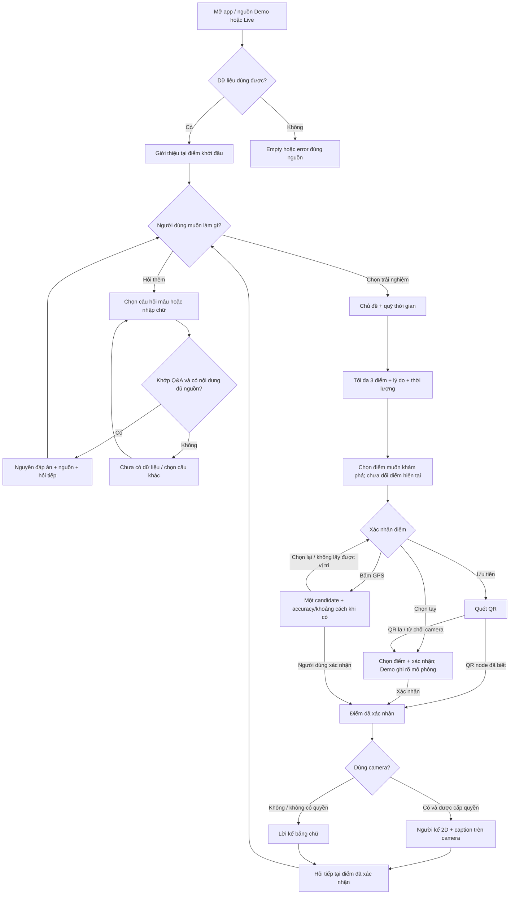

# Ngõ Kể — Luồng hoạt động làm cơ sở thiết kế UI

Ngày đối chiếu: 03/10/2026.

Tài liệu tổng hợp hành vi từ plan và đối chiếu source hiện tại. Đây không phải duyệt phase, nội dung Q&A hoặc quyết định khóa số màn hình/navigation.

## 1. Nguồn và trạng thái

- Nguồn hành vi: [TECH_DEMO_PLAN.md](TECH_DEMO_PLAN.md), [PRD mục 3](PRO-NgoKe-MVP.md#3-user-journey), [TechDesign: source/state/flow](TechDesign-NgoKe-MVP.md#demolive-state--screen-flows), [MVP_ROADMAP.md](MVP_ROADMAP.md).
- Nguồn trạng thái: [MEMORY.md](../MEMORY.md), [bàn giao Phase 2](../agent_docs/phase_2_review.md).
- Source đối chiếu: `mobile/App.tsx`, `mobile/src/navigation.ts`, `mobile/src/screens/HomeScreen.tsx`, `mobile/src/screens/QaScreen.tsx`, `mobile/src/screens/UnavailableScreen.tsx`, `mobile/src/data/sourceState.ts`, `mobile/src/qa/match.ts`, `data/demo.json`.
- Phase 1 đã duyệt. Code Phase 2 đã bàn giao, đang chờ duyệt nội dung Q&A mô phỏng; G2 chưa chốt.
- Phase 3–7 và voice chưa triển khai/chưa được duyệt. Báo cáo này dựa trên đọc tài liệu/source, không phải một lần chạy kiểm thử mới.

## 2. Luồng đang có trong app

```text
Mở app → Home, mặc định Demo
  ├─ Demo: đọc và kiểm tra data/demo.json trong bundle
  │    ├─ Hợp lệ → hiện sáu điểm mô phỏng
  │    │    └─ Bấm “Bắt đầu nghe giới thiệu và hỏi đáp”
  │    │         → Giới thiệu tại Điểm demo 01 + nguồn mô phỏng
  │    │         → Chọn câu hỏi mẫu hoặc nhập chữ
  │    │              ├─ Khớp câu hỏi/alias → nguyên đáp án + nguồn
  │    │              │    → 1–2 câu hỏi tiếp theo nếu có
  │    │              │    → Hỏi tiếp hoặc “Xem câu hỏi khác”
  │    │              └─ Không khớp → “Chưa có dữ liệu”
  │    │                   → Chọn câu hỏi mẫu hoặc nhập lại
  │    └─ Fixture lỗi → thông báo lỗi Demo
  └─ Live → trạng thái trống, chưa có backend/dataset live
```

Chi tiết source hiện tại:

- `App.tsx` có các route `Home`, `Qa`, `Placeholder`; `Qa` chỉ hiển thị nội dung khi source ready, nếu không dùng `UnavailableScreen`.
- Bộ dữ liệu có sáu điểm, nhưng cả sáu Q&A hiện đều gắn `demo-01`. Danh sách điểm trên Home chưa phải chức năng chọn/xác nhận điểm.
- Màn Q&A hiện bốn câu mẫu đầu tiên, nhận câu hỏi từ chip, nút Hỏi hoặc Enter. Ô nhập được xóa sau khi gửi câu hỏi hợp lệ về mặt nhập liệu.
- So khớp bỏ khác biệt hoa/thường, dấu tiếng Việt, khoảng trắng và một số dấu câu cuối. Chỉ khớp câu hỏi/alias đã chuẩn hóa; không fuzzy và không sinh đáp án.
- “Chọn trải nghiệm”, “Camera và người kể”, “Xác nhận điểm GPS” trên Home là các lối mở placeholder, không phải hành vi đã hoạt động.
- Intro/đáp án hiện bằng chữ. Nhãn nút có chữ “nghe” chưa có nghĩa là app phát giọng nói.

## 3. Luồng MVP theo plan



Các nhánh sau Q&A là luồng dự kiến, chưa có trong code Phase 2. Sơ đồ thể hiện hành vi, không bắt buộc mỗi ô phải là một màn riêng.

### Bước 1 — Vào app và nhận giới thiệu

- Demo khởi động tại một điểm mô phỏng được dataset chỉ định; hiện tại là `demo-01`.
- Live chỉ trình bày dữ liệu thật đã duyệt khi API/dataset dùng được. Cách chọn điểm khởi đầu của Live cần chốt khi làm phase liên quan; không mặc định gọi đó là vị trí thực của người dùng.
- Giới thiệu ngắn, có nguồn và nhãn dữ liệu. Đưa ra lựa chọn hỏi thêm hoặc chọn trải nghiệm.

### Bước 2 — Hỏi đáp và hỏi tiếp

- Người dùng chọn câu hỏi mẫu hoặc tự nhập.
- App chuẩn hóa câu hỏi, đối chiếu với câu hỏi/alias đã chuẩn bị và trả nguyên đáp án có nguồn.
- Hiện 1–2 câu hỏi tiếp theo trong tập có sẵn. Người dùng có thể hỏi tiếp hoặc chuyển sang chọn trải nghiệm.
- Câu lạ hoặc thiếu evidence: báo chưa có dữ liệu. Lỗi dataset có trạng thái riêng, không gọi là câu hỏi chưa có đáp án.

### Bước 3 — Chọn trải nghiệm

- Chọn Ẩm thực, Chuyện xưa hoặc Khám phá tự do.
- Chọn quỹ thời gian; thiếu hoặc không hiểu input thì cần người dùng bổ sung, không tự đoán.
- Các mốc thời gian và cách xử lý input cụ thể cần review trong Phase 3.

### Bước 4 — Xem và chọn điểm gợi ý

- Hiện tối đa ba điểm với lý do phù hợp và thời lượng.
- Demo ghi rõ thời lượng/tọa độ mô phỏng, không dùng đi bộ thực địa.
- Không đủ điểm/thời gian thì có trạng thái để đổi lựa chọn.
- Chọn điểm chỉ thể hiện ý định khám phá: không tự xác nhận đã đến, không tự coi là đã ghé.

### Bước 5 — Xác nhận điểm

- QR: mã thuộc node đã biết xác nhận node đó; QR lạ không đổi điểm và có đường chọn tay.
- Chọn tay: chọn điểm rồi xác nhận; Demo thể hiện đây là xác nhận mô phỏng.
- GPS: chỉ chạy khi bấm, trả một candidate cùng độ chính xác/khoảng cách khi có. Hiện “Bạn có thể đang ở…” và hành động xác nhận/chọn lại.
- GPS bị từ chối, lỗi, kém chính xác hoặc ngoài cụm: báo trạng thái và có đường chọn lại/chọn tay. Ngưỡng cụ thể cần review ở Phase 5.
- Chỉ sau xác nhận hợp lệ mới đổi bối cảnh điểm để lấy lời kể/Q&A.

### Bước 6 — Xem lời kể tại điểm

- Khi người dùng dùng camera và có quyền: người kể 2D placeholder + caption, dùng lại nội dung đã chuẩn bị.
- Khi không dùng được camera: tiếp tục bằng chữ.
- Rời màn camera phải dừng preview.
- Từ điểm này người dùng có thể hỏi tiếp hoặc trở lại nhánh trải nghiệm để nhận gợi ý tiếp theo. Policy cập nhật điểm đã ghé/quỹ thời gian còn lại chưa chốt.

## 4. Luồng nguồn dữ liệu

| Trường hợp | Hành vi |
| --- | --- |
| Demo hợp lệ | Dùng dữ liệu bundled, không cần API/key/server cho Q&A và gợi ý |
| Demo fixture lỗi | Báo lỗi Demo |
| Live thiếu cấu hình/dataset hoặc dữ liệu rỗng hợp lệ | Empty của Live |
| Live lỗi mạng/timeout/shape | Error của Live |
| Live hợp lệ, nội dung đã review | Dùng dữ liệu thật từ API |
| Đổi nguồn | Không hiển thị đáp án/candidate/gợi ý từ nguồn cũ như của nguồn mới |

Lỗi Live không tự chuyển sang Demo. Backend Node 24 + JSON API + SQLite là phần sẽ xây ở Phase 6, không phải source cũ đang chờ cung cấp.

## 5. Các khu vực UI rút ra từ luồng

| Khu vực | Nội dung cần thiết kế |
| --- | --- |
| Home / nguồn dữ liệu | Demo/Live, trạng thái dữ liệu, điểm bắt đầu, hành động vào trải nghiệm |
| Giới thiệu + Q&A | Intro, câu hỏi mẫu, ô nhập, nguyên đáp án, nguồn, hỏi tiếp, chưa có dữ liệu |
| Chọn trải nghiệm + kết quả | Chủ đề, quỹ thời gian, tối đa ba điểm có lý do/thời lượng, thiếu kết quả |
| Xác nhận điểm | QR, chọn tay, candidate GPS, xác nhận/chọn lại, quyền bị từ chối và lỗi |
| Lời kể tại điểm | Camera + người kể 2D + caption, bản đọc chữ, nguồn, hỏi tiếp |

Có thể tách lựa chọn/kết quả, quét QR/chọn tay/GPS thành màn hoặc bảng phụ ở bước thiết kế. Plan chưa khóa tám màn hay bất kỳ số lượng màn hình cụ thể nào.

## 6. Voice sau core

Sau duyệt riêng và chọn connector/giọng:

```text
Nói câu hỏi → STT → cùng bộ so khớp Q&A
→ nguyên đáp án + nguồn → TTS đọc đáp án
```

Nhập/đọc chữ luôn giữ được. Voice không thay đổi ranh giới Q&A cố định; chưa thuộc luồng hoạt động hiện tại.
