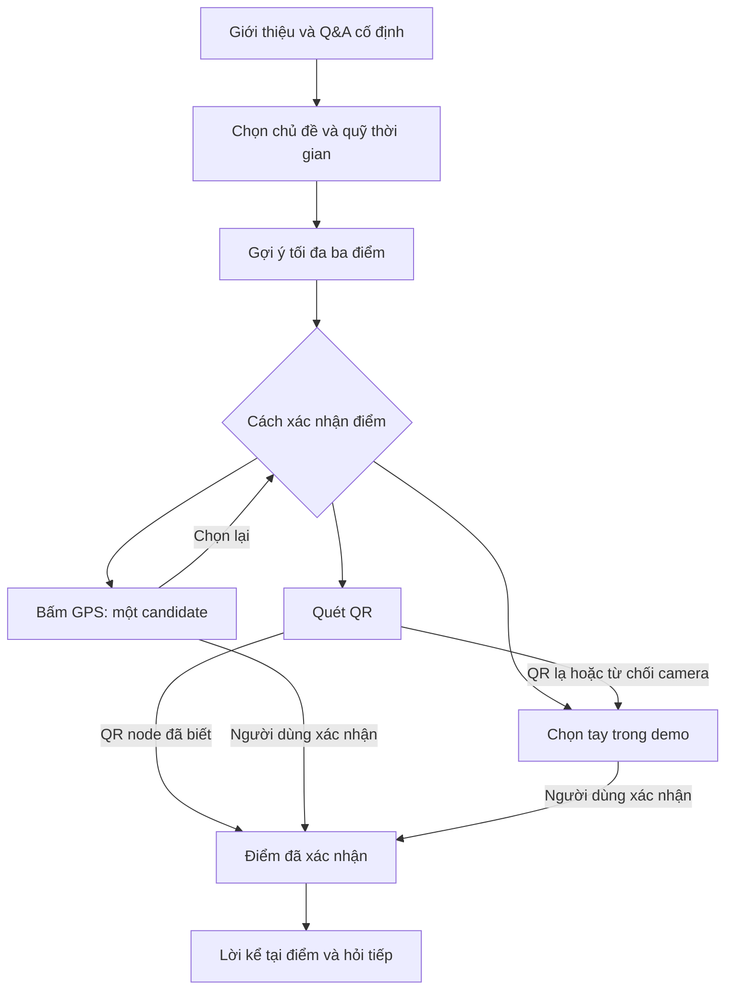

# Product Requirements Document: Ngõ Kể MVP

**Phiên bản tài liệu:** 0.1 — bản nháp để review  
**Ngày tạo:** 02/10/2026  
**Trạng thái:** Phase 0 — chờ duyệt hành vi và kiến trúc; chưa được duyệt để viết app.  
**Phạm vi:** Tech demo mobile của người A; không phải kế hoạch phát hành sản phẩm thương mại.

## 1. Product Overview

**Sản phẩm:** Ngõ Kể — app native Android/iOS bằng Expo + React Native, giúp người dùng khám phá con ngõ qua lời giới thiệu, hỏi đáp cố định và gợi ý điểm theo chủ đề/quỹ thời gian. Tại điểm dừng, người kể 2D placeholder và caption xuất hiện trên nền camera.

**Mục tiêu MVP:** Review được một luồng demo chức năng hoàn chỉnh bằng fixture offline, từ giới thiệu đến hỏi đáp, chọn chủ đề/thời gian, nhận gợi ý điểm, xác nhận điểm và xem lời kể rồi hỏi tiếp.

**Mốc hoàn tất/ra mắt, ngân sách và chỉ tiêu kinh doanh:** Chưa xác định. Thứ tự phase đã được plan quy định, không tương đương lịch triển khai theo ngày hoặc tuần.

### Nguồn và cách áp dụng template

| Nguồn                                                                                | Vai trò                                                                                                                                        |
| ------------------------------------------------------------------------------------ | ---------------------------------------------------------------------------------------------------------------------------------------------- |
| `TECH_DEMO_PLAN.md`, bản đính kèm có tên `TECH_DEMO_PLAN(1).md`, cập nhật 02/10/2026 | Nguồn chuẩn cho phạm vi, hành vi, stack, thứ tự phase và cửa review.                                                                           |
| `Văn bản đã dán (1)(2).txt` — Part 2, PRD Generator                                  | Khung trình bày: tổng quan, người dùng, hành trình, yêu cầu, ngoài phạm vi, tiêu chí thành công, UX, ràng buộc, câu hỏi mở và Handoff Context. |
| Yêu cầu người dùng trong lượt tạo PRD                                                | Giữ phase 0, chỉ xuất tài liệu review; mọi thông tin thiếu ghi “Chưa xác định”; không mở rộng sản phẩm.                                        |

Các mục mặc định trong template như deadline 6–8 tuần, analytics, SEO, đăng nhập, chỉ tiêu tăng trưởng, chuẩn hiệu năng định lượng, beta theo số lượng người dùng hoặc tự động deploy không trở thành yêu cầu của Ngõ Kể khi plan chưa quy định. PRD không thay plan và không cấp quyền triển khai.

## 2. Who It's For & Problem Statement

**Người dùng được mô tả trong plan:** Người muốn nghe giới thiệu về con ngõ, hỏi về nơi đó, chọn trải nghiệm ẩm thực/chuyện xưa/khám phá tự do và nhận gợi ý điểm phù hợp với quỹ thời gian.

**Nhu cầu chức năng rút từ luồng đã nêu:** Có thể đọc nội dung có nguồn, hỏi trong bộ Q&A được duyệt, hiểu lý do đề xuất điểm và chủ động xác nhận điểm đang trải nghiệm.

**Chưa xác định:** Persona cụ thể, tuổi/nghề nghiệp, mức thành thạo công nghệ, nghiên cứu pain point, cách người dùng khám phá app, giải pháp hiện tại, đối thủ, quy mô thị trường, lý do chuyển đổi và mô hình doanh thu. Không có dữ liệu để khẳng định các yếu tố này.

### User Stories

Các story dưới đây diễn đạt lại hành vi trong plan; tiêu chí chấp nhận nằm tại các mã yêu cầu được dẫn chiếu.

| Nhóm tính năng bắt buộc         | User story                                                                                           | Phase   | Tiêu chí chấp nhận tham chiếu         |
| ------------------------------- | ---------------------------------------------------------------------------------------------------- | ------- | ------------------------------------- |
| App native và nguồn demo/live   | Là người dùng demo, tôi muốn mở app trên điện thoại và dùng fixture local để trải nghiệm luồng demo. | 1, 6, 7 | R1.01–R1.03; R6.01–R6.04; R7.01–R7.03 |
| Giới thiệu và Q&A cố định       | Tôi muốn chọn hoặc nhập câu hỏi để nhận câu trả lời đã soạn, có nguồn và câu hỏi tiếp theo.          | 2       | R2.01–R2.04                           |
| Chủ đề, thời gian và gợi ý điểm | Tôi muốn chọn sở thích/quỹ thời gian để xem tối đa ba điểm cùng lý do và thời lượng mô phỏng.        | 3       | R3.01–R3.03                           |
| QR, camera và người kể          | Tôi muốn xác nhận điểm bằng QR hoặc chọn tay rồi xem lời kể qua người kể 2D và caption.              | 4       | R4.01–R4.05                           |
| GPS có xác nhận                 | Tôi muốn xem điểm GPS gợi ý và tự xác nhận hoặc chọn lại trước khi app đổi điểm.                     | 5       | R5.01–R5.03                           |

**Nice to Have:** Không bổ sung. Plan không có danh sách tính năng tùy chọn. Voice là phase riêng sau core demo, không phải tính năng thêm nếu còn thời gian.

## 3. User Journey

1. **Mở demo — phase 1–2:** App khởi chạy bằng fixture local; tại node đầu, hiện lời giới thiệu ngắn. Node đầu cụ thể chưa xác định trong plan.
2. **Hỏi — phase 2:** Chọn chip câu hỏi hoặc nhập chữ. App normalize và khớp câu hỏi/alias; trả nguyên đáp án đã soạn, nguồn demo và 1–2 câu hỏi tiếp theo. Ngoài bộ Q&A hoặc thiếu evidence thì báo chưa có dữ liệu.
3. **Chọn trải nghiệm — phase 3:** Người kể hỏi muốn ẩm thực, chuyện xưa hay khám phá tự do; người dùng chọn quỹ thời gian. App hiểu input ngắn theo logic hiện có.
4. **Nhận điểm — phase 3:** Hiện tối đa ba điểm cùng lý do và thời lượng mô phỏng; đây là gợi ý trải nghiệm, không phải chỉ đường.
5. **Xác nhận điểm — phase 4–5:** Ưu tiên QR của node đã biết khi đến điểm mới; có chọn tay để chạy demo. GPS chỉ đưa một candidate để người dùng xác nhận/chọn lại, không tự đổi node.
6. **Xem lời kể, hỏi tiếp — phase 4:** Trên camera preview, hiện người kể 2D placeholder và caption dùng nội dung đã có ở phase 2; tiếp tục Q&A cố định bằng chữ.
7. **Kiểm chứng trọn luồng — phase 7:** Lặp lại kịch bản bằng fixture, kiểm tra fallback và trạng thái demo/live.

**Discovery, onboarding bổ sung, retention, chia sẻ và kênh phát hành:** Chưa xác định; không tạo thêm luồng.

### Sơ đồ luồng để review phase 0

Sơ đồ mô tả các khu vực chức năng trong plan; số màn hình và navigation cụ thể chưa xác định. Tại điểm đã xác nhận, camera hiển thị người kể 2D + caption khi dùng được; fallback giữ trải nghiệm bằng chữ.



## 4. MVP Features — yêu cầu và tiêu chí chấp nhận

Mọi yêu cầu dưới đây được nghiệm thu trong phase ghi trên hàng. “Bắt buộc” chỉ áp dụng trong phạm vi phase đã được duyệt; không cho phép làm sớm phase kế tiếp. Các tiêu chí là điều kiện kiểm tra trong tương lai, chưa phải kết quả đã đạt.

### Phase 0 — Chốt hành vi và kiến trúc

| Mã    | Phase | Yêu cầu                                                                   | Tiêu chí chấp nhận                                                                                                                                                             |
| ----- | ----- | ------------------------------------------------------------------------- | ------------------------------------------------------------------------------------------------------------------------------------------------------------------------------ |
| R0.01 | 0     | Chốt phạm vi trải nghiệm.                                                 | Tài liệu review thể hiện Expo/RN native Android+iOS; Q&A cố định; QR xác nhận; GPS chỉ gợi ý; người kể 2D + caption; voice riêng sau core; UI demo chức năng.                  |
| R0.02 | 0     | Ghi luồng, ranh giới và hợp đồng mobile/API/data cùng chỗ để nối data/UI. | Luồng và sơ đồ tại mục 3, ranh giới tại Out of Scope và hợp đồng tại mục 7 có thể đối chiếu plan; chi tiết chưa có được đánh dấu tại mục 9. Không tự đặt schema hoặc endpoint. |
| R0.03 | 0     | Duyệt trước triển khai.                                                   | Người dùng duyệt rõ plan trước khi tạo native project. Tạo PRD không được coi là duyệt phase 0; trong phase 0 chưa tạo `mobile/`, chưa viết app.                               |

### Phase 1 — Khung app native

| Mã    | Phase | Yêu cầu                                                                     | Tiêu chí chấp nhận                                                                                                                                                                     |
| ----- | ----- | --------------------------------------------------------------------------- | -------------------------------------------------------------------------------------------------------------------------------------------------------------------------------------- |
| R1.01 | 1     | Tạo `mobile/`, cấu hình Expo cho Android/iOS và skeleton navigation/screen. | Có thể mở app và thao tác trên ít nhất một điện thoại Android hoặc iPhone có Expo Go; gói review có ảnh Home/screen placeholder, lệnh chạy và kết quả Expo dependency check.           |
| R1.02 | 1     | Dùng fixture local để khởi chạy Home; có trạng thái demo/live.              | Home ở demo đọc fixture từ bundle; thể hiện mode hiện tại. Live chưa cấu hình giữ empty state, không hiển thị fixture như dữ liệu thật.                                                |
| R1.03 | 1     | Safe areas, component native và layout thao tác một tay ở mức demo.         | Home/skeleton có safe areas, màu/chữ/touch targets để review thao tác; người dùng review cấu trúc và hướng trình bày trước phase 2. Kích thước hoặc design token cụ thể chưa xác định. |

### Phase 2 — Giới thiệu và hỏi đáp cố định

| Mã    | Phase | Yêu cầu                                                                 | Tiêu chí chấp nhận                                                                                                                                                                          |
| ----- | ----- | ----------------------------------------------------------------------- | ------------------------------------------------------------------------------------------------------------------------------------------------------------------------------------------- |
| R2.01 | 2     | Mở demo tại node đầu và hiện giới thiệu ngắn, chip câu hỏi, ô nhập chữ. | Hoàn tất được đoạn `mở → giới thiệu → chọn câu hỏi mẫu/tự nhập`; lời giới thiệu và bộ câu hỏi được đưa ra review. Node ID và câu chữ cụ thể chưa xác định.                                  |
| R2.02 | 2     | Normalize và khớp câu hỏi/alias với bộ Q&A viết sẵn.                    | Exact match và alias match trả nguyên câu trả lời đã chuẩn bị cho câu tương ứng; không gọi LLM hoặc sinh đáp án. Quy tắc normalization/alias cụ thể cần đối chiếu logic và dữ liệu hiện có. |
| R2.03 | 2     | Hiện nguồn, chỉ trả nội dung có evidence đã duyệt.                      | Đáp án demo có attribution nguồn demo; thiếu evidence hoặc câu ngoài danh sách báo “chưa có dữ liệu”, không bịa nội dung. Ca exact/alias/unknown/attribution có kết quả kiểm tra.           |
| R2.04 | 2     | Gợi ý hỏi tiếp trong bộ câu hỏi cố định.                                | Sau đáp án có 1–2 câu hỏi tiếp theo thuộc danh sách đã review; chọn câu tiếp theo vẫn dùng cùng cơ chế Q&A. Người dùng duyệt giới thiệu, Q&A và nhánh hội thoại trước phase 3.              |

### Phase 3 — Hội thoại dẫn tới lựa chọn

| Mã    | Phase | Yêu cầu                                                                                  | Tiêu chí chấp nhận                                                                                                                                                                                                                                                                                  |
| ----- | ----- | ---------------------------------------------------------------------------------------- | --------------------------------------------------------------------------------------------------------------------------------------------------------------------------------------------------------------------------------------------------------------------------------------------------- |
| R3.01 | 3     | Hỏi chủ đề ẩm thực/chuyện xưa/khám phá tự do, cho chọn quỹ thời gian và hiểu input ngắn. | Người dùng chọn được chủ đề/thời gian và hoàn tất nhánh “chuyện xưa” lẫn “ẩm thực”; bộ input ngắn và lựa chọn thời gian cụ thể chưa xác định.                                                                                                                                                       |
| R3.02 | 3     | Gọi logic recommendation hiện có và giải thích đề xuất.                                  | Hiện tối đa ba điểm, mỗi điểm có lý do và thời lượng mô phỏng. Không biến thời lượng/điểm gợi ý thành hướng dẫn rẽ theo rẽ.                                                                                                                                                                         |
| R3.03 | 3     | Xử lý thiếu điểm/thiếu thời gian và kiểm tra các điều kiện recommendation.               | Có trạng thái thiếu điểm/thiếu thời gian; có ca kiểm thử interest, time budget, visited, unavailable, unreachable, đối chiếu logic hiện có. Quy tắc xếp hạng và expected result chi tiết chưa xác định, phải làm rõ để nghiệm thu. Người dùng review câu hỏi dẫn, thứ tự màn hình và lý do đề xuất. |

### Phase 4 — Camera, QR và người kể

| Mã    | Phase | Yêu cầu                                                       | Tiêu chí chấp nhận                                                                                                                                                                                          |
| ----- | ----- | ------------------------------------------------------------- | ----------------------------------------------------------------------------------------------------------------------------------------------------------------------------------------------------------- |
| R4.01 | 4     | Chỉ bật camera sau thao tác người dùng và xin quyền đúng lúc. | Camera không tự bật khi mở app; thao tác vào chức năng camera dẫn tới xử lý quyền. Rời màn camera thì camera dừng.                                                                                          |
| R4.02 | 4     | Scan QR của node đã biết để xác nhận điểm.                    | Quét QR demo hợp lệ mở đúng node; QR lạ không được nhận thành một node đã xác nhận. Định dạng payload và ánh xạ node chưa xác định.                                                                         |
| R4.03 | 4     | Hiện người kể 2D placeholder và caption trên camera preview.  | Sau scan, preview có lớp người kể và caption dùng lại câu thoại đã có ở phase 2; người dùng review vị trí/kích thước placeholder và caption. Không tự thiết kế mascot hi-fi, chọn/thu giọng hoặc gắn audio. |
| R4.04 | 4     | Fallback chọn điểm bằng tay khi từ chối quyền hoặc QR lạ.     | Cả hai tình huống vẫn cho chọn node bằng tay và tiếp tục trải nghiệm nội dung bằng chữ; không buộc người dùng phải có camera để chạy demo.                                                                  |
| R4.05 | 4     | Kiểm chứng camera/QR trên thiết bị.                           | Kiểm tra ít nhất một Android và một iPhone nếu có thiết bị; ghi thiết bị/kết quả riêng. Thiếu thiết bị thì ghi chưa kiểm tra, không ghi pass.                                                               |

### Phase 5 — GPS thận trọng và xác nhận điểm

| Mã    | Phase | Yêu cầu                                                            | Tiêu chí chấp nhận                                                                                                                                                                                                                           |
| ----- | ----- | ------------------------------------------------------------------ | -------------------------------------------------------------------------------------------------------------------------------------------------------------------------------------------------------------------------------------------- |
| R5.01 | 5     | Chỉ lấy vị trí khi người dùng bấm GPS; trả một candidate gần nhất. | Hiện candidate cùng accuracy và khoảng cách khi có, với microcopy “có thể là…”. Không giữ theo dõi nền hoặc khẳng định đây là vị trí chắc chắn.                                                                                              |
| R5.02 | 5     | Người dùng xác nhận/chọn lại trước khi đổi node.                   | Nhận candidate không làm đổi node hiện tại; chỉ xác nhận của người dùng mới đổi node. Khi đi sang điểm mới ưu tiên QR; xác nhận tay được ghi rõ là mô phỏng trong demo.                                                                      |
| R5.03 | 5     | Xử lý GPS bị từ chối, accuracy kém, ngoài cụm và gợi ý nhầm.       | Mỗi tình huống có kiểm tra, không tự xác nhận candidate và vẫn có cách chọn lại/chọn tay. Ngưỡng accuracy/khoảng cách chưa xác định. Người dùng review microcopy/flow trước thử thực địa; nhóm data khảo sát tọa độ trước khi test ở Ao Sen. |

### Phase 6 — Cắm API và dataset thật

| Mã    | Phase | Yêu cầu                                                                | Tiêu chí chấp nhận                                                                                                                                                                                         |
| ----- | ----- | ---------------------------------------------------------------------- | ---------------------------------------------------------------------------------------------------------------------------------------------------------------------------------------------------------- |
| R6.01 | 6     | Live gọi endpoint hiện có, URL backend cấu hình theo môi trường.       | Khi backend/dataset sẵn sàng, live đọc record thật đã review; có kiểm tra shape data và nguồn. URL, endpoint, schema cụ thể chưa xác định từ plan.                                                         |
| R6.02 | 6     | Giữ ranh giới demo/live khi thiếu cấu hình, rỗng, lỗi hoặc timeout.    | Thiếu server/dataset hoặc dữ liệu rỗng hiện empty state; lỗi/timeout hiện error state. Mode vẫn là live; tuyệt đối không âm thầm nạp `data/demo.json`. Ngưỡng timeout và câu chữ trạng thái chưa xác định. |
| R6.03 | 6     | Demo hoạt động độc lập API, server và API key.                         | Q&A và recommendation demo dùng `data/demo.json` trực tiếp từ bundle, hoạt động không mạng/server/key; không dùng live để bù dữ liệu fixture.                                                              |
| R6.04 | 6     | Handoff để nhóm data/UI thay dữ liệu/giao diện mà không đổi logic lõi. | Có hướng dẫn và checklist cho B/C về dataset, API, nguồn và phần trình bày. Người dùng review trước khi gắn dữ liệu thật hoặc đưa UI hi-fi vào code; không tự import dữ liệu chưa duyệt.                   |

### Phase 7 — Offline và kiểm thử demo end-to-end

| Mã    | Phase | Yêu cầu                                                                 | Tiêu chí chấp nhận                                                                                                                                                                                                                                            |
| ----- | ----- | ----------------------------------------------------------------------- | ------------------------------------------------------------------------------------------------------------------------------------------------------------------------------------------------------------------------------------------------------------- |
| R7.01 | 7     | Đóng băng scope, kiểm tra app shell và fixture local.                   | Kịch bản `giới thiệu → hỏi → chọn chủ đề → nhận điểm → xác nhận → xem lời kể → hỏi tiếp` chạy lặp lại bằng fixture offline; có log test. Chỉ sửa lỗi trong phạm vi đã duyệt.                                                                                  |
| R7.02 | 7     | Kiểm tra Q&A, fallback camera/GPS/QR, chuyển mode và khả năng thao tác. | Có kết quả kiểm tra các fallback, Q&A, demo/live, truy cập bàn phím và kích thước chữ; lỗi live không chuyển thành demo. Không tự thêm chuẩn accessibility định lượng chưa có trong plan.                                                                     |
| R7.03 | 7     | Báo đúng mức hoàn tất và bàn giao demo.                                 | Có danh sách Android/iOS/thiết bị đã thử, kết quả và phần chưa thử; README cách mở demo mobile; handoff API/data/voice cho A/B/C. Dữ liệu thật, voice hoặc phần cứng chưa có được ghi chưa hoàn tất; người dùng xem demo hoàn chỉnh trước khi chốt tech demo. |

### Sau core demo — Voice là phase riêng

| Mã    | Phase                      | Yêu cầu                                                                | Tiêu chí chấp nhận                                                                                                                                                                                        |
| ----- | -------------------------- | ---------------------------------------------------------------------- | --------------------------------------------------------------------------------------------------------------------------------------------------------------------------------------------------------- |
| RV.01 | Voice riêng, sau core demo | Chỉ bắt đầu khi người dùng dẫn dắt và duyệt riêng.                     | Có duyệt phase voice và connector/giọng do người dùng chọn trước triển khai. Chưa có lựa chọn thì giữ luồng chữ; voice không chặn review hoặc hoàn tất core demo.                                         |
| RV.02 | Voice riêng, sau core demo | TTS đọc câu trả lời cố định; STT đưa câu nói về cùng bộ câu hỏi/alias. | Voice hoạt động trên tập Q&A đã review; đáp án vẫn cố định, không gọi LLM hay thêm hội thoại sinh tự do. Luôn giữ nhập/đọc bằng chữ làm fallback.                                                         |
| RV.03 | Voice riêng, sau core demo | Ghi engine, thiết bị hỗ trợ và fallback.                               | Báo engine/connector/giọng, thiết bị đã thử và hành vi fallback; phần chưa được kiểm chứng ghi rõ. Các lựa chọn, quyền microphone, điều kiện mạng và retention chưa xác định để review trong phase voice. |

## Out of Scope (Not in MVP)

| Mã   | Phase/phạm vi              | Ranh giới                                                                                   | Tiêu chí chấp nhận ranh giới                                                                                                 |
| ---- | -------------------------- | ------------------------------------------------------------------------------------------- | ---------------------------------------------------------------------------------------------------------------------------- |
| X.01 | Core phase 1–7 và voice    | Chatbot sinh câu trả lời, LLM, tự bịa chuyện.                                               | Q&A chỉ trả đáp án cố định có evidence; unknown/thiếu evidence báo chưa có dữ liệu. Voice vẫn dùng bộ Q&A đó.                |
| X.02 | Core phase 1–7             | Chỉ đường rẽ theo rẽ, theo dõi nền, chỉ dẫn GPS thời gian thực.                             | Không có các luồng này; node/ETA là gợi ý. Sáu node fixture, tọa độ và ETA giả lập không dùng để đi bộ ngoài thực địa.       |
| X.03 | Core phase 1–7             | AR neo vật thể, model 3D, animation khuôn miệng, nhận diện công trình, thiết kế mascot sâu. | Người kể chỉ là 2D placeholder + caption trên camera. AR/3D muốn triển khai phải có scope/review riêng; chưa xác định phase. |
| X.04 | Core phase 1–7             | Nhận dạng biển hiệu tự do/OCR.                                                              | Mobile demo chỉ scan QR của node đã biết, có fallback chọn tay.                                                              |
| X.05 | Core phase 1–7             | Hoàn thiện UI hi-fi.                                                                        | UI phục vụ demo chức năng và có thể thay sau; không biến thiết kế sâu thành điều kiện hoàn tất core.                         |
| X.06 | Core phase 1–7             | Voice tích hợp sớm.                                                                         | Core chạy input/output text; chỉ nối TTS/STT trong phase voice riêng đã duyệt sau core.                                      |
| X.07 | Core phase 1–7             | Dùng web/PWA làm deliverable mobile, hoặc xây web/PWA ở bất kỳ phase nào.                   | Đã gỡ web/PWA khỏi phạm vi theo quyết định 03/10/2026; không dựng web preview, `public/` hay PWA. Nghiệm thu mobile bằng app native trong Expo Go. |
| X.08 | Core phase 1–7             | API ghi data từ điện thoại.                                                                 | Mobile không mở API ghi data; API bổ sung chỉ khi phase cần, theo phạm vi được duyệt.                                        |
| X.09 | Toàn bộ quy trình hiện tại | Tự tạo/push remote, deploy hoặc phát hành store build.                                      | Không thực hiện nếu chưa có yêu cầu riêng; hoàn tất tech demo không đồng nghĩa được phép phát hành.                          |

Không mặc định hẹn các mục ngoài scope vào “version 2”. Lộ trình bổ sung chưa xác định, ngoại trừ voice đã được plan đặt sau core demo với cửa duyệt riêng.

## 6. Look & Feel — UI/UX ở mức demo chức năng

Tên dưới đây mô tả khu vực chức năng để review; số màn hình và cách chia navigation cụ thể chưa xác định.

| Khu vực                   | Phase | Nội dung/thao tác                                            | Tiêu chí chấp nhận                                       |
| ------------------------- | ----- | ------------------------------------------------------------ | -------------------------------------------------------- |
| Home và trạng thái mode   | 1     | Fixture demo, skeleton màn hình, demo/live.                  | R1.01–R1.03; người dùng review cấu trúc trước hội thoại. |
| Giới thiệu và Q&A         | 2     | Intro, chip, nhập chữ, đáp án, nguồn, hỏi tiếp.              | R2.01–R2.04; không cần UI sâu để review nội dung.        |
| Chủ đề/thời gian và gợi ý | 3     | Lựa chọn và tối đa ba điểm với lý do/ETA mô phỏng.           | R3.01–R3.03; thứ tự hiển thị được người dùng review.     |
| Camera/QR/người kể        | 4     | Preview, 2D placeholder, caption và chọn tay.                | R4.01–R4.05; kích thước/vị trí overlay được review.      |
| GPS/xác nhận điểm         | 5     | Candidate, accuracy/khoảng cách khi có, xác nhận/chọn lại.   | R5.01–R5.03; microcopy không diễn đạt chắc chắn.         |
| Empty/error live          | 6     | Thiếu cấu hình, rỗng, lỗi, timeout.                          | R6.02; giữ live và không thay bằng fixture.              |
| Bàn phím/kích thước chữ   | 7     | Khả năng dùng luồng demo khi nhập chữ và đổi kích thước chữ. | R7.02; ghi kết quả/giới hạn thực tế.                     |

**Visual style, palette, font, asset người kể, layout chi tiết, chuẩn accessibility, ngôn ngữ bổ sung:** Chưa xác định. Placeholder được cho phép có chủ đích trong tech demo này.

## 7. Technical Considerations & hợp đồng mobile/API/data

Phần này ghi quyết định trong plan và ranh giới nghiệm thu; không phải Technical Design Document hoặc schema mới.

| Mã   | Phase quyết định/kiểm chứng                       | Hợp đồng/yêu cầu                                                                                                 | Tiêu chí chấp nhận                                                                                                                                                                    |
| ---- | ------------------------------------------------- | ---------------------------------------------------------------------------------------------------------------- | ------------------------------------------------------------------------------------------------------------------------------------------------------------------------------------- |
| T.01 | Chốt 0; kiểm chứng 1, 4, 7                        | Mobile Expo + React Native cho Android/iOS; ưu tiên component native.                                            | App mở trên thiết bị bằng Expo Go; Android/iOS báo kiểm tra riêng. Expo SDK, RN version, phiên bản OS tối thiểu và danh sách thiết bị chưa xác định.                                  |
| T.02 | Chốt 0; kiểm chứng 6                              | Server hiện có: Node 24 + JSON API + SQLite.                                                                     | Dùng endpoint hiện có cho live; không mở API ghi data mobile; chỉ bổ sung API khi phase cần. Không đổi stack theo mặc định template.                                                  |
| T.03 | Chốt 0; kiểm chứng trong phase 2–6 khi dùng logic | Tái dùng `public/core.js` cho normalization, intent, recommendation, vị trí, retrieval nếu Metro import ổn định. | Có kết quả kiểm chứng khả năng import; tránh nhân bản cùng thuật toán sang mobile. Khả năng import và phương án khi không ổn định chưa xác định, cần review trước thay đổi kiến trúc. |
| T.04 | Chốt 0; kiểm chứng 1, 2, 3, 6, 7                  | Demo đọc `data/demo.json` trực tiếp từ bundle; sáu node hiện có là giả lập.                                      | Q&A/recommendation demo không cần mạng/API key/server; nguồn demo rõ ràng, không dùng tọa độ/ETA fixture để đi thực địa.                                                              |
| T.05 | Chốt 0; kiểm chứng 6, 7                           | Live chỉ dùng record thật đã review từ API.                                                                      | Record/source/shape được kiểm tra; thiếu cấu hình/dataset hiện empty, lỗi/timeout hiện error, không fallback demo.                                                                    |
| T.06 | Chốt 0; kiểm chứng 4, 5, 7                        | Camera dùng `expo-camera`; GPS dùng `expo-location`, chỉ theo yêu cầu người dùng.                                | Camera bật sau thao tác, dừng khi rời màn; location chỉ lấy khi yêu cầu, không theo dõi nền; kiểm tra các ca từ chối quyền.                                                           |
| T.07 | Chốt 0; kiểm chứng 6, 7                           | Có chỗ thay data/UI và nối voice, giữ logic lõi.                                                                 | Hướng dẫn handoff B/C ở phase 6 và A/B/C ở phase 7 nêu API/data/voice; thay UI/data không nhân bản logic. Nối voice vẫn chờ phase riêng.                                              |

### Các chi tiết hợp đồng chưa có

| Thành phần     | Đã biết từ plan                                                                      | Chưa xác định                                                                                             |
| -------------- | ------------------------------------------------------------------------------------ | --------------------------------------------------------------------------------------------------------- |
| Node/fixture   | Sáu node giả lập; file `data/demo.json`.                                             | Schema, ID node đầu, nội dung từng node, metadata/source và tọa độ cụ thể.                                |
| Q&A/evidence   | Câu hỏi/alias, đáp án cố định, evidence đã duyệt, nguồn demo, 1–2 câu hỏi tiếp theo. | Danh sách/nội dung thực tế, cấu trúc evidence, dấu hiệu duyệt, quy tắc normalization và ánh xạ follow-up. |
| Recommendation | Input chủ đề/quỹ thời gian; test visited/unavailable/unreachable; tối đa ba điểm.    | Các lựa chọn thời gian, mẫu input ngắn, quy tắc xếp hạng, ETA và expected result từng ca.                 |
| QR             | Chỉ mã của node đã biết.                                                             | Payload, ánh xạ mã → node, bộ QR dùng kiểm thử.                                                           |
| GPS            | Một candidate gần nhất, accuracy/khoảng cách khi có; phải xác nhận.                  | Ngưỡng accuracy/khoảng cách, điều kiện ngoài cụm và cách chọn candidate cụ thể trong logic hiện có.       |
| Live API       | JSON API hiện có; URL theo môi trường; kiểm tra shape/source/error/timeout.          | URL, route/method, schema response, mã lỗi, timeout, cơ chế duyệt dataset và dữ liệu thật sẵn có.         |
| Voice          | TTS/STT nối bộ Q&A cố định; người dùng chọn connector/giọng.                         | Connector, engine, giọng, microphone, hỗ trợ thiết bị, điều kiện mạng và retention.                       |

**Non-functional chưa xác định:** Mục tiêu startup/latency/FPS, số người đồng thời, uptime, scalability, authentication/authorization, mã hóa/retention/telemetry, chuẩn bảo mật hoặc compliance. Không tự áp chỉ tiêu hay thêm hệ thống để đáp ứng các mục chưa có. Các ranh giới quyền camera/GPS và API chỉ đọc vẫn phải tuân theo T.02/T.06.

## 8. AI / Automation Scope

| Hạng mục               | Phase             | Hợp đồng đầu ra/tiêu chí chấp nhận                                                                                                |
| ---------------------- | ----------------- | --------------------------------------------------------------------------------------------------------------------------------- |
| Q&A sản phẩm           | 2; giữ nguyên 3–7 | Không gọi LLM; output là nguyên đáp án cố định có nguồn hoặc trạng thái chưa có dữ liệu, như R2.02–R2.04.                         |
| Gợi ý điểm             | 3                 | Dùng logic recommendation hiện có; không chuyển thành suy luận/hội thoại sinh tự do, như R3.01–R3.03.                             |
| Xác nhận của con người | 0–7; voice riêng  | Người dùng xác nhận candidate GPS; duyệt từng phase; duyệt nội dung/data/UI theo gate; chọn connector/giọng và duyệt riêng voice. |
| Voice                  | Sau core demo     | TTS/STT là giao diện âm thanh của cùng bộ Q&A; luôn có fallback chữ, như RV.01–RV.03.                                             |

LLM provider, prompt, quyền agent trong sản phẩm và ngân sách LLM không áp dụng cho phạm vi Q&A này. Provider/chi phí/retention của voice chưa xác định. Không thêm telemetry hoặc pipeline eval AI ngoài các ca kiểm thử hành vi trong plan.

## 9. Budget, Constraints & Open Questions

**Nguồn lực đã biết:** Phạm vi Tech của người A; có handoff cho nhóm data/UI và người A/B/C. Tên người, tổng số thành viên, trách nhiệm chi tiết của B/C chưa xác định. Chữ “người A” không phải phân loại trình độ A/B/C của template.

**Ngân sách phát triển/vận hành, deadline, lịch demo/phát hành và chiến lược launch:** Chưa xác định. Cơ chế feedback hiện có là người dùng review từng phase; không tự bổ sung beta hoặc số người thử.

| Mã   | Thông tin chưa xác định                                                       | Phase cần làm rõ                                     | Tiêu chí để đóng mục                                                                                                 |
| ---- | ----------------------------------------------------------------------------- | ---------------------------------------------------- | -------------------------------------------------------------------------------------------------------------------- |
| Q.01 | Persona, pain point nghiên cứu, đối thủ, chỉ tiêu kinh doanh/launch.          | Chưa xác định; không tự gán phase                    | Người dùng cung cấp; chỉ cập nhật PRD nếu không mở scope, hoặc sửa plan/review khi mở scope. Không dùng số liệu giả. |
| Q.02 | Ngân sách, lịch, owner, team và trình độ theo template.                       | 0 nếu người dùng muốn bổ sung                        | Có thông tin do người dùng xác nhận; không suy từ “người A”.                                                         |
| Q.03 | Version Expo/RN, OS tối thiểu và thiết bị kiểm thử.                           | 1; cập nhật 4, 7                                     | Được ghi trong kết quả check và ma trận thiết bị, phân biệt đã thử/chưa thử.                                         |
| Q.04 | Metro import `public/core.js` và hợp đồng logic dùng chung.                   | 0–1 để chốt cách kiểm chứng; trước phase sử dụng 2–6 | Kiểm chứng import khi đã được duyệt triển khai; phương án cần thay đổi được review trước thực hiện.                  |
| Q.05 | Node đầu, lời giới thiệu, bộ Q&A/alias/evidence và follow-up cụ thể.          | 2                                                    | Người dùng review nội dung; bộ ca exact/alias/unknown/source có đáp án kỳ vọng.                                      |
| Q.06 | Quỹ thời gian, input ngắn, ranking/ETA và expected result recommendation.     | 3                                                    | Đối chiếu logic/dữ liệu hiện có và review câu hỏi/lý do; đủ expected result cho R3.03.                               |
| Q.07 | Payload QR, bộ mã demo, asset/layout/caption.                                 | 4                                                    | Bộ mã ánh xạ đúng node; người dùng review placeholder/caption. Không tự thêm mascot hi-fi.                           |
| Q.08 | Ngưỡng GPS, tọa độ khảo sát và cách nhận biết ngoài cụm.                      | 5; trước thử thực địa                                | Quy tắc được review; nhóm data khảo sát tọa độ trước test Ao Sen; không dùng fixture đi thực địa.                    |
| Q.09 | API URL/endpoint/schema/error/timeout, dataset thật và tiêu chí review nguồn. | 6                                                    | Hợp đồng và record được kiểm tra/review trước nối live; nếu chưa có vẫn ghi empty/error đúng.                        |
| Q.10 | Style/chuẩn accessibility hoặc chỉ tiêu non-functional bổ sung.               | Chi tiết demo 1/4/7; chỉ tiêu khác chưa xác định     | Review trong phạm vi demo; bổ sung scope chỉ sau sửa plan và duyệt. Không dùng giá trị mặc định template.            |
| Q.11 | Connector/engine/giọng, quyền và dữ liệu âm thanh.                            | Voice riêng sau core                                 | Người dùng chọn và duyệt riêng; có báo hỗ trợ thiết bị/fallback trước nghiệm thu voice.                              |

Các chỗ thiếu trên là thông tin chưa xác định, không phải giả định đã được chấp thuận. Plan nhắc code/fixture/backend hiện có nhưng lần tạo PRD này chỉ có tài liệu đính kèm; chưa kiểm tra repository, schema, record hoặc phần cứng thực tế.

## 10. Success Metrics & Quality Standards

Thành công ở đây được đo bằng hành vi và evidence review của tech demo, không phải doanh thu/tăng trưởng. Tiêu chí định lượng chỉ dùng con số đã có trong plan.

| Chỉ dấu                      | Phase          | Mục tiêu/tiêu chí chấp nhận                                                                               | Cách kiểm chứng                                         |
| ---------------------------- | -------------- | --------------------------------------------------------------------------------------------------------- | ------------------------------------------------------- |
| Native chạy được             | 1; tổng hợp 7  | Ít nhất một Android hoặc iPhone thao tác được bằng Expo Go ở phase 1.                                     | Lệnh/check, ảnh thiết bị, trạng thái Android/iOS riêng. |
| Q&A đúng phạm vi             | 2; hồi quy 7   | Exact/alias đúng đáp án, unknown/thiếu evidence không bịa; nguồn demo rõ; 1–2 follow-up trong bộ câu hỏi. | Các ca kiểm thử R2.02–R2.04.                            |
| Gợi ý có giải thích          | 3; hồi quy 7   | Tối đa ba điểm; có lý do/thời lượng mô phỏng; nhánh lịch sử/ẩm thực hoàn tất.                             | Kịch bản và ca recommendation R3.01–R3.03.              |
| Xác nhận đúng và có fallback | 4–5; hồi quy 7 | QR đúng node; GPS không tự xác nhận; camera/GPS/QR lỗi có luồng manual.                                   | Log ca quyền bị từ chối, QR lạ, GPS kém/ngoài cụm/nhầm. |
| Offline và ranh giới live    | 6–7            | Demo Q&A/gợi ý không cần mạng/key/server; live rỗng/lỗi không đổi demo.                                   | Chạy demo không mạng và các ca live R6.02–R6.03.        |
| Core demo end-to-end         | 7              | Lặp lại đầy đủ kịch bản tại R7.01 và báo phần chưa kiểm chứng.                                            | Log test, ma trận thiết bị, người dùng review bản demo. |

Không ghi pass cho phần chưa thử hoặc thiếu dữ liệu. Không thay lỗi bằng dữ liệu giả để làm luồng có vẻ hoàn tất. Placeholder và fixture được phép trong demo, nhưng phải thể hiện đúng bản chất; người dùng review nội dung và kết quả thực tế.

## 11. Phase Gates & Review

Quy tắc này áp dụng cho mọi phase: làm một phase mỗi lần; hoàn tất thì dừng code, gửi gói review và chờ duyệt rõ ràng. Chỉ sửa feedback của phase hiện tại; không gom nhiều phase vào một bàn giao. Nếu phát sinh scope mới, sửa plan rồi review trước khi code phần đó.

| Mã gate | Phase                | Đầu ra/cửa duyệt                                  | Tiêu chí chấp nhận gate                                                                           | Trạng thái hiện tại                   |
| ------- | -------------------- | ------------------------------------------------- | ------------------------------------------------------------------------------------------------- | ------------------------------------- |
| G0      | 0                    | Plan, PRD chuyển đổi, sơ đồ luồng và ranh giới.   | Người dùng duyệt rõ plan trước khi tạo project native.                                            | Đang chờ review; chưa duyệt viết app. |
| G1      | 1                    | Home/skeleton, Expo Go, lệnh và dependency check. | Có thao tác trên ít nhất một điện thoại; người dùng duyệt cấu trúc/hướng trình bày trước phase 2. | Chưa bắt đầu.                         |
| G2      | 2                    | Luồng text và bộ intro/Q&A/nhánh.                 | Người dùng duyệt nội dung trước recommendation.                                                   | Chưa bắt đầu.                         |
| G3      | 3                    | Lựa chọn chủ đề/thời gian và đề xuất.             | Người dùng duyệt câu hỏi dẫn, thứ tự màn hình và lý do đề xuất.                                   | Chưa bắt đầu.                         |
| G4      | 4                    | QR, camera, 2D/caption và manual fallback.        | Người dùng duyệt vị trí/kích thước người kể/caption; báo kiểm tra thiết bị đúng thực tế.          | Chưa bắt đầu.                         |
| G5      | 5                    | Candidate GPS và xác nhận/chọn lại.               | Người dùng duyệt microcopy/flow trước thử thực địa; tọa độ được khảo sát trước test Ao Sen.       | Chưa bắt đầu.                         |
| G6      | 6                    | API/data, empty/error, tài liệu thay data/UI.     | Review trước gắn data thật/hi-fi; chỉ record đã duyệt; demo/live tách biệt.                       | Chưa bắt đầu.                         |
| G7      | 7                    | Demo hoàn chỉnh, test log, README/handoff.        | Người dùng xem và chốt tech demo; phần chưa thử/chưa có được ghi rõ.                              | Chưa bắt đầu.                         |
| GV      | Voice riêng sau core | Connector/giọng và phạm vi TTS/STT.               | Người dùng duyệt riêng và chọn connector/giọng trước bắt đầu; nghiệm thu theo RV.01–RV.03.        | Chưa được duyệt.                      |

**Gói review mỗi phase:** Phase hoàn tất; file/hành vi thay đổi; link mở app hoặc ảnh trên thiết bị; lệnh và kết quả check; giới hạn còn lại; nội dung cần người dùng quyết định. Phase 0 bàn giao tài liệu, chưa có app hay kết quả chạy native.

## 12. Definition of Done for Core MVP

Checklist này mô tả điều kiện hoàn tất tương lai; hiện không có hạng mục triển khai nào được đánh dấu đạt.

- [ ] **Phase 1, tổng hợp 7:** App native mở được trong Expo Go trên thiết bị; trạng thái Android/iOS và thiết bị đã thử/chưa thử được báo riêng (R1.01, T.01, R7.03).
- [ ] **Phase 2–3, tổng hợp 7:** Giới thiệu, Q&A có nguồn, hỏi tiếp, chủ đề/thời gian và đề xuất node hoạt động bằng fixture (R2.01–R3.03).
- [ ] **Phase 4–5, tổng hợp 7:** QR xác nhận đúng điểm, người kể 2D/caption và các fallback hoạt động; GPS không tự xác nhận node (R4.01–R5.03).
- [ ] **Phase 6–7:** Demo local chạy không mạng; live có empty/error đúng khi thiếu/lỗi và không fallback fixture; dữ liệu live chỉ được nối nếu đã review (R6.01–R6.04).
- [ ] **Phase 7:** Kịch bản end-to-end chạy lặp lại; có log và kiểm tra bàn phím/kích thước chữ; lỗi được sửa trong scope đã duyệt (R7.01–R7.02).
- [ ] **Phase 7:** README mở demo và handoff API/data/voice cho A/B/C có đủ giới hạn, phần chưa có dữ liệu thật/voice/thiết bị (R7.03).
- [ ] **Phase 0–7:** Mỗi phase có review/duyệt theo mục 11; không tự chuyển phase, mở scope, push remote, deploy hoặc phát hành store (R0.03, G0–G7, X.09).
- [ ] **Phase 7:** Người dùng review bản demo mobile hoàn chỉnh và chốt tech demo (G7).

Voice chưa nối không chặn hoàn tất core demo: phải ghi rõ voice chưa hoàn tất và chờ phase riêng. Dữ liệu thật hoặc thiết bị chưa có cũng phải ghi đúng giới hạn, không biến điều kiện “khi có” thành kết quả đã đạt.

## 13. Next Steps

1. **Hiện tại — phase 0:** Người dùng review PRD này cùng plan, góp ý phạm vi/hành vi và các mục chưa xác định. Chỉ chỉnh tài liệu trong phạm vi được yêu cầu.
2. **Sau khi người dùng duyệt rõ phase 0/plan:** Mới bắt đầu phase 1 theo đúng phạm vi và gate; việc xuất PRD không tự kích hoạt tạo project hoặc viết app.
3. **Sau mỗi phase:** Dừng tại cửa review tương ứng; phase sau chỉ bắt đầu khi được duyệt rõ.
4. **Sau core demo:** Voice chỉ bắt đầu khi có duyệt riêng và connector/giọng người dùng chọn. Không tự chạy tiếp các bước setup, beta, deploy hoặc launch mặc định trong template.

---

_Tài liệu tạo ngày 02/10/2026. Status: Draft for review — Phase 0; implementation not approved. Không có app, API hay dữ liệu sản phẩm được triển khai trong lần tạo PRD này._

## Handoff Context

<!-- Giữ khối này khi chuyển sang bước tiếp theo. Mọi automation phải giữ gate, không diễn giải PRD là quyền viết app. -->

- Stage: prd
- App name: Ngõ Kể
- User level: Chưa xác định; không suy từ vai trò người A trong plan.
- Target platform: Native Android/iOS — Expo + React Native; thử bằng Expo Go.
- Budget: Chưa xác định.
- Timeline: Chưa xác định; giữ thứ tự phase 0 → 1 → 2 → 3 → 4 → 5 → 6 → 7; voice riêng sau core demo.
- Current phase: 0 — đang chờ review.
- Implementation approved: false.
- Source of truth: TECH_DEMO_PLAN.md; bản đính kèm TECH_DEMO_PLAN(1).md, cập nhật 02/10/2026.
- Template file: Văn bản đã dán (1)(2).txt — Part 2 PRD Generator.
- Source files: TECH_DEMO_PLAN(1).md → PRD-NgoKe-MVP.md.
- Next allowed action: Review/chỉnh PRD và plan; chưa tạo mobile/ hoặc viết app.
- Review rule: Một phase mỗi lần; dừng và chờ duyệt rõ trước phase kế tiếp.
- Core boundaries: Fixture offline; live không fallback demo; Q&A cố định theo câu hỏi/alias và evidence, không LLM; GPS cần xác nhận; camera 2D placeholder + caption; UI demo chức năng.
- Voice gate: Sau core demo, duyệt riêng và dùng connector/giọng người dùng chọn; luôn giữ fallback chữ.
- Delivery gate: Không tạo/push remote, deploy hoặc phát hành store nếu chưa có yêu cầu riêng.

### Machine-Readable Summary

```json
{
  "schemaVersion": 1,
  "documentType": "prd",
  "appName": "Ngõ Kể",
  "oneLiner": "Demo native khám phá con ngõ qua Q&A cố định, gợi ý điểm và người kể 2D/caption trên camera.",
  "targetUsers": "Người muốn khám phá con ngõ qua chuyện xưa/ẩm thực; persona cụ thể chưa xác định.",
  "phase": "0 — chờ review",
  "implementationApproved": false,
  "mustHave": [
    "Native Expo/RN Android+iOS; fixture offline và live tách biệt",
    "Giới thiệu và Q&A cố định có nguồn, alias và hỏi tiếp",
    "Chủ đề/quỹ thời gian; tối đa ba điểm với lý do và ETA mô phỏng",
    "QR/chọn tay; người kể 2D placeholder và caption trên camera",
    "GPS chỉ gợi ý; người dùng xác nhận điểm"
  ],
  "niceToHave": [],
  "notInMvp": [
    "LLM hoặc hội thoại sinh tự do",
    "Chỉ đường trực tiếp hoặc theo dõi GPS nền",
    "AR neo vật thể, 3D, lip-sync, nhận diện công trình/OCR",
    "UI hi-fi",
    "Voice trong core demo; chỉ nối ở phase riêng sau core",
    "Web/PWA (đã gỡ khỏi phạm vi 03/10/2026; không xây web/PWA)",
    "API ghi data từ mobile",
    "Tự push remote, deploy hoặc phát hành store"
  ],
  "successMetrics": [
    "Phase 1: thao tác được trên ít nhất một điện thoại bằng Expo Go",
    "Phase 7: kịch bản fixture end-to-end chạy lặp lại và có log",
    "Live rỗng/lỗi không fallback demo; GPS không tự xác nhận",
    "Android/iOS và phần chưa kiểm chứng được báo riêng"
  ],
  "sourceOfTruth": "TECH_DEMO_PLAN.md",
  "nextAllowedAction": "Review tài liệu phase 0; chưa viết app",
  "voiceApprovalRequired": true
}
```
