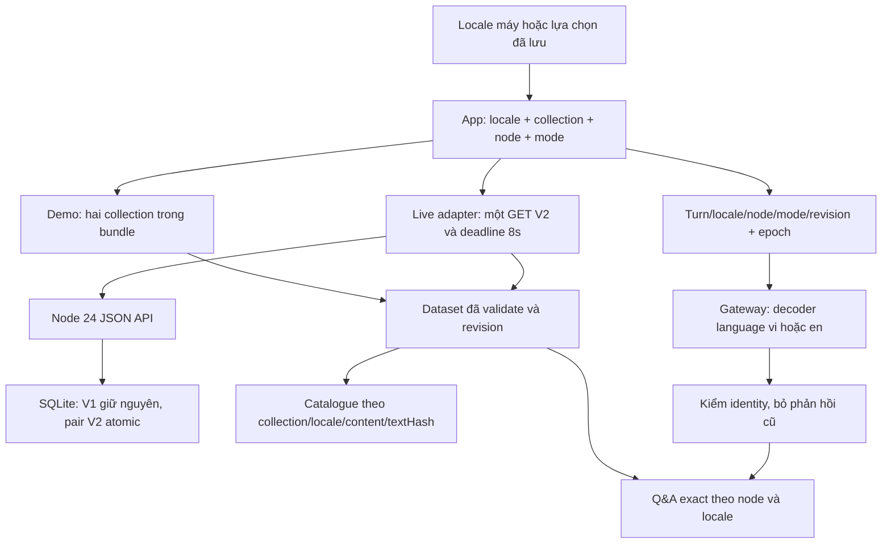
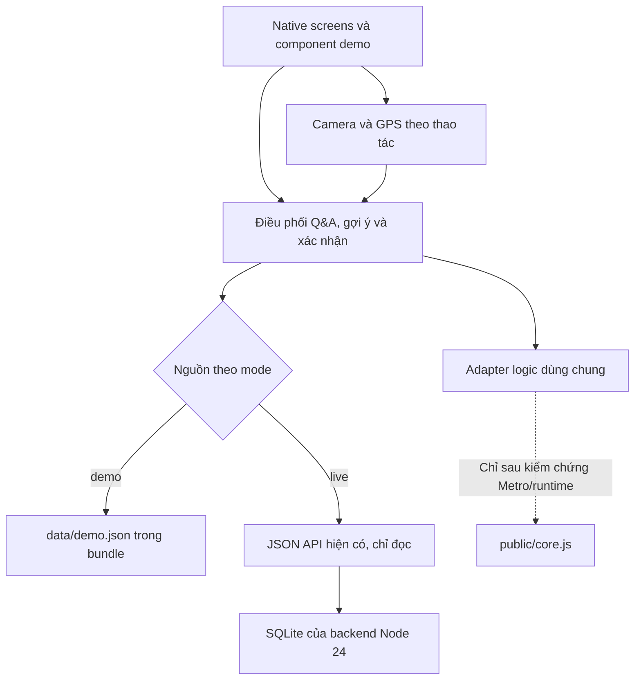
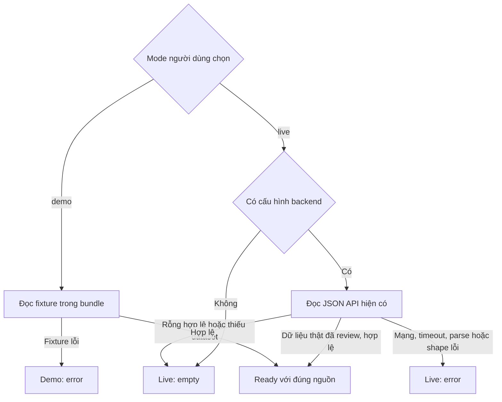

# Technical Design Document: Ngõ Kể MVP

> **Thiết kế hiện hành sauPhase8:** baseline91ddfbd đã kiểm; phạm vi VI/EN đang triển khai theo [POST8_EXECUTION_SPEC](POST8_EXECUTION_SPEC.md), [API additiveV2](HANDOFF_API.md#hợp-đồng-việtanh-bổ-sung). Parser/hash/locale/i18n thuần dùng chung, storage/native/UI nằm ngoài backend. Live V1 giữ tương thích; V2 nhận một locale của pair công bố atomic, giữ tổng deadline8s/no fallback. Voice chỉ đổi phần cần choVIEN: locale xuyên request/engine/response, hủy lượt cũ khi đổi ngôn ngữ, asset identity/hash rõ; không mở chatbot/LLM hoặc tiếp tục gate voice cũ.



Nội dung/evidence doW1 biên tập vàW4 review, không tạo lịch sử từ truyện hư cấu. GeometryV2 thiếu nguồn lànull/null, GPS bỏ qua và vẫn chọn tay; sơ đồ chương không thành dẫn đường. `reviewStatus=approved` là trạng thái review nội dung có evidence, khác nghiệm thu thiết bị/người dùng. UItext mặc định ẩn nhưng có thể mở mà không reset player; đổi locale dừng/hủy voice và không tự mở micro/phát track mới.

> **16/10/2026:** thiết kế hiện hành cho đợt thực hiện là [Phase7.1/8 spec](PHASE_7_1_8_EXECUTION_SPEC.md). Quyền triển khai do người dùng yêu cầu chạy xuyên suốt, không còn trạng thái “Implementation approved: false” của bản nháp lịch sử dưới đây. Backend được tuyển nền từ 6e0c5bf, không nhận là backend có sẵn đã được duyệt; không chat/LLM/voice trong Phase8.

## Executive Summary

**System:** Ngõ Kể  
**Version:** Thiết kế 0.1 — bản nháp để review  
**Architecture Pattern:** App native có lớp trình bày, điều phối luồng và adapter nguồn dữ liệu; nối backend hiện có, không thiết kế lại backend.  
**Current phase:** 0 — chỉ thiết kế; chưa được duyệt triển khai.  
**Implementation approved:** false  
**Estimated Effort:** Chưa xác định (TBD).

Mobile dùng **Expo + React Native cho Android/iOS**. Backend giữ **Node 24 + JSON API + SQLite hiện có** theo plan. Demo đọc **`data/demo.json` từ bundle**, độc lập API/server/key; live chỉ lấy record thật đã review và không tự fallback sang demo. `public/core.js` là ứng viên dùng chung, **chưa xác minh Metro import hoặc runtime React Native**.

Tài liệu này không tạo `mobile/`, native project, package/config, fixture, API, database, pipeline hay store build. Các đường dẫn/module mới bên dưới là đề xuất để review và chỉ được tạo trong phase tương ứng sau cửa duyệt. Xuất Tech Design không có nghĩa phase 0 đã được duyệt.

## Sources & Verification Status

Thứ tự ưu tiên: yêu cầu người dùng → `TECH_DEMO_PLAN.md` → PRD chuyển đổi → đề xuất tổ chức kỹ thuật trong tài liệu này. Plan là nguồn chuẩn về phạm vi, hành vi và thứ tự phase; Tech Design không tự sửa các quyết định đó.

| Nguồn/hiện vật                                                                | Trạng thái kiểm tra                                                                            | Điều có thể kết luận                                                                             |
| ----------------------------------------------------------------------------- | ---------------------------------------------------------------------------------------------- | ------------------------------------------------------------------------------------------------ |
| `TECH_DEMO_PLAN.md`, bản đính kèm `TECH_DEMO_PLAN(1).md`, cập nhật 02/10/2026 | Đã đọc tài liệu.                                                                               | Stack, hành vi, phase và gate do plan quy định.                                                  |
| `PRD-NgoKe-MVP.md`, phiên bản 0.1                                             | Đã đọc tài liệu.                                                                               | Mã yêu cầu R0–R7, RV, T, X và các mục chưa xác định để truy vết.                                 |
| `Văn bản đã dán (1)(3).txt` — Part 3 Technical Design Generator               | Đã đọc template.                                                                               | Giữ metadata, Handoff Context và JSON summary; điều chỉnh ví dụ theo scope của plan.             |
| `public/` — web preview                                                       | Đã gỡ khỏi phạm vi theo quyết định 03/10/2026; không xây web/PWA.                                 | Không tạo `public/`, web preview hay PWA ở bất kỳ phase nào.               |                               |
| `public/core.js`                                                              | Chưa đọc file, exports, dependencies hoặc chạy bằng Metro.                                     | Chưa thể khẳng định dùng chung trực tiếp được, là module thuần JS hoặc tương thích React Native. |
| `data/demo.json`                                                              | Chưa đọc file hoặc kiểm tra bundle.                                                            | Theo plan có sáu node giả lập; schema, ID, nội dung và tính hợp lệ chưa xác minh.                |
| Backend Node 24, JSON API, SQLite                                             | Chưa có source, route, schema SQL, file DB hay server để kiểm tra.                             | Stack là quyết định trong plan; đường dẫn, framework, ORM và endpoint thực tế chưa xác định.     |
| `mobile/`, package/lockfile/config Metro, thiết bị Android/iOS                | Chưa có native project trong các file được cung cấp; chưa chạy ứng dụng hay kiểm thử thiết bị. | Không ghi pass; không suy cấu trúc repo gốc từ workspace chỉ chứa tài liệu.                      |

**Cách đọc phần còn lại:** “Theo plan” là quyết định đã nêu trong nguồn; “Đề xuất” là phương án tổ chức để review; “TBD/Chưa xác định” là thông tin chưa có. Đọc tài liệu chính thức không thay thế kiểm tra source/bundle/runtime của dự án.

## Architecture Overview

### High-Level Architecture



Hai nguồn dùng cùng ranh giới dữ liệu/logic của mobile nhưng có adapter riêng. Lỗi live đi về trạng thái lỗi của live, không có nhánh chuyển sang fixture. Mobile không đọc trực tiếp file SQLite và không có API ghi data. Một “adapter” ở đây chỉ ánh xạ đầu vào/đầu ra hoặc thao tác thiết bị; không chứa bản sao thuật toán.

### Tech Stack Decision

| Thành phần       | Quyết định hoặc đề xuất                                                                                          | Phase                                            | Giới hạn/chưa xác định                                                                 |
| ---------------- | ---------------------------------------------------------------------------------------------------------------- | ------------------------------------------------ | -------------------------------------------------------------------------------------- |
| Mobile           | Theo plan: Expo + React Native; component native, thao tác một tay.                                              | 0–1                                              | SDK/RN version, OS tối thiểu và package manager TBD. Không đổi sang web/PWA.           |
| Presentation     | Theo plan: UI demo chức năng. Đề xuất component nhỏ, nhận dữ liệu qua props.                                     | 1–7                                              | Palette/font/asset/ngôn ngữ code và styling library TBD; không chốt hi-fi.             |
| Navigation       | Đề xuất một lớp navigation cho các khu vực chức năng trong mục Screen Flows.                                     | 1                                                | Chưa chọn Expo Router hay React Navigation; không khẳng định repo đã cài một thư viện. |
| Session state    | Đề xuất state ở app shell/controller, giữ mode và trạng thái nguồn tách biệt.                                    | 1–7                                              | Chưa chọn thư viện state; không thêm lưu phiên bền vững hoặc cache live.               |
| Shared logic     | Theo plan: xem xét dùng `public/core.js` nếu import ổn định; qua bridge để UI không phụ thuộc exports trực tiếp. | Kiểm chứng sau duyệt 0, trước lần dùng trong 2–6 | Chưa xác minh exports, signature hoặc Metro. Không sao chép thuật toán.                |
| Demo source      | Theo plan: bundle `data/demo.json`, không gọi API để tải fixture.                                                | 1–3, 6–7                                         | Đường import ngoài `mobile/` và shape JSON phải được kiểm tra.                         |
| Live source      | Theo plan: JSON API hiện có, URL theo môi trường. Đề xuất một adapter dữ liệu chỉ đọc.                           | 6                                                | Endpoint/method/auth/schema/timeout TBD; không tự đặt route mới.                       |
| Backend/database | Theo plan: Node 24 + JSON API + SQLite hiện có.                                                                  | 0, 6                                             | Framework, ORM, schema SQL/migration chưa kiểm tra; không thay hoặc thiết kế DB mới.   |
| Camera/location  | Theo plan: `expo-camera` và `expo-location`, chỉ theo yêu cầu người dùng.                                        | 4–5                                              | Quyền và tương thích phải kiểm tra trên SDK/thiết bị thực tế.                          |
| Voice            | Theo plan: TTS/STT trên cùng bộ Q&A, phase riêng sau core.                                                       | Voice riêng                                      | Chưa chọn engine/connector/giọng; core không có audio dependency được chọn mặc định.   |

### Alternatives & Trade-offs

Các lựa chọn dưới đây so sánh cách triển khai trong stack của plan; không mở lại quyết định Expo/Node 24/SQLite.

| Quyết định         | Lựa chọn                                               | Lợi ích                                                                   | Hạn chế                                                                       | Hướng đề xuất                                                                       |
| ------------------ | ------------------------------------------------------ | ------------------------------------------------------------------------- | ----------------------------------------------------------------------------- | ----------------------------------------------------------------------------------- |
| Tổ chức navigation | Expo Router                                            | Route theo file; dùng được nếu template Expo được chọn đã theo hướng này. | Phải khớp template/version thực tế; dễ tạo thêm màn hình nếu dùng mẫu rộng.   | TBD ở phase 1 sau kiểm tra scaffold được duyệt.                                     |
| Tổ chức navigation | React Navigation                                       | Khai báo luồng tường minh; phù hợp số khu vực chức năng hữu hạn.          | Cần cấu hình/dependencies tương thích Expo.                                   | Không cài cả hai; chọn một theo repo/scaffold và báo trade-off ở G1.                |
| State              | React state/context ở app shell                        | Ít lớp cho demo; dễ nhìn mode/candidate/confirmed node.                   | Phải kiểm soát cập nhật và kết quả bất đồng bộ rõ ràng.                       | Đề xuất ban đầu; thư viện cụ thể chưa chốt.                                         |
| State              | Thư viện store chuyên dụng                             | Tập trung transitions/selectors khi luồng phức tạp.                       | Thêm dependency và abstraction chưa được plan yêu cầu.                        | Chỉ cân nhắc khi có nhu cầu kỹ thuật cụ thể được review.                            |
| Dùng chung core    | Import qua bridge tới `public/core.js`                 | Giữ một nguồn thuật toán; hạn chế sửa web/backend.                        | Có thể vướng globals, export format, dependency hoặc đường ngoài root mobile. | Ưu tiên kiểm chứng trước; hiện chưa kết luận dùng được.                             |
| Dùng chung core    | Tách phần logic tương thích thành module dùng chung    | Có thể loại bỏ coupling trình bày khi import trực tiếp thất bại.          | Thay đổi cấu trúc/core ảnh hưởng consumer hiện có; cần hồi quy.               | Phương án có điều kiện, chỉ review khi có bằng chứng lỗi; chưa tạo thư mục/package. |
| Demo fixture       | Import file gốc từ bundle                              | Không cần server/key/mạng; một nguồn fixture như plan.                    | Cần kiểm chứng Metro resolve file nằm ngoài `mobile/`.                        | Hướng của plan; kiểm tra thực tế trước ghi pass.                                    |
| Demo fixture       | Tải fixture qua API hoặc duy trì bản chép trong mobile | Dễ né việc import ngoài root.                                             | Tải API phá độc lập offline; bản chép dễ lệch nguồn.                          | Không chọn. Không dùng để che lỗi bundling.                                         |
| Live adapter       | Đọc API hiện có, ánh xạ ở biên mobile                  | Giữ backend/SQLite; không nhân bản API.                                   | Cần biết shape và provenance thật trước tích hợp.                             | Hướng đề xuất ở phase 6.                                                            |
| Live adapter       | Mở API bổ sung khi thiếu dữ liệu cần thiết             | Có thể giải quyết thiếu contract thực tế.                                 | Là thay đổi backend cần review; không được giả định route có sẵn.             | Chỉ khi phase cần và được duyệt; không có API ghi mobile.                           |

## Project Structure & Component Design

Đây là **cấu trúc đề xuất**, không phải danh sách thư mục vừa được tạo. Đuôi file JS/TS/TSX và entry/navigation config được quyết định sau khi có scaffold được duyệt; không đổi tên hoặc di chuyển source hiện có trong lần thiết kế này.

| Đường dẫn                   | Một nhiệm vụ chính                                                    | Phase tạo/dùng            | Trạng thái                                                                  |
| --------------------------- | --------------------------------------------------------------------- | ------------------------- | --------------------------------------------------------------------------- |
| `TECH_DEMO_PLAN.md`         | Nguồn chuẩn scope/phase/gate.                                         | 0–7                       | Tên logic; đã đọc bản đính kèm `(1)`, chưa xác minh vị trí trong repo.      |
| `PRD-NgoKe-MVP.md`          | Hành vi và tiêu chí chấp nhận.                                        | 0–7                       | Đã có tài liệu review.                                                      |
| `TechDesign-NgoKe-MVP.md`   | Kiến trúc, hợp đồng và cách kiểm chứng.                               | 0–7                       | Deliverable duy nhất của yêu cầu hiện tại.                                  |
| `mobile/`                   | Project Expo native; dependencies/config thuộc mobile.                | 1                         | Đề xuất theo plan; chưa tạo.                                                |
| `mobile/src/screens/`       | Các khu vực màn hình; gọi controller và render.                       | Skeleton 1; hành vi 2–6   | Đề xuất; không đặt thuật toán core ở đây.                                   |
| `mobile/src/components/`    | UI dùng lại: câu hỏi, đáp án/nguồn, điểm gợi ý, mode/empty/error.     | 1–6                       | Đề xuất; giữ mức demo.                                                      |
| `mobile/src/state/`         | Session state và transitions, bao gồm mode và điểm đã xác nhận.       | 1–6                       | Đề xuất; không mặc định persistence.                                        |
| `mobile/src/controllers/`   | Điều phối luồng giữa state, source, core và màn hình.                 | 2–6                       | Đề xuất; không chép logic normalization/ranking vào controller.             |
| `mobile/src/data/`          | Adapter fixture/API, ánh xạ và validation biên.                       | Demo 1; live 6            | Đề xuất; không chứa bản sao `data/demo.json`.                               |
| `mobile/src/core/`          | Bridge gọi module core đã được kiểm chứng.                            | Trước lần dùng 2–6        | Đề xuất; exports/signature thực tế TBD.                                     |
| `mobile/src/device/`        | Adapter camera/QR/GPS và lifecycle theo thao tác.                     | 4–5                       | Đề xuất; không có background tracking.                                      |
| `mobile/src/config/`        | Đọc cấu hình mode/backend theo môi trường.                            | 1, 6                      | Đề xuất; tên biến/config TBD, không chứa bí mật server.                     |
| `mobile/assets/`            | Placeholder người kể 2D và asset trình bày được review.               | 4                         | Đề xuất; không tự làm mascot hi-fi/audio.                                   |
| `mobile/tests/`             | Ca logic/adapter/controller phù hợp phase; không thay test phần cứng. | 2–7                       | Đề xuất; runner và extension TBD.                                           |
| `mobile/README.md`          | Cách mở demo, cấu hình live, điều kiện offline và giới hạn.           | Lệnh chạy 1; hoàn thiện 7 | Đề xuất; lệnh thực tế lấy từ project sau khi kiểm tra.                      |
| `public/core.js`, `public/` | Logic ứng viên dùng chung; `public/` đã gỡ khỏi phạm vi 03/10/2026.  | 0, 2–6                    | Nếu có core thật thì kiểm tra source; không sửa/sao chép trong phase 0.     |
| `data/demo.json`            | Fixture gốc dùng để bundle.                                           | 1–7                       | Chưa kiểm tra file; không tạo fixture thay thế.                             |
| Backend và file SQLite      | API/data server hiện có.                                              | 6                         | Đường dẫn chưa xác định; không bịa `server/index.js`, tên DB hoặc bảng SQL. |

### Ranh giới module đề xuất

| Module logic             | Đầu vào → đầu ra mục tiêu                                                | Không chịu trách nhiệm                                               |
| ------------------------ | ------------------------------------------------------------------------ | -------------------------------------------------------------------- |
| DataSource               | Mode/cấu hình → ready dataset, empty hoặc error.                         | Không chọn node hiện tại; không trả fixture cho live.                |
| CoreBridge               | Dữ liệu/context/input → kết quả từ core thực tế sau mapping.             | Không sinh đáp án, xếp hạng mới hoặc giả lập một export chưa có.     |
| QAController             | Câu hỏi/chip + context node → đáp án cố định có nguồn hoặc unavailable.  | Không gọi LLM; không dùng unavailable để che lỗi tải toàn dataset.   |
| RecommendationController | Chủ đề/thời gian + context theo core → tối đa ba gợi ý.                  | Không xác nhận vị trí, dẫn đường hoặc đánh dấu đã đến khi chỉ gợi ý. |
| ConfirmationController   | QR hợp lệ hoặc thao tác xác nhận GPS/manual → node đã xác nhận.          | Không commit từ callback GPS hoặc đề xuất recommendation.            |
| Camera/Location adapter  | Thao tác/quyền/lifecycle → QR event hoặc vị trí một lần/lỗi.             | Không ghi câu chuyện, theo dõi nền hoặc giữ camera khi rời màn.      |
| Narrator view            | Text đã duyệt → placeholder 2D + caption trên preview; chữ khi fallback. | Không animation khuôn miệng, AR/3D hoặc tự chọn audio.               |

Các tên trên là tên vai trò đề xuất, chưa phải hàm/export thật. UI có thể thay mà vẫn dùng cùng controller/data contract; data có thể thay qua adapter mà không tạo thuật toán thứ hai.

## Shared Core & Metro Verification Gate

**Trạng thái:** `public/core.js` chưa được cung cấp, chưa import, chưa bundle, chưa chạy trên Android/iOS. Không ghi “Metro-compatible”. Plan cũng chưa xác định module ESM/CommonJS hay cách bố trí workspace.

Tài liệu Expo mô tả hỗ trợ monorepo dựa trên cấu hình workspace và khuyến nghị Metro kế thừa `expo/metro-config`. Điều này không chứng minh một file cụ thể ngoài root app sẽ import/chạy đúng. Không áp sẵn `watchFolders`, workspace/package hay alias resolver khi chưa biết SDK và cấu trúc repo. Nguồn: [Expo monorepos](https://docs.expo.dev/guides/monorepos/) và [Expo Metro](https://docs.expo.dev/guides/customizing-metro/), đọc ngày 02/10/2026.

### Quy trình kiểm chứng tương lai

Sau G0, trong phần kiểm chứng khung native và trước lần đầu dùng core cho phase 2, thực hiện các bước kỹ thuật dưới đây. Probe chỉ xác minh tích hợp, không triển khai sớm hội thoại/recommendation của phase sau.

1. **Đọc source thực tế:** Kiểm tra exports/signature, dependencies/transitive imports, side effects, truy cập `window`/`document`/DOM, browser storage, Node-only modules hoặc file system. Đây là hạng mục kiểm tra, không phải khẳng định file có các vấn đề đó.
2. **Kiểm tra đường import:** Xác định root repo/app, package manager, lockfile, Expo SDK và Metro config. Thử import file gốc qua bridge; đồng thời kiểm tra import `data/demo.json` từ vị trí gốc. Không sửa source/config trước khi biết nguyên nhân.
3. **Kiểm tra bundle bằng Metro:** Ghi lệnh/config/version và kết quả cho Android/iOS. Node import, web preview hoặc static inspection thành công không thay kết quả bundling native.
4. **Kiểm tra runtime React Native:** Gọi các export thực tế áp dụng cho mobile bằng đầu vào đã biết từ core/data. So sánh kết quả với expected result được review; kiểm tra side effects/lỗi runtime. Bundle thành công chưa đủ để kết luận dùng được.
5. **Kiểm tra ổn định:** Khi thay core/fixture được duyệt, xác nhận thay đổi được Metro nhận; thử khởi chạy lại và cold bundle. Chỉ ghi kết quả cho platform/thiết bị thực sự thử.

**Điều kiện qua gate:** Có bằng chứng resolve + bundle + runtime cho chức năng đã kiểm tra, đúng output và không phải bản sao thuật toán. Android/iOS chưa thử ghi riêng. Không dùng câu “dùng chung được trên cả hai” nếu mới thử một platform.

**Nếu thất bại:** Báo file/import/export gây lỗi và log; giữ trạng thái chưa xác minh. Đề xuất sửa mapping/config tối thiểu nếu đủ, hoặc tách phần logic dùng chung với consumer hiện có cùng dùng một nguồn. Thay đổi kiến trúc/core phải review trước thực hiện; không tự chép thuật toán sang mobile, đổi sang API cho demo hoặc tạo module fallback bí mật.

## Data Contracts

### Hợp đồng nội bộ đề xuất

Các khái niệm sau là **hợp đồng ở biên mobile để review**, không phải tên trường đang có trong JSON/API/SQLite. Khi source được cung cấp, adapter ánh xạ từ shape thực tế; không yêu cầu nhóm data đổi schema chỉ để khớp tên đề xuất này.

| Nội dung logic        | Dữ liệu cần có                                                               | Ràng buộc và validation                                                                                         | Phase          |
| --------------------- | ---------------------------------------------------------------------------- | --------------------------------------------------------------------------------------------------------------- | -------------- |
| Dataset context       | Mode, tập node/Q&A và thông tin nguồn đủ cho luồng.                          | Source phải đúng mode; kiểu/root shape thực tế TBD. Dataset rỗng khác dataset lỗi.                              | Demo 1; live 6 |
| Node                  | Định danh, nội dung giới thiệu/lời kể và thông tin phục vụ lựa chọn.         | ID theo source, không đoán tên/type; xác minh reference tới node có tồn tại. Node đầu TBD.                      | 2–5            |
| Câu hỏi               | Câu hỏi mẫu, alias liên quan và context theo core.                           | Danh sách/normalization/alias ambiguity TBD; không thêm fuzzy/semantic matcher.                                 | 2              |
| Đáp án và evidence    | Text đã soạn, nguồn/evidence đã review và liên kết câu hỏi.                  | Trả nguyên text; thiếu evidence báo chưa có dữ liệu. Không tự coi `mode=live` là bằng chứng nội dung đã review. | 2, 6           |
| Follow-up             | 1–2 câu thuộc danh sách được review.                                         | Reference phải trỏ đến câu hỏi có trong bộ được dùng; cách chọn cụ thể TBD.                                     | 2              |
| Recommendation input  | Chủ đề, quỹ thời gian; visited/availability/reachability theo logic thực tế. | Enum, đơn vị, điều kiện và validation chi tiết TBD; không đặt trọng số/filter mới.                              | 3              |
| Recommendation output | Tối đa ba node, lý do, thời lượng mô phỏng.                                  | Không suy đây là chỉ đường hoặc tọa độ đã khảo sát; expected result cần lấy từ core/data được review.           | 3              |
| QR mapping            | Payload mã đã biết → node có trong dataset đang dùng.                        | Format/registry TBD; payload lạ không commit node và không mở URL tùy ý.                                        | 4              |
| GPS candidate         | Một node gợi ý, accuracy và khoảng cách khi có.                              | Tọa độ/matching/threshold TBD; candidate không phải confirmed node.                                             | 5              |

Validation biên kiểm tra shape và các reference cần cho chức năng đã triển khai. Không tự đặt `reviewed: true`, version field, SQL table hoặc record mẫu rồi khẳng định chúng là hợp đồng hiện có. Cách chứng minh evidence/dataset đã được review phải lấy từ quy trình thật của nhóm data và người dùng.

### Demo dataset

Fixture gốc là `data/demo.json` theo plan, được import theo đường tĩnh sau khi kiểm chứng bundling; không tải fixture từ API. Sáu node, tọa độ và ETA là mô phỏng. Giới thiệu/Q&A/nguồn phải được review ở phase 2 trước sử dụng làm nội dung được duyệt.

Lỗi file, lỗi parse hoặc thiếu trường bắt buộc là lỗi dữ liệu demo cần báo/sửa trong scope; không dựng dữ liệu giả mới để lấp chỗ trống. Một câu ngoài bộ Q&A là unavailable của câu hỏi, không phải lỗi toàn dataset. Cách mapping JSON cụ thể chờ đọc fixture.

### SQLite hiện có

Database nằm sau backend, không trong mobile. Tên file, bảng, cột, foreign key, index và migration runner đều **chưa xác định/chưa kiểm tra**. Không tạo migration/schema mới cho tech demo từ tài liệu thiếu source. Ở phase 6, đọc route/query/schema hiện có để ghi hợp đồng chính xác; thay đổi data chỉ sau review và không qua API ghi từ điện thoại.

## API Contracts & Environment

### Live API: phần đã biết và phần chờ xác minh

| Hạng mục   | Hợp đồng thiết kế                                                            | Chi tiết hiện có                                                                             |
| ---------- | ---------------------------------------------------------------------------- | -------------------------------------------------------------------------------------------- |
| Transport  | JSON API của backend Node 24 hiện có.                                        | Host/protocol/port/framework TBD.                                                            |
| Surface    | Đọc dữ liệu cần cho luồng mobile từ endpoint hiện có.                        | Route, method và số request TBD; không giả định `/api/nodes` hoặc endpoint riêng cho Q&A.    |
| Request    | Cấu hình backend theo môi trường, input theo hợp đồng route thực tế.         | Query/path/header/auth/pagination TBD. Không tự thêm tài khoản/token provider.               |
| Response   | Dữ liệu thật đã review, đủ node/nội dung/nguồn cho chức năng đang dùng.      | Root JSON, tên trường/type, envelope và provenance TBD. Adapter ánh xạ sau kiểm tra source.  |
| Validation | Kiểm tra response và các reference cần thiết trước cấp dữ liệu cho UI/core.  | Validator/library TBD; shape sai thành error, không thành fixture.                           |
| Empty      | Thiếu cấu hình/dataset hoặc response rỗng hợp lệ được hiển thị như empty.    | Quy ước empty và ý nghĩa HTTP status phải đối chiếu API thật; chưa gán riêng một status.     |
| Error      | Network, lỗi API, timeout, parse/shape không hợp lệ được hiển thị như error. | Mã lỗi, retry, ngưỡng timeout và microcopy TBD. Không retry nền hoặc fallback demo mặc định. |
| Writes     | Không có API ghi data cho mobile.                                            | Không thiết kế POST/PUT/DELETE CRUD theo ví dụ template.                                     |

Trong phase 6, lập bảng contract theo **route thực tế đã đọc**: nguồn file, method/path, input, shape response, empty/error/status, validation, attribution và ca kiểm thử. Nếu endpoint hiện có thiếu dữ liệu cần cho scope, báo khoảng thiếu rồi review API bổ sung; không mở thêm route chỉ để lấp bảng tài liệu.

### Cấu hình môi trường đề xuất

| Cấu hình           | Mục đích                                                         | Trạng thái                                                                                                       |
| ------------------ | ---------------------------------------------------------------- | ---------------------------------------------------------------------------------------------------------------- |
| Mode demo/live     | Chọn đúng source và thể hiện trên UI.                            | Theo plan; tên config và mode mặc định ngoài flow mở demo TBD.                                                   |
| Backend base URL   | Chỉ dùng cho live; phải truy cập được từ điện thoại thử.         | Giá trị/tên biến/cách inject TBD ở phase 6. Không suy máy thật truy cập được URL `localhost` của máy phát triển. |
| Timeout            | Giới hạn thời gian chờ API, chuyển error khi quá hạn.            | Giá trị và policy TBD; không tự gán số giây.                                                                     |
| Server credentials | Thuộc backend nếu có; không đưa bí mật server vào bundle mobile. | Cơ chế auth hiện có chưa biết; không chọn provider hoặc triển khai secrets mới.                                  |

Không tự mở staging/production, dùng tunnel, deploy backend hoặc nhập data thật trong phase 0. Cách kết nối mạng nội bộ và yêu cầu nền tảng cần được kiểm tra ở phase 6 với môi trường thực tế.

## Demo/Live State & Screen Flows

### Session state đề xuất

| State logic               | Vai trò                                                   | Điều kiện thay đổi                                                                                                         |
| ------------------------- | --------------------------------------------------------- | -------------------------------------------------------------------------------------------------------------------------- |
| Mode và data source       | `demo` hoặc `live`, gắn nguồn đang dùng.                  | Thao tác đổi mode/cấu hình; lỗi không tự đổi mode.                                                                         |
| Dataset status            | Đề xuất `idle/loading/ready/empty/error`.                 | Kết quả source/validation; tên enum nội bộ không phải status API.                                                          |
| Node hiện tại đã xác nhận | Context cho nội dung ở điểm.                              | QR hợp lệ hoặc xác nhận GPS/manual. Khởi động demo ở node đầu là bối cảnh mô phỏng theo plan, không phải định vị thực địa. |
| Các điểm đề xuất          | Kết quả recommendation.                                   | Chủ đề/quỹ thời gian/logic hiện có; không tự ghi thành node hiện tại.                                                      |
| GPS candidate             | Một gợi ý chưa xác nhận cùng accuracy/khoảng cách khi có. | Kết quả lấy vị trí theo thao tác; chưa commit vào node hiện tại.                                                           |
| Q&A state                 | Câu hỏi, đáp án/nguồn/follow-up hoặc unavailable/error.   | Input/context node/dataset; không giữ câu trả lời demo rồi gắn nhãn live.                                                  |
| Camera state              | Quyền, màn đang focus, quét mã và overlay nội dung.       | Thao tác vào/rời chức năng; chỉ preview đang dùng được giữ hoạt động.                                                      |
| Chủ đề/thời gian/visited  | Input cho recommendation theo core.                       | Policy cập nhật visited/reset TBD; nhận gợi ý không được coi là đã đến.                                                    |
| Context của request       | Nhận biết response thuộc mode/node/lần yêu cầu nào.       | Đề xuất bỏ kết quả cũ khi context đổi để tránh response live/demo/QR/GPS cập nhật nhầm.                                    |

Đề xuất giữ state trong bộ nhớ cho phiên demo; chưa thiết kế lưu lịch sử, AsyncStorage, offline live cache hoặc đồng bộ dữ liệu. Khi chuyển mode, không hiển thị đáp án/candidate/đề xuất từ nguồn cũ như của nguồn mới. Reset cụ thể các lựa chọn người dùng cần review, nhưng invariant nguồn và xác nhận điểm phải giữ.

### Quy tắc chọn source



Empty/error giữ nguyên mode. Chuyển sang demo chỉ xảy ra khi người dùng chọn mode demo; không xảy ra vì API thất bại.

### Các khu vực màn hình

Tên dưới đây là tên chức năng đề xuất, chưa khóa tên route/file hoặc số màn hình. Có thể ghép lựa chọn và kết quả trong một màn nếu người dùng review đồng ý ở phase liên quan.

| Khu vực                | Phase | Dữ liệu/thao tác                                                                      | Đường đi và fallback                                                                    |
| ---------------------- | ----- | ------------------------------------------------------------------------------------- | --------------------------------------------------------------------------------------- |
| Home/App Shell         | 1     | Safe areas, skeleton, mode, nguồn demo local.                                         | Mở demo; live chưa cấu hình hiện empty; chưa có hành vi phase 2–5.                      |
| Giới thiệu + Q&A       | 2     | Intro tại node đầu, chips, input chữ, đáp án nguyên văn/nguồn, 1–2 follow-up.         | Unknown/thiếu evidence → chưa có dữ liệu; lỗi dataset → error riêng.                    |
| Chủ đề + thời gian     | 3     | Ẩm thực, chuyện xưa, khám phá tự do và quỹ thời gian.                                 | Input thiếu/không phù hợp được xử lý theo core đã review; không đoán budget.            |
| Điểm gợi ý             | 3     | Tối đa ba node, lý do và ETA mô phỏng.                                                | Thiếu điểm/thời gian → trạng thái tương ứng; không dẫn đường.                           |
| Camera + QR + người kể | 4     | Xin quyền sau thao tác; QR node đã biết; 2D placeholder/caption trên preview.         | QR lạ/từ chối quyền → chọn tay và chữ; rời màn → dừng camera.                           |
| Xác nhận điểm/manual   | 4–5   | Chọn tay rõ là mô phỏng; QR hợp lệ xác nhận điểm; GPS candidate có xác nhận/chọn lại. | Candidate không tự đổi node; ưu tiên QR khi đi tới điểm mới.                            |
| GPS candidate          | 5     | Nút GPS, một candidate, accuracy/khoảng cách khi có, “có thể là…”.                    | Quyền bị từ chối, accuracy kém, ngoài cụm, candidate sai → chọn lại/manual; ngưỡng TBD. |
| Live empty/error       | 6     | Thiếu cấu hình/data, lỗi/timeout/schema.                                              | Giữ live, không đưa fixture vào; tiếp tục demo chỉ qua đổi mode chủ động.               |

Luồng chính: **giới thiệu → hỏi → chọn chủ đề/thời gian → nhận điểm → xác nhận → lời kể → hỏi tiếp**. Tại camera, nội dung dùng lại phase 2. Không thêm welcome/account/profile/settings hoặc luồng launch từ template.

## Error Handling, Fallback & Device Lifecycle

| Tình huống                               | Phase                          | Hành vi thiết kế                                                            | Kiểm chứng cần có                                                                |
| ---------------------------------------- | ------------------------------ | --------------------------------------------------------------------------- | -------------------------------------------------------------------------------- |
| Fixture không load/shape sai             | 1–2, 7                         | Báo lỗi demo; không dùng API hoặc fixture mới để che lỗi.                   | Load/bundle/validation lỗi được phân biệt với Q&A unknown.                       |
| Câu hỏi ngoài danh sách/thiếu evidence   | 2, 7                           | Báo chưa có dữ liệu; không LLM, không bịa đáp án.                           | Exact/alias/unknown/evidence/source và follow-up hợp lệ.                         |
| Input hoặc điểm/thời gian không đủ       | 3, 7                           | Hiện trạng thái cần xử lý theo logic hiện có.                               | Expected result được review cho interest/budget/visited/unavailable/unreachable. |
| Camera chưa có quyền/bị từ chối          | 4, 7                           | Xin khi người dùng thao tác; denied chuyển manual/chữ.                      | Không auto camera; luồng chữ vẫn hoàn tất được.                                  |
| QR lạ hoặc không có node tương ứng       | 4, 7                           | Không commit; cho chọn tay.                                                 | Known QR đúng node; unknown không thành điểm đã xác nhận.                        |
| QR event lặp                             | 4, 7                           | Đề xuất chặn xử lý lặp trong cùng thao tác quét; tránh mở/commit nhiều lần. | Không làm đổi điểm liên tục; thời gian/policy chặn lặp chưa chốt.                |
| Camera mất focus/rời màn                 | 4, 7                           | Unmount/stop preview và bỏ callback không còn thuộc màn hiện tại.           | Preview dừng thực tế trên thiết bị.                                              |
| GPS denied/lỗi lấy vị trí                | 5, 7                           | Báo trạng thái, chọn lại/manual; không tự xác nhận node.                    | Mỗi lần lấy vị trí có thao tác người dùng; không có watcher nền.                 |
| Accuracy kém/ngoài cụm/candidate sai     | 5, 7                           | Dùng wording gợi ý, giữ xác nhận/chọn lại; không đổi node từ callback.      | Ngưỡng được review; ca mô phỏng và thực địa được phân biệt.                      |
| Live thiếu URL/dataset hoặc rỗng hợp lệ  | 6, 7                           | Empty state của live.                                                       | Mode/nguồn không đổi; không load fixture thay thế.                               |
| Live network/API/timeout/parse/shape lỗi | 6, 7                           | Error state của live, không cache/fallback demo.                            | Bằng chứng lỗi và UI đúng; status/timeout cụ thể theo contract thật.             |
| Response đến sau đổi mode/context        | 6–7; khi có thao tác async 4–5 | Đề xuất bỏ response cũ theo context request.                                | Không hiển thị nội dung/candidate của nguồn hoặc node cũ.                        |
| Voice chưa chọn/lỗi/không hỗ trợ         | Voice riêng                    | Giữ input/output chữ; không chọn engine khác âm thầm.                       | Báo engine/thiết bị/fallback thật sau gate voice.                                |

Với camera, tài liệu Expo yêu cầu unmount preview khi màn không còn focus; với location, API lấy vị trí một lần và quyền foreground phù hợp hướng không theo dõi nền. Thiết kế này đề xuất đối chiếu `CameraView`/permission API, `requestForegroundPermissionsAsync` và `getCurrentPositionAsync` theo SDK được chọn; **chưa gọi các API trong dự án**. Nguồn: [Expo Camera](https://docs.expo.dev/versions/latest/sdk/camera/) và [Expo Location](https://docs.expo.dev/versions/latest/sdk/location/), đọc ngày 02/10/2026.

## Phase Implementation & Verification Plan

Tất cả hạng mục chạy app/bundle/thiết bị dưới đây là **kế hoạch kiểm tra tương lai, chưa thực hiện**. Một phase mỗi lần, chỉ bắt đầu sau duyệt rõ phase trước. Nội dung thiết kế không cấp quyền tạo file hoặc chạy lệnh triển khai.

### Phase 0 — Chốt hành vi và kiến trúc

**Truy vết:** R0.01–R0.03, T.01–T.07, G0.

- **Cấu trúc/hợp đồng/luồng:** Review cấu trúc đề xuất, nguồn demo/live, bridge có điều kiện, flow màn hình và ranh giới data/API nêu trên. Backend/core/fixture chưa kiểm tra được ghi rõ, không điền schema/route giả.
- **Lỗi/fallback:** Review nguyên tắc unknown Q&A, camera/QR/GPS manual, live empty/error và voice chữ; chưa triển khai fallback.
- **Kiểm tra:** Đối chiếu tài liệu với plan/PRD, traceability, thông tin TBD, metadata/Handoff/JSON và trạng thái chưa được duyệt viết app. Không tạo scaffold để thử Metro trong phase 0.
- **Cửa review:** Bàn giao plan/PRD/Tech Design và sơ đồ; người dùng phải duyệt rõ plan trước khi tạo project native. Yêu cầu tạo tài liệu hiện tại không được tính là G0 pass.

### Phase 1 — Khung app native

**Truy vết:** R1.01–R1.03, T.01/T.04, G1.

- **Cấu trúc/màn hình:** Sau G0 mới tạo `mobile/`, chọn template/navigation/version, shell/skeleton/safe areas và component màu/chữ/touch ở mức demo; Home mở bằng fixture.
- **Data/API:** Đọc file fixture gốc và chứng minh nó nằm trong bundle. Mode/source có ranh giới từ đầu; chưa cấu hình live thì empty. Chỉ kiểm chứng bridge/Metro trước khi core được dùng, không triển khai hội thoại/gợi ý sớm.
- **Lỗi/fallback:** Fixture lỗi là error demo; live chưa cấu hình không thành demo; camera/GPS chưa bật vì chưa tới phase tương ứng.
- **Kiểm tra:** Expo dependency check/config, Home/navigation và thao tác trên ít nhất một Android hoặc iPhone có Expo Go. Lưu SDK/OS/thiết bị/lệnh và kết quả thực tế; Metro chưa kiểm chứng phải ghi trạng thái pending.
- **Cửa review:** Ảnh Home/skeleton, lệnh mở và kết quả check; duyệt cấu trúc/trình bày trước phase 2.

### Phase 2 — Giới thiệu và Q&A cố định

**Truy vết:** R2.01–R2.04, T.03/T.04, G2.

- **Cấu trúc/màn hình:** QAController + UI intro/chips/input/answer/source/follow-up; giữ text input/output, chưa audio.
- **Data/API:** Dùng fixture đã đọc và Q&A/evidence đã review; đối chiếu exports core trước gọi. Nếu gate core chưa đạt, xử lý phương án dùng chung được review trước tiếp tục; không tự cài matcher thay thế.
- **Lỗi/fallback:** Unknown/thiếu evidence → chưa có dữ liệu; không LLM. Lỗi dataset/core là error kỹ thuật riêng, không giả làm unknown để che lỗi.
- **Kiểm tra:** Exact/alias từ corpus thực tế → nguyên đáp án; unknown/thiếu evidence; attribution demo; 1–2 follow-up thuộc bộ câu hỏi. Expected result do nội dung đã review quyết định.
- **Cửa review:** Intro, bộ Q&A và nhánh text trước phase 3; không yêu cầu UI sâu.

### Phase 3 — Hội thoại dẫn tới lựa chọn

**Truy vết:** R3.01–R3.03, T.03/T.04, G3.

- **Cấu trúc/màn hình:** RecommendationController; hỏi ẩm thực/chuyện xưa/khám phá tự do; chọn thời gian, input ngắn; hiện tối đa ba điểm.
- **Data/API:** Input/intent/ranking/ETA dùng core và fixture thực tế; không đặt phút, trọng số hoặc hard filter khi chưa kiểm tra logic. Mỗi đề xuất có lý do/thời lượng mô phỏng.
- **Lỗi/fallback:** Thiếu điểm/thiếu thời gian hiện trạng thái theo logic đã review; recommendation không commit node hoặc mở dẫn đường.
- **Kiểm tra:** Hoàn tất nhánh chuyện xưa và ẩm thực; interest, budget, visited, unavailable, unreachable, max ba điểm, lý do/ETA. Expected result còn TBD chưa được ghi pass.
- **Cửa review:** Câu hỏi gợi ý, thứ tự màn hình và lý do đề xuất; chưa chỉ đường trực tiếp.

### Phase 4 — Camera, QR và người kể

**Truy vết:** R4.01–R4.05, T.06, G4.

- **Cấu trúc/màn hình:** Camera/QR adapter, ConfirmationController, narrator view/asset 2D; preview và caption reuse câu thoại phase 2.
- **Data/API:** Registry/payload QR thực tế ánh xạ node của nguồn đang dùng; scan hợp lệ mới xác nhận. Không tự định dạng QR URI mới hoặc OCR.
- **Lỗi/fallback:** Denied/QR lạ → manual và chữ; không tự chọn/thu giọng; rời màn dừng camera. Overlay không AR/3D/lip-sync.
- **Kiểm tra:** Thao tác mới bật/xin quyền; known QR đúng node; unknown/denied manual đủ; caption đúng; rời màn dừng preview. Kiểm tra ít nhất một Android và một iPhone nếu có thiết bị; thiếu thiết bị ghi chưa kiểm tra.
- **Cửa review:** Kích thước/vị trí placeholder và caption; chưa thiết kế mascot hi-fi hoặc audio.

### Phase 5 — GPS và xác nhận điểm

**Truy vết:** R5.01–R5.03, T.03/T.06, G5.

- **Cấu trúc/màn hình:** Location adapter lấy vị trí khi bấm; candidate view + xác nhận/chọn lại; tách candidate khỏi node hiện tại.
- **Data/API:** Một candidate gần nhất với accuracy/khoảng cách khi có, dựa trên logic/toạ độ đã kiểm tra. Threshold/cách nhận biết ngoài cụm còn TBD; fixture vẫn là giả lập.
- **Lỗi/fallback:** Denied, accuracy kém, ngoài cụm hoặc sai candidate không tự commit; có manual/QR. QR được ưu tiên khi đến điểm mới; xác nhận tay demo ghi mô phỏng.
- **Kiểm tra:** Các ca lỗi nêu trên, xác nhận/chọn lại, không đổi node từ callback, không background tracking; ca mock không được ghi là kiểm chứng accuracy ngoài thực địa.
- **Cửa review:** Microcopy “có thể là…” và flow xác nhận trước thử thực địa. Nhóm data phải khảo sát tọa độ trước thử Ao Sen; không dùng fixture/ETA để đi bộ thực địa.

### Phase 6 — Cắm API và dataset thật

**Truy vết:** R6.01–R6.04, T.02/T.05/T.07, G6.

- **Cấu trúc/màn hình:** Live adapter/config/validation, mode empty/error; handoff data/UI để thay mà không sửa logic lõi.
- **Data/API:** Kiểm tra route/query/schema SQLite và payload thật; chốt URL theo môi trường, shape, nguồn/evidence và policy timeout. Chỉ record đã review; không import data chưa duyệt hoặc mở API ghi mobile.
- **Lỗi/fallback:** Thiếu cấu hình/dataset/rỗng hợp lệ → empty; error/timeout/invalid shape → error. Giữ live, bỏ response nguồn cũ; không fixture fallback hoặc live cache ngoài plan.
- **Kiểm tra:** Điện thoại truy cập đúng backend; contract/API/source; từng ca empty/error/timeout/shape; chuyển mode không lẫn nguồn; demo Q&A/recommendation không mạng/key/server. Endpoint/data chưa có thì ghi chưa kiểm tra live với dữ liệu thật.
- **Cửa review:** Review trước gắn data thật hoặc UI hi-fi vào code; checklist và hướng dẫn cho B/C.

### Phase 7 — Offline và kiểm thử end-to-end

**Truy vết:** R7.01–R7.03, G7, các ranh giới X.01–X.09.

- **Cấu trúc/màn hình:** Đóng băng scope, hoàn thiện README/handoff API/data/voice; chỉ sửa lỗi được duyệt.
- **Data/API:** Kiểm tra app shell/fixture local và ranh giới mode; không mở scope cache live hoặc offline voice. Ghi riêng điều kiện cung cấp/khởi chạy bundle trong Expo Go và việc luồng demo sau đó không cần API/mạng.
- **Lỗi/fallback:** Hồi quy camera/GPS/QR, Q&A unknown, mode/empty/error; kiểm tra bàn phím/kích thước chữ và những giới hạn đã biết.
- **Kiểm tra:** Lặp `giới thiệu → hỏi → chọn chủ đề → nhận điểm → xác nhận → xem lời kể → hỏi tiếp`; có log và ma trận thiết bị. Ghi tình huống mất mạng đã thử, cách khởi động và phần chưa kiểm chứng; không hứa first launch Expo Go hoàn toàn offline nếu chưa thử.
- **Cửa review:** Người dùng xem/chốt bản demo native hoàn chỉnh. Dữ liệu thật/voice/phần cứng chưa có phải báo chưa hoàn tất, không ghi pass thay.

### Sau core demo — Voice riêng

**Truy vết:** RV.01–RV.03, GV.

- **Cấu trúc/luồng:** Chỉ thiết kế chỗ nối TTS/STT; chưa tạo audio module hoặc chọn dependency/provider. TTS nhận text đáp án cố định, STT đưa câu nói về cùng QAController/matcher.
- **Data/API:** Engine/connector/giọng/điều kiện mạng/quyền microphone/retention TBD, do người dùng lựa chọn và review riêng.
- **Lỗi/fallback:** Không hỗ trợ/lỗi/chưa chọn connector thì giữ nhập/đọc bằng chữ. Không đổi sang hội thoại sinh tự do.
- **Kiểm tra và gate:** Chỉ sau core và duyệt riêng voice cùng connector/giọng. Kiểm tra tập Q&A đã review trên engine/thiết bị thật, báo hỗ trợ và fallback; chưa có thì chưa kiểm thử voice.

## Testing Strategy & Commands

### Cách kiểm tra đề xuất

| Lớp                | Đối tượng                                                                    | Nguồn expected result                                             | Evidence                                                     |
| ------------------ | ---------------------------------------------------------------------------- | ----------------------------------------------------------------- | ------------------------------------------------------------ |
| Logic/bridge       | Normalization, intent, retrieval, recommendation, candidate mapping thực tế. | Core + fixture/nội dung đã review; không tự viết oracle xếp hạng. | Input/output, module/version và kết quả ca.                  |
| Adapter/controller | Source selection, validation, empty/error, xác nhận node, response cũ.       | Invariant plan/PRD và contract API đã kiểm tra.                   | Kết quả mô phỏng lỗi/async; ghi rõ mock.                     |
| UI/device          | QR/camera/GPS, one-hand layout, safe areas, bàn phím/kích thước chữ.         | Flow/gate đã review.                                              | Ảnh/video hoặc thao tác thiết bị, OS/SDK và trạng thái thật. |
| End-to-end         | Luồng fixture, các fallback và demo/live.                                    | Kịch bản phase 7.                                                 | Log chạy lặp, mode/source, thiết bị và giới hạn.             |

Test runner/assertion/UI automation chưa chọn; không mặc định Jest/Vitest/Playwright hoặc coverage 80%. Web/PWA đã gỡ khỏi phạm vi 03/10/2026 nên mọi nghiệm thu chạy trên app native. Số lần lặp và ngưỡng performance chưa xác định.

**Visual verification:** Sau khi được duyệt code phase tương ứng, dựng component → mở trên thiết bị → chụp/xem → sửa trong scope → gửi review. Hiện chỉ có thiết kế; chưa render UI mobile. Khi test fail, giữ expected result đã review, thu log/context, sửa nguyên nhân và chạy lại ca liên quan; không sửa test để biến sai hành vi thành pass hoặc tự nhảy phase.

### Lệnh và điều kiện thực thi

Chưa có `package.json`, SDK, scripts hoặc runner để chốt setup/test/typecheck/lint/build. Các giá trị `TBD` trong JSON cuối tài liệu **không phải lệnh thực thi**. Chưa chạy lệnh ứng dụng nào trong lần thiết kế này.

Hai CLI được tài liệu Expo mô tả cho kiểm chứng bundling là `npx expo start` và `npx expo export`; đây chỉ là tham chiếu cho người triển khai sau duyệt, chưa phải build script đã được xác nhận cho repo này. Sau khi có project, ghi exact command/cwd/version cho dependency check, Metro từng platform, runtime/device và tests vào README cùng kết quả. Nguồn: [Expo Metro](https://docs.expo.dev/guides/customizing-metro/).

### Báo cáo kiểm thử tối thiểu

Mỗi ca ghi phase/mã PRD, input/context/mode, expected result đã review, actual result, pass/fail/chưa kiểm tra, lệnh hoặc thao tác, log/ảnh và giới hạn. Ma trận thiết bị ghi Android/iOS riêng với model/OS/Expo SDK thực tế. Không điền version/model hoặc kết quả giả để hoàn thiện bảng.

## Security, Performance & Observability

**Security/data boundary:** Camera/GPS chỉ theo thao tác, không location nền; QR chỉ resolve node đã biết; mobile chỉ đọc API; evidence/data thật phải review. Đề xuất không ghi raw GPS, câu nhập, ảnh camera hoặc thông tin bí mật vào log kiểm thử nếu không cần và chưa có quyết định retention. Cơ chế auth/authorization/TLS/server validation hiện có chưa kiểm tra, không tự chọn provider hoặc thêm hệ thống auth.

**Performance:** Chưa có latency/FPS/uptime/concurrency target. Khi được triển khai, đo khởi động, đọc fixture, gọi core/API và camera lifecycle trên thiết bị thực tế trước đề xuất tối ưu. Không tự thêm Redis/CDN/background prefetch/database cache; SQLite/query/index hiện có cần đọc trước khi nhận định hiệu năng.

**Observability:** Scope hiện tại là log check/test và giới hạn để người dùng review. Không tự cài analytics, Sentry, Prometheus, Grafana, Jenkins hoặc log shipping từ ví dụ template. Telemetry production, nơi lưu log, retention và chỉ số vận hành đều TBD, không là điều kiện phát hành demo đã được chọn.

## Development Workflow, Deployment & Maintenance

**AI assistance:** Một đầu mối triển khai đọc plan → PRD → Tech Design, xử lý một phase được duyệt rồi kiểm chứng và dừng review. Có thể giao đọc/review riêng để kiểm tra scope; đó là cách làm phát triển, không phải agent trong app. Công cụ coding do người dùng chọn chưa xác định trong nguồn, không mặc định từ lịch sử trò chuyện.

**Git/CI/CD:** Repo gốc, branch policy, scripts/hooks/provider chưa được cung cấp. Không tạo/push remote, merge/deploy/store build. Không sinh pipeline Jenkins/GitHub Actions hoặc config `.opencode`/AGENTS trong yêu cầu chỉ xuất Tech Design. Kiểm tra phù hợp phase được chạy khi có project và được phép triển khai; exact scripts TBD.

**Deployment:** Deliverable core là app native thử bằng Expo Go trên thiết bị; web/PWA đã gỡ khỏi phạm vi. Backend live theo môi trường hiện có, chưa chọn host/tunnel/store hoặc provisioning/IaC. Remote/deploy/store cần yêu cầu riêng; không dùng “tạo tài liệu xong” để tự chuyển Part 4 hoặc setup native.

**Maintenance/migration:** Khi cần sửa core/data/UI sau review, cập nhật mapping, ca hồi quy và handoff theo phần thay đổi. Dependency/version update có chủ đích và kiểm tra lại SDK/device tương ứng; cadence chưa xác định. Không đặt mốc số người dùng, migration database, microservices hoặc multi-region từ template.

## Cost, Timeline & Risks

### Cost Analysis

| Hạng mục                   | Điều đã biết                                            | Chi phí/mốc thời gian                          |
| -------------------------- | ------------------------------------------------------- | ---------------------------------------------- |
| Mobile demo/Expo Go        | Theo plan, native fixture demo.                         | TBD; không suy ngân sách từ công cụ được chọn. |
| Backend Node 24/SQLite     | Theo plan có backend hiện có; chưa kiểm tra môi trường. | Hosting/vận hành TBD.                          |
| Thiết bị thử               | Android/iOS báo riêng; iPhone/Android khi có ở phase 4. | Thiết bị sẵn có và chi phí TBD.                |
| Voice                      | Phase riêng, chưa chọn connector/giọng.                 | Giá/cost ceiling/điều kiện sử dụng TBD.        |
| CI/deploy/monitoring/store | Chưa được yêu cầu triển khai trong tech demo hiện tại.  | Không đưa giả định chi phí vào tổng.           |

Không có tổng ngân sách, số tuần, mức giá hoặc benchmark được xác nhận. Timeline chỉ có thứ tự phase và gate; chưa đủ dữ liệu để kết luận thời hạn khả thi. Không mang “Last verified: 2026-05” hay giá/mốc ví dụ từ template sang đây; chưa tra giá vì chưa có dịch vụ/ngân sách cần lựa chọn.

### Risk Mitigation

| Rủi ro/điểm chưa biết                                   | Ảnh hưởng                                               | Cách xử lý trong scope                                                                   |
| ------------------------------------------------------- | ------------------------------------------------------- | ---------------------------------------------------------------------------------------- |
| Core có dependency/globals hoặc format không phù hợp RN | Không dùng chung trực tiếp được.                        | Gate Metro + runtime; sửa mapping/config hoặc review extraction có một nguồn thuật toán. |
| Fixture ngoài root mobile không bundle được             | Demo không độc lập server.                              | Kiểm tra path/SDK/config; không tải API hoặc chép fixture để che lỗi.                    |
| Shape/route/source chưa có                              | Không thể chốt live contract hoặc test pass.            | Phase 6 đọc source/payload, chốt mapping và evidence, giữ empty/error khi chưa sẵn sàng. |
| Lẫn mode/response cũ                                    | Demo hiện như live hoặc sai context node.               | State nguồn rõ, bỏ result cũ, test chuyển mode/request.                                  |
| GPS/fixture bị hiểu là vị trí chắc chắn                 | Xác nhận nhầm điểm hoặc dùng dữ liệu mô phỏng thực địa. | Candidate riêng, người dùng xác nhận, wording và tọa độ khảo sát trước field test.       |
| Thiếu thiết bị                                          | Không kiểm chứng native/camera/GPS đủ hai platform.     | Ghi chưa thử và giới hạn; không thay bằng web pass.                                      |
| Nội dung/data chưa review hoặc voice chưa chọn          | Không thể nghiệm thu nội dung/voice.                    | Gate G2/G6/GV, giữ unknown hoặc text fallback đúng phạm vi.                              |

Xác suất/số liệu tác động chưa xác định; bảng không tự gán mức định lượng.

## Open Questions — TBD

Các câu hỏi này ghi phần cần làm rõ để triển khai đúng phase; không yêu cầu trả lời hết trước khi review tài liệu thiết kế.

| Mã     | Câu hỏi chưa có đáp án                                                                                                    | Phase/nguồn cần đối chiếu                                                                   |
| ------ | ------------------------------------------------------------------------------------------------------------------------- | ------------------------------------------------------------------------------------------- |
| TD-Q01 | Repo/source gốc, package/lockfile và cấu trúc backend/core/data thực tế ở đâu?                                            | Trước setup/đọc source sau G0; hiện chỉ có tài liệu.                                        |
| TD-Q02 | Expo SDK/RN/OS tối thiểu, package manager, ngôn ngữ code, navigation và styling/state approach nào được chọn?             | 1; template/scaffold được duyệt.                                                            |
| TD-Q03 | `public/core.js` xuất gì, có dependencies/side effects nào, Metro resolve và RN runtime ra sao?                           | Gate kiểm chứng trước dùng trong 2–6.                                                       |
| TD-Q04 | `data/demo.json` có shape/IDs/nguồn gì; node đầu và intro/Q&A/alias/evidence/follow-up nào được duyệt?                    | Fixture 1; nội dung/logic 2.                                                                |
| TD-Q05 | Input ngắn, quỹ thời gian, ranking/ETA, visited/unavailable/unreachable và expected result thực tế là gì?                 | 3; đọc core/data và review.                                                                 |
| TD-Q06 | QR payload/registry/known-node mapping và placeholder/caption cụ thể là gì?                                               | 4.                                                                                          |
| TD-Q07 | GPS threshold/candidate/outside-cluster logic nào được dùng, tọa độ khảo sát ở Ao Sen đã có chưa?                         | 5; trước test thực địa.                                                                     |
| TD-Q08 | API method/path/URL/schema/auth/empty/error/timeout nào tồn tại, SQLite query/schema ra sao, record/source nào đã review? | 6; source/backend/dataset thật.                                                             |
| TD-Q09 | Đổi mode/node cần reset gì, visited cập nhật lúc nào, policy xử lý request cũ được review ra sao?                         | Khi triển khai state; hồi quy 7. Invariant không lẫn nguồn và không tự xác nhận đã cố định. |
| TD-Q10 | Điều kiện khởi chạy Expo Go/bundle khi mất mạng và thiết bị Android/iOS nào thực sự có thể thử?                           | 1, 4, 7; ghi giới hạn startup riêng.                                                        |
| TD-Q11 | Runner, scripts test/typecheck/lint/bundle và lệnh dependency check thực tế là gì?                                        | Sau có project được duyệt; theo từng phase.                                                 |
| TD-Q12 | Budget, deadline, technical lead, AI coding tool và review date là gì?                                                    | Chưa xác định; không suy từ vai trò người A.                                                |
| TD-Q13 | Connector/engine/giọng voice, microphone, data retention, mạng và hỗ trợ thiết bị nào được người dùng chọn?               | Voice riêng sau core/GV.                                                                    |

## Documentation & Technical Success Checklist

Đầu ra review mỗi phase: phase hoàn tất; file/hành vi thay đổi; link mở app hoặc ảnh trên thiết bị; lệnh/kết quả; giới hạn; quyết định cần người dùng review. Chỉ sửa feedback phase hiện tại; scope mới phải sửa plan/review trước code.

- [ ] **Phase 0:** Kiến trúc, luồng, data/API boundary, phần chưa kiểm tra và Metro gate được người dùng review; chưa được tính là quyền code chỉ vì có tài liệu.
- [ ] **Phase 1:** Shell native/fixture/dependency check và ít nhất một điện thoại đạt R1; lệnh thực tế được ghi.
- [ ] **Phase 2–3:** Q&A/nguồn/follow-up và gợi ý đúng logic/nội dung đã review; không LLM, không thuật toán thứ hai.
- [ ] **Phase 4–5:** QR/camera/2D/caption và GPS/manual đúng xác nhận; lifecycle/fallback có evidence thiết bị.
- [ ] **Phase 6:** API/data contract chính xác theo source đã đọc, demo offline/live empty/error, handoff B/C; không API ghi mobile.
- [ ] **Phase 7:** Flow lặp lại, test log/ma trận thiết bị, README mở demo và handoff API/data/voice A/B/C; người dùng chốt core.
- [ ] **Voice riêng:** Chỉ sau core và GV; TTS/STT cố định, engine/thiết bị/fallback được báo; chưa có thì ghi chưa hoàn tất.

### Self-Verification Checklist theo template

| Required Section                     | Present?                                                                                  |
| ------------------------------------ | ----------------------------------------------------------------------------------------- |
| Platform/approach clearly chosen     | Có: Expo/RN native, backend hiện có.                                                      |
| Alternatives compared with pros/cons | Có: cách tích hợp/state/navigation/source, giữ stack của plan.                            |
| Tech stack fully specified           | Các quyết định trong plan đã ghi; version/tool/route/schema còn TBD, không giả vờ đầy đủ. |
| Trade-offs honestly acknowledged     | Có: Metro, source ngoài root, live/API và thiếu thiết bị.                                 |
| Cost breakdown included              | Có các hạng mục; giá/tổng ngân sách TBD.                                                  |
| Timeline realistic                   | Thứ tự phase đã giữ; deadline/ước lượng TBD, chưa đủ dữ liệu đánh giá.                    |
| AI assistance strategy defined       | Có quy tắc một phase + review; coding tool TBD; không AI/agent trong sản phẩm.            |

**Critical review:** Ngân sách có phù hợp stack không và timeline có đủ cho phạm vi không — chưa xác định. Ranh giới data/quyền/API đã được mô tả; security của backend thực tế chưa kiểm tra. Câu hỏi chưa có đáp án được giữ TBD, không chuyển thành quyết định đã duyệt.

**Next allowed action:** Review/chỉnh tài liệu phase 0. Không tự tạo native project, setup dependencies, cấu hình agent/CI, push/deploy hoặc triển khai phase 1.

## References

- Nguồn chuẩn: `TECH_DEMO_PLAN.md` — bản đính kèm `TECH_DEMO_PLAN(1).md`, 02/10/2026.
- Yêu cầu: `PRD-NgoKe-MVP.md`, draft 0.1.
- Template: `Văn bản đã dán (1)(3).txt`, Part 3 Technical Design Generator.
- [Expo monorepos](https://docs.expo.dev/guides/monorepos/) — đọc 02/10/2026; hướng dẫn workspace, không xác nhận cấu trúc repo này.
- [Expo Metro](https://docs.expo.dev/guides/customizing-metro/) — đọc 02/10/2026; tham chiếu config/bundling, chưa chạy Metro dự án.
- [Expo Camera](https://docs.expo.dev/versions/latest/sdk/camera/) — đọc 02/10/2026; tham chiếu preview/quyền/lifecycle, chưa thử thiết bị.
- [Expo Location](https://docs.expo.dev/versions/latest/sdk/location/) — đọc 02/10/2026; tham chiếu foreground/quyền và lấy vị trí một lần, chưa thử thiết bị.

---

_Version: 0.1 — Draft; Phase 0; implementation not approved_
_Last Updated: 2026-10-02_
_Next Review: Chưa xác định (TBD)_
_Technical Lead: Chưa xác định (TBD)_

## Handoff Context

<!-- Machine-readable summary for the next workflow step. Do not delete; the next prompt in the workflow reads this block. -->

- Stage: techdesign
- App name: Ngõ Kể
- User level: Chưa xác định (TBD) (A = vibe coder, B = developer, C = in-between)
- Target platform: Native Android/iOS bằng Expo + React Native; thử trong Expo Go; current phase 0, chưa tạo native project
- Budget: Chưa xác định (TBD)
- Timeline: Chưa xác định (TBD); phase 0 → 1 → 2 → 3 → 4 → 5 → 6 → 7; voice riêng sau core, một phase mỗi lần và chờ duyệt rõ
- Chosen stack: Expo + React Native; Node 24 + JSON API; SQLite hiện có theo plan; hosting chưa xác định; public/core.js chỉ dùng sau kiểm chứng Metro/runtime
- AI coding tool: Chưa xác định (TBD)
- Source files: TECH_DEMO_PLAN.md (bản đính kèm TECH_DEMO_PLAN(1).md) → PRD-NgoKe-MVP.md → TechDesign-NgoKe-MVP.md; plan là nguồn chuẩn; hiện chỉ được review tài liệu, implementation approved: false

---

```json
{
  "schemaVersion": 1,
  "documentType": "techdesign",
  "appName": "Ngõ Kể",
  "stack": {
    "frontend": "Expo + React Native",
    "backend": "Node 24 + JSON API",
    "database": "SQLite",
    "auth": "TBD",
    "styling": "TBD",
    "deployment": "TBD"
  },
  "commands": {
    "setup": "TBD",
    "dev": "TBD",
    "test": "TBD",
    "typecheck": "TBD",
    "lint": "TBD",
    "build": "TBD"
  },
  "aiScope": "none"
}
```
