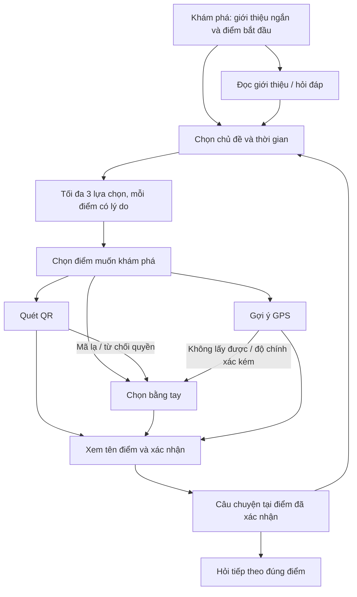

<!-- Hallmark · pre-emit critique of proposal: P4 H4 E4 S5 R4 V4. This is a proposal, not a verified rendered UI. -->
# Ngõ Kể — Đề xuất xây lại UI và cải thiện UX

Ngày review: **11/10/2026**. Mã nguồn: **`main`, commit `25c9e8c`**. Đã chạy `git pull --ff-only`: nhánh đã cập nhật với `origin/main`. Thư mục `.idea/` cục bộ được giữ nguyên.

**Trạng thái: đề xuất để review, chưa triển khai.** Người dùng đã chọn hướng **“Sổ tay ngõ phố: ấm, giàu bản sắc”**. Việc chọn phong cách chưa phải duyệt các thay đổi hành vi bên dưới.

## 1. Đề xuất chính

Xây lại trải nghiệm quanh **điểm khám phá và câu chuyện**, với ba việc dễ hiểu: **bắt đầu khám phá → chọn một điểm phù hợp → xác nhận và đọc chuyện/hỏi tiếp**.

Ưu tiên nối luồng đang bị đứt, làm đúng bối cảnh điểm và phản hồi thao tác. Sau đó áp dụng nền giấy ấm, chữ rõ, xanh trầm và bố cục mang nhịp đọc của một cuốn sổ tay. Giữ Expo/React Native, React Navigation và logic có thể tái dùng; chưa có lý do để viết lại cả ứng dụng hoặc đổi framework.

| Phương án | Kết quả | Đánh đổi |
| --- | --- | --- |
| **A — UI + nối luồng + sửa các điểm sai UX liên quan (đề xuất)** | Có diện mạo mới, biết làm gì tiếp, đọc đúng nội dung và lựa chọn có tác dụng | Cần chốt thay đổi hành vi; bổ sung test tương ứng |
| B — Chỉ đổi trình bày | Màu, chữ, bố cục và nhãn gọn hơn | Gợi ý thời gian, bối cảnh Q&A và thử lại Live vẫn cần một lượt sửa riêng |

## 2. Dự án thực tế đang có gì

Phạm vi đọc gồm cấu trúc mã nguồn ứng dụng, cả bảy file màn hình, điều hướng/theme, các module data/Q&A/recommendation/QR/GPS, fixture/schema, cấu hình/dependency, test và kịch bản E2E, cùng tài liệu sản phẩm/thiết kế/bàn giao. Đã rà danh mục 41 tài liệu Markdown và đọc sâu các nguồn chi phối UI/UX. Không coi thư viện trong `node_modules`, lockfile và log lịch sử là mã sản phẩm cần đọc từng dòng.

| Phần | Hiện trạng | Ý nghĩa với lần làm UI |
| --- | --- | --- |
| App | Expo 57, React 19.2.3, React Native 0.86.3 | Giữ native Android/iOS; không dựng web/PWA |
| Điều hướng | Native stack; 5 màn chức năng, 1 màn unavailable, 1 placeholder còn đăng ký | Có thể nối luồng bằng hệ thống hiện có, chưa cần bottom tabs |
| Giao diện | `theme.ts` mới có màu; styles lặp ở từng màn | Bổ sung token chữ/khoảng cách và ít component thực sự dùng chung |
| Nội dung | 6 điểm mô phỏng; 6 Q&A đều thuộc `demo-01` | Không trình bày như dữ liệu địa điểm thật hoặc Q&A đầy đủ tại mọi điểm |
| Nguồn | Demo từ bundle; Live qua adapter HTTP; có mock server | Backend Node/SQLite là kế hoạch, chưa có backend production trong repo |
| Tương tác | QR, chọn tay, GPS candidate, chữ/caption | Giữ xác nhận chủ động và đường dùng khi không cấp quyền |
| Kiểm tra | Chạy lại **90/90 test đạt**, exit 0 | Chứng minh các ca hiện có; không chứng minh UX tổng thể đã đúng |

Ảnh đã xem trực tiếp: Home cũ, chọn trải nghiệm/kết quả, Q&A, camera/người kể, GPS và Live thiếu cấu hình tại `agent_docs/evidence/phase-2/` đến `phase-6/`. Đây là ảnh lưu từ các phase trước, không phải ảnh chụp build hiện tại. Một số nhãn trong ảnh đã khác source, nên kết luận hành vi dựa vào source hiện tại.

Các PNG Phase 7 được kiểm tra có chữ ký đầu file sai và công cụ không mở được; không dùng chúng làm bằng chứng thị giác. Không sửa các file bằng chứng.

## 3. Những vấn đề nên giải quyết trước

P0 dưới đây là nguy cơ hiểu sai nội dung/trạng thái; P1 là cản trở thao tác; P2 là chất lượng trình bày. Đây là đánh giá sản phẩm, không phải chứng nhận audit bảo mật.

| Ưu tiên | Hiện trạng và bằng chứng | Đề xuất |
| --- | --- | --- |
| **P0** | Q&A nhận `currentNodeId` để hiện tên điểm, nhưng tìm trong toàn bộ `dataset.qa`; intro và cả 6 Q&A đều nói về `demo-01`. Đổi sang điểm khác vẫn có thể nhận đáp án “Bạn đang đứng ở Điểm demo 01”. [QaScreen.tsx](E:/Project/Ngo_Ke/ngoke/mobile/src/screens/QaScreen.tsx:35) | Nội dung và câu hỏi theo đúng điểm đang đọc. Điểm chưa có Q&A hiện “Chưa có câu hỏi cho điểm này”; phần giới thiệu chung phải ghi rõ là giới thiệu khu vực |
| **P0** | “Live · dữ liệu đã duyệt” có thể được gắn cho payload mô phỏng: validator hiện chỉ nhận `kind: simulated` và đúng 6 node. [sourceState.ts](E:/Project/Ngo_Ke/ngoke/mobile/src/data/sourceState.ts:169), [live.ts](E:/Project/Ngo_Ke/ngoke/mobile/src/data/live.ts:66) | Phân biệt **cách lấy dữ liệu** và **tính chất nội dung**. Ví dụ “Từ máy chủ · nội dung mô phỏng”. Chưa coi Live đồng nghĩa với dữ liệu thật |
| **P0** | Khi khởi động, app dùng `startNodeId` dù chưa có xác nhận nhưng Q&A ghi “Bạn đang ở”. Khi đổi nguồn, `currentNodeId` cũng không được kiểm lại có tồn tại trong dataset mới. [App.tsx](E:/Project/Ngo_Ke/ngoke/mobile/App.tsx:67) | Dùng “Điểm bắt đầu”/“Đang xem” trước xác nhận; tách điểm mục tiêu và điểm đã xác nhận. Kiểm lại ID khi đổi dataset |
| **P1** | Home đặt giới thiệu kỹ thuật, chọn mode, trạng thái và danh sách 6 điểm trước CTA bắt đầu. Danh sách là `View`, không bấm để khám phá. [HomeScreen.tsx](E:/Project/Ngo_Ke/ngoke/mobile/src/screens/HomeScreen.tsx:34) | Đưa một CTA chính lên vùng đầu; danh sách điểm xuống sau, mỗi dòng có hành động rõ |
| **P1** | Plan chỉ hiện các thẻ kết quả, không có lối chọn điểm. Q&A không có lối sang Plan; GPS xác nhận xong không mở lời kể. Camera giữ điểm đang kể bằng state riêng, không nhận điểm hiện tại. [PlanScreen.tsx](E:/Project/Ngo_Ke/ngoke/mobile/src/screens/PlanScreen.tsx:227), [CameraScreen.tsx](E:/Project/Ngo_Ke/ngoke/mobile/src/screens/CameraScreen.tsx:9) | Nối các CTA theo hành trình; truyền bối cảnh bằng ID; xác nhận xong có lối mở đúng câu chuyện, không phải quay Home và chọn lại |
| **P1** | Quỹ thời gian chỉ được kiểm có/không và trả ra; không tham gia lọc hoặc xếp hạng. Thực thi với 15 và 60 phút đều ra các điểm 10, 20, 25 phút. [pick.ts](E:/Project/Ngo_Ke/ngoke/mobile/src/recommendation/pick.ts:59) | Chốt ý nghĩa của quỹ thời gian. Đề xuất tối đa 3 **lựa chọn thay thế**, mỗi điểm không vượt thời gian người dùng có; không biểu diễn chúng thành một tuyến đi |
| **P1** | `retryLive` gọi `setLiveBusy(true)` rồi `false` trong cùng handler; request ban đầu cũng không đặt busy. [App.tsx](E:/Project/Ngo_Ke/ngoke/mobile/App.tsx:46) | Một hàm tải dùng cho lần đầu và thử lại; loading kéo dài đúng vòng đời request; lỗi giữ nguyên nguồn. Nhận định nút thử lại dựa trên source và React batching, chưa tái hiện bằng UI runtime |
| **P1** | Thực thi parser: `parseTopic('ẩm thực')` trả `undefined`; `parseTimeBudget('1 tiếng rưỡi')` trả 60. UI còn ghi “Ăn thực”. [pick.ts](E:/Project/Ngo_Ke/ngoke/mobile/src/recommendation/pick.ts:27), [PlanScreen.tsx](E:/Project/Ngo_Ke/ngoke/mobile/src/screens/PlanScreen.tsx:23) | Dùng “Ẩm thực” nhất quán; giữ ID dữ liệu cũ, sửa nhận dạng văn bản và bổ sung test. Đưa nhập tự do thành tùy chọn phụ |
| **P1** | Màn GPS dùng chung một thông báo cho từ chối quyền và lỗi lấy vị trí; Q&A đặt câu trả lời sau ô nhập trong vùng cuộn, không có thao tác đưa đáp án mới vào tầm nhìn | Tách thông báo có hành động sửa phù hợp; đưa câu trả lời mới vào vùng nhìn, kiểm bàn phím thật |
| **P2** | Nhiều khối trắng bo góc, card lồng card, khoảng đệm lặp; chữ “Phase”, “fixture”, đường dẫn file và hướng dẫn cấu hình xuất hiện trong trải nghiệm | Giảm lớp khung, dùng phân cấp chữ và khoảng trắng; dồn chi tiết kỹ thuật vào phần xem thêm; vẫn để nhãn mô phỏng rõ |

**Điểm nên giữ:** màu hiện tại dễ phân biệt; phần lớn nút đã có vùng chạm 48–56 đơn vị; có safe area, phản hồi nhấn, nhiều accessibility label; QR không nhận mã lạ; GPS cần xác nhận; lỗi Live không âm thầm lấy dữ liệu Demo; câu trả lời có evidence.

## 4. Luồng UX đề xuất

Sơ đồ là đề xuất tương tác, không có nghĩa phải tạo thêm một route cho mỗi ô. Dùng năm route chức năng hiện có, ghép bước chọn và kết quả trong Plan; chọn tay và nguồn có thể là vùng mở rộng/modal native. Chưa cần thêm thanh tab chỉ để có hình thức giống app lớn.

**Quy tắc điểm:** chọn một gợi ý chỉ đặt điểm mục tiêu. Quét QR/GPS chỉ đưa điểm để kiểm tra. Hành động “Xác nhận điểm” mới thay điểm hiện tại. Quay lại hoặc hủy giữ nguyên điểm cũ. Nếu QR thuộc điểm khác mục tiêu, hiển thị tên điểm thực sự quét được và cho người dùng quyết định.

**Quy tắc Back:** giữ lựa chọn chủ đề/thời gian khi sửa; xác nhận thành công không để Back tự bật quét lại. Camera phải dừng khi mất focus hoặc app về nền, kể cả khi navigation mới giữ component mounted. Đổi nguồn phải kiểm bối cảnh và bỏ kết quả không còn thuộc dataset đang dùng.

### Home — “Khám phá”

Thứ tự đề xuất: tên app + nhãn nguồn gọn → lời giới thiệu một câu → điểm bắt đầu/điểm đã xác nhận → **“Bắt đầu khám phá”** hoặc **“Tiếp tục đọc”** → **“Chọn trải nghiệm”** → danh sách các điểm.

Demo/Live vẫn có lối chuyển rõ, nhưng phần giải thích dài mở khi cần. Luôn hiện “Nội dung mô phỏng” ở bản demo. CTA bắt đầu cần nằm trong vùng đầu màn hình tiêu chuẩn; ở chữ lớn phải cuộn tới được, không ép cắt chữ.

### Plan — chọn và nhận gợi ý

Hai câu hỏi ngắn: **“Bạn muốn khám phá gì?”** và **“Bạn có bao nhiêu thời gian?”**. Dùng chủ đề và chip thời gian đã có; “Nhập lựa chọn khác” mở phần nhập tự do. Một CTA **“Xem gợi ý”** sau khi chọn đủ, báo lỗi cạnh trường liên quan.

Kết quả dùng danh sách thoáng: tên điểm → lý do → thời lượng mô phỏng → **“Chọn điểm này”**. Có tóm tắt lựa chọn và **“Sửa lựa chọn”**, giữ giá trị cũ. Không lồng từng thẻ vào một thẻ lớn. Không hiển thị tổng hành trình hoặc thời gian đi bộ khi thuật toán chưa có.

### Q&A — “Câu chuyện & hỏi đáp”

Tên điểm và trạng thái xác nhận nằm gần đầu. Lời kể/giới thiệu là nội dung chính; câu hỏi gợi ý theo đúng `nodeId`, rồi đến ô nhập có label. Thu gọn intro khi đã có đáp án để tránh đọc lại cả khối.

Đáp án hiển thị nguyên văn đã duyệt, nguồn ở ngay dưới, kèm 1–2 câu hỏi tiếp theo nếu dữ liệu có. Câu chưa có đáp án dùng trạng thái trung tính **“Mình chưa có nội dung cho câu này”** và gợi ý câu đã có; không tô đỏ như lỗi hệ thống. Không tạo giao diện hứa hẹn chatbot trả lời mọi thứ.

**Giới hạn dữ liệu:** `DemoNode.story` và `caption` hiện chưa có trường evidence riêng. Chỉ hiện nhãn mô phỏng/disclaimer thực có cho lời kể; không mượn evidence của Q&A để gắn nguồn cho một câu chuyện khác. Muốn attribution riêng cho story cần đề xuất schema/data ở lượt riêng.

### Camera — quét trước, người kể sau

Trước khi quét: giải thích một câu, CTA **“Quét mã QR”**, lối **“Chọn bằng tay”** nhìn thấy ngay. Khi quét: preview là vùng chính, chỉ dẫn ngắn, trạng thái đọc được. Sau quét: tên điểm + **“Xác nhận điểm”** + **“Quét lại”**.

Sau xác nhận: caption trên nền đặc đủ tương phản, người kể không che nội dung quan trọng; có **“Đọc câu chuyện”**, **“Hỏi tiếp”** và **“Tắt camera”**. Biến thể đọc chữ luôn dùng được. Không đặt nút play/micro hoặc dùng chữ “nghe” khi chưa có audio.

### GPS — một quyết định dễ hiểu

Mở bằng thao tác **“Tìm điểm gần tôi”**. Trạng thái cần phân biệt: đang lấy vị trí, từ chối quyền, không lấy được fix, độ chính xác kém, ngoài khu vực, có candidate.

Candidate hiển thị **“Bạn có thể đang gần…”**, khoảng cách/độ chính xác có thật và nhãn tọa độ mô phỏng trong demo. Hai lựa chọn rõ **“Xác nhận điểm”** / **“Chọn bằng tay”**. Khi bị từ chối quyền vĩnh viễn, giải thích cách mở cài đặt thay vì chỉ mời thử lại. Giữ các ngưỡng 50 m/300 m đã chốt.

## 5. Hướng thị giác “Sổ tay ngõ phố”

**Cảm giác:** gần gũi, tĩnh, có chiều sâu văn hóa; dùng được khi đứng ngoài đường. Bản sắc đến từ chữ, chất màu và nội dung, không cần phủ họa tiết hoài cổ lên mọi màn.

| Thành phần | Đề xuất |
| --- | --- |
| Nền | Giấy ấm `#F7F2E8`; mặt nội dung `#FFFDF7` |
| Chữ | Mực trầm `#2E3028`; chữ phụ `#626559` |
| Nhấn chính | Xanh trầm `#2D5748`, dùng cho hành động chính và trạng thái chọn |
| Nhấn phụ | Gạch nung `#9C4F36` dùng ít; không dùng thay tất cả trạng thái lỗi/cảnh báo |
| Typography | Tiêu đề có thể dùng serif đứng với dấu tiếng Việt đẹp; nội dung/nút dùng sans dễ đọc. Chốt font bằng mẫu native thực tế trước khi thêm font/dependency |
| Nhịp chữ | Body khoảng 16–18 đơn vị, line-height 24–28; tên điểm nổi bật hơn metadata; không viết hoa dài |
| Bố cục | Một cột, lề 20–24; giảm lớp card, dùng đường phân cách mảnh và khoảng trắng có chủ đích |
| Hình ảnh | Chỉ dùng asset thật được cung cấp hoặc minh họa có nhãn; bản hiện tại vẫn đủ dùng khi chưa có ảnh. Không dựng ảnh địa điểm giả thành tư liệu |
| Icon/chuyển động | Một hệ icon; chuyển động ngắn để phản hồi, không animation trang trí liên tục; không thêm thư viện motion chỉ cho fade |

Tính toán sRGB cho palette đề xuất: mực/nền **11.99:1**, chữ phụ/nền **5.34:1**, chữ sáng/nút xanh **8.04:1**, gạch nung/nền **5.25:1**. Đây là kiểm tra màu trên nền phẳng; chưa phải kiểm thử chữ nhỏ, màn ngoài trời hoặc caption trên camera.

Tra cứu UI/UX Pro Max trả nhóm Museum/Gallery nhưng font gợi ý thiên về tiếng Hoa và cấu trúc thiên về website. Không dùng nguyên bộ kết quả đó cho app Việt. Palette và bố cục trên là đề xuất riêng theo lựa chọn của người dùng; font còn cần kiểm tiếng Việt khi render.

## 6. Phạm vi triển khai cụ thể nếu chọn phương án A

| Nhóm file | Thay đổi dự kiến |
| --- | --- |
| `mobile/src/theme.ts` | Token màu, chữ, khoảng cách, radius; nguồn dùng chung |
| `mobile/src/screens/HomeScreen.tsx`, `PlanScreen.tsx`, `QaScreen.tsx`, `CameraScreen.tsx`, `LocationScreen.tsx`, `UnavailableScreen.tsx` | Bố cục, nhãn, phản hồi, bối cảnh nội dung, CTA nối luồng, loading/empty/error |
| `mobile/App.tsx`, `mobile/src/navigation.ts` | Tham số điểm mục tiêu/điểm hiện tại, điều hướng liên màn, tải/thử lại Live, kiểm ID theo dataset |
| `mobile/src/components/` — chỉ tạo phần dùng lặp | Dự kiến `ActionButton.tsx`, `SourceLabel.tsx`, `PointPicker.tsx`; bổ sung ít hơn nếu reuse trực tiếp đã đủ |
| `mobile/src/recommendation/pick.ts` | Chỉ khi được duyệt: ý nghĩa budget và parser tiếng Việt; giữ tối đa 3 điểm và loại điểm đóng/đã ghé |
| `mobile/src/data/live.ts` | Chỉ sửa nhãn source nếu cần để tránh gọi nội dung mô phỏng là nội dung thật; giữ timeout 8 giây và xử lý lỗi |
| `mobile/tests/recommendation.test.mjs` và test hồi quy UI/điều phối tối thiểu | Ca budget, parser, bối cảnh điểm, thử lại và đổi nguồn; chọn công cụ theo setup hiện có khi viết spec |
| `tools/e2e/demo-scenario.mjs`, `tools/e2e/phase7-checks.mjs` | Cập nhật bước/selector theo luồng và nhãn mới; giữ các kiểm tra fallback, quyền và Back |
| `docs/UI_FRAMEWORK.md`, `docs/HANDOFF_UI.md`, `REVIEW-CHECKLIST.md`, `MEMORY.md` | Ghi quyết định mới, phạm vi được duyệt, kết quả và phần chưa thử |

Không dự kiến xóa file. Placeholder đang đăng ký có thể để nguyên nếu không cản trở thay đổi; dọn lịch sử không phải mục tiêu lần này. Không nâng Expo, thêm state library, đổi matcher sang AI, viết backend, thêm voice/AR, bản đồ dẫn đường hoặc web preview.

**Ranh giới duyệt:** [HANDOFF_UI.md](E:/Project/Ngo_Ke/ngoke/docs/HANDOFF_UI.md:5) đang giới hạn sửa core. Budget/parser và sửa điều phối không thể được coi là đổi màu đơn thuần; cần ghi rõ trong scope được chốt. Đề xuất hiện tại không tự mở Phase 8/backend và không đánh dấu G7 đã duyệt.

## 7. Thứ tự làm và cách kiểm

1. **Chốt phạm vi/hành vi:** chọn A/B; chốt quỹ thời gian là giới hạn cho từng lựa chọn; thống nhất cách hiện điểm chưa có Q&A.
2. **Duyệt mẫu native:** Home + Plan + một trạng thái câu chuyện/hỏi đáp để khóa nhịp chữ, màu, thẻ điểm. Không triển khai toàn bộ hi-fi rồi mới xem lần đầu.
3. **Nối luồng và hoàn thiện trạng thái:** bối cảnh điểm, QR/GPS/tay, Back, dữ liệu Live, bàn phím; bổ sung kiểm tra hồi quy gắn với lỗi thực tế.
4. **Áp dụng phần còn lại và review trên thiết bị:** hoàn thiện camera/caption/nguồn/empty/error; chạy test, typecheck, lint, native bundle và E2E phù hợp.

Tiêu chí nghiệm thu đề xuất, chưa phải kết quả đã đạt:

- Người mới thấy hành động bắt đầu mà không phải đọc hướng dẫn kỹ thuật hoặc cuộn hết danh sách điểm.
- Từ kết quả gợi ý có lối xác nhận và mở đúng nội dung; không phải quay Home để tìm tính năng tiếp theo.
- Chọn 15 phút không bị mô tả là phù hợp với điểm 20–25 phút nếu chốt giới hạn từng điểm.
- Điểm 03 không trả lời “bạn đang ở điểm 01”; thiếu nội dung hiện đúng thiếu nội dung.
- “Thử lại” phát request mới, hiển thị loading và cho kết quả/lỗi; không đổi sang Demo.
- Hủy chọn điểm hoặc từ chối quyền không làm mất đường đọc chữ; Back/background dừng camera.
- Trạng thái chọn không dựa riêng vào màu; nhãn/disabled/busy phù hợp trợ năng. React Native có các API trạng thái này và TalkBack/VoiceOver cần được thử riêng. [Tài liệu React Native](https://reactnative.dev/docs/accessibility)
- Vùng chạm theo handoff hiện có: ít nhất 48 đơn vị; kiểm màn nhỏ/lớn, chữ phóng lớn, xoay ngang, bàn phím mềm, safe area và caption nền sáng/tối. Nội dung dài được xuống dòng; không cắt chữ để cố giữ nút một dòng.

## 8. Đã kiểm và giới hạn

**Đã làm trong lượt review:** pull upstream thành công; rà source và ảnh lưu; chạy lại 90 test (90 pass, 0 fail); thực thi trực tiếp các ca budget/parser và truy vấn Q&A; kiểm tương phản palette bằng công thức sRGB. Các ca bổ sung là phép kiểm hiện trạng, chưa được lưu thành test sửa lỗi vì chưa triển khai.

**Chưa làm:** sửa code app, chạy native build hiện tại, E2E mới, typecheck/lint mới, kiểm điện thoại/iOS, QR/GPS thật, bàn phím mềm và screen reader. Ảnh lưu không thay thế các kiểm tra đó.

Lưu ý từ [TEST_REPORT.md](E:/Project/Ngo_Ke/ngoke/docs/TEST_REPORT.md:31): offline cold start trong Expo Go từng không đạt; chưa hứa app “luôn mở được không cần mạng” chỉ vì fixture được bundle. Đợt làm UI cũng không tự giải quyết packaging offline.

Nhận định về `retryLive` đối chiếu quy tắc React gộp cập nhật state trong handler; đây là phân tích mã, chưa phải kết quả bấm thử nút trong build native. [React: Queueing a Series of State Updates](https://react.dev/learn/queueing-a-series-of-state-updates)

Các tài liệu cũ có đoạn chưa đồng bộ phase, đặc biệt `MEMORY.md`, `APP_FLOW.md`, `UI_FRAMEWORK.md`. Trạng thái triển khai trong bản đề xuất dựa vào source tại commit nêu đầu tài liệu; các quyết định sản phẩm dựa vào yêu cầu người dùng và tài liệu đã chốt, không suy từ dòng lịch sử lỗi thời.

## 9. Việc cần bạn quyết / việc bạn tự làm

| Việc cần quyết | Đề xuất | Nếu chưa chốt |
| --- | --- | --- |
| Phong cách | **Đã chọn:** Sổ tay ngõ phố, ấm, giàu bản sắc | Đủ hướng để làm mẫu; font/màu cụ thể vẫn là đề xuất |
| Phạm vi lần xây lại | **A: UI + nối luồng + sửa UX liên quan** trong mục 6 | Chưa sửa code; tiếp tục review đề xuất |
| Quỹ thời gian | Mỗi điểm gợi ý là một lựa chọn phù hợp với quỹ thời gian; tối đa 3 lựa chọn thay thế | Chưa đổi thuật toán; không hứa tổng tuyến nằm trong quỹ |
| Điểm chưa có Q&A | Hiện trạng thái thiếu câu hỏi theo đúng điểm; có lối về giới thiệu chung | Không tự sinh nội dung/nguồn để lấp chỗ trống |

**Việc bạn cần tự làm ngay:** không có; không cần chuẩn bị backend hoặc dữ liệu thật để review mẫu UI mô phỏng.

**Khi nghiệm thu:** xem và chọn mẫu native; nếu không có thiết bị kết nối cho công cụ, bạn cần hỗ trợ thử QR/GPS/iPhone trên máy thật. Các kiểm tra thiết bị đã nằm trong plan; thiếu chúng chỉ giới hạn mức nghiệm thu, không ngăn việc chuẩn bị thiết kế. Bộ ảnh/font/mascot riêng **[ngoài plan hiện tại]** là tùy chọn nếu bạn muốn định danh riêng, không phải điều kiện để bắt đầu bản đề xuất này.
