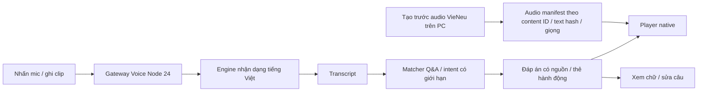

# Ngõ Kể — Roadmap hoàn thiện luồng Voice

## Current end-to-end evidence — revision 8b318b — 15/10/2026

- Host checks currently pass: mobile 171/171, typecheck, lint, Expo dependency check, catalogue 34/34, gateway synthetic smoke, fresh iOS Expo export and Android API 37 release UI checks. Current source/catalogue/manifest revision: `8b318b4e9955e3b7affe72cb21ea08cf8123a616eeab2eb1420ab105c7b65e6b`.
- Fresh 8-question synthetic ASR→matcher run returned 5/8 exact, zero wrong, three unknown; retain these as unknown until safely resolved. The cached transcript replay at 21/21 measures the strict matcher only, not fresh ASR or human speech.
- Current Android release build and LAN Expo Go bundle both carry the current revision. Android verified typed Q&A/follow-up and 20 recorder start/cancel lifecycle cycles; Expo host verified bundle delivery only. The AVD has no usable audio signal.
- GV1 integrity is complete; subjective listening QC is pending. GV3/GV5/GV7 remain open for current-bundle iPhone speech across all chapters, human listening, physical audio/interruption, screen-reader and hardware performance testing. The user deferred the iPhone reload; AVD has no audio. Do not mark the Voice goal complete.

## Earlier transcript-alias snapshot — revision 5a82b1 (superseded) — 15/10/2026

- Four measured large-v3 transcript variants now resolve as exact aliases in their owning Q&A entries; `qa-home` was already covered. `qa-flowers` uses six aliases, so the source bound is six. Current dataset revision: `5a82b1d4fa223b2170fd9fa2c761a01479b4e3e159a81a6de72f65566a8d2568`.
- Replaying cached synthetic transcripts through the current matcher maps 21/21 expected questions for both small and large-v3 sets, with zero wrong/unknown. This does not replace actual iPhone speech coverage.
- Latest Android release APK is 121,249,288 bytes, SHA-256 `A44C99FF04125D5C24DD45ADFEA8C74EB8675C53EA00B4C2B45CEFEF95538BBC`, installed and checked on API 37 AVD. Latest iOS HBC export SHA-256: `35D9DBA66BAC6ECD1D429DE99CC75019524740685C345943036B7D8AA0E07108`.
- Fresh checks pass: tests 170/170, typecheck, lint, Expo dependency check, audio catalogue 34/34, gateway synthetic smoke and native chapter-4 typed-alias/answer UI. See `../agent_docs/evidence/voice/android37-native-release-asr-alias-2026-10-15/README.md`.
- Open gates remain human listening QC, iPhone reload/current-bundle spoken coverage across all chapters, physical audio routes/interruption, screen-reader checks and hardware performance. Do not mark GV7 complete yet.

## Status snapshot before Q&A alias update — 15/10/2026

- Rechecked the live Expo Go preview: Metro `:8081/status` and gateway `:8788/health` respond over LAN. The gateway reports the explicit `large-v3-cuda` profile on Node 24.14.1 / faster-whisper 1.2.1. Latest direct LAN iOS bundle fetch returned HTTP 200 in 5.26 s (6,073,980 bytes) with the current revision, alias and gateway URL and no stale disconnected copy. A PowerShell `Invoke-WebRequest` request timed out; `curl` verified delivery. The iPhone has not reloaded this bundle yet.
- Fresh gates pass: 170/170 mobile tests, typecheck, lint, Expo dependency compatibility, 34/34 canonical audio integrity checks, gateway synthetic-audio smoke, and `git diff --check`. The actual mobile-helper → GPU gateway → production matcher path returned 21/21 expected Q&A after adding two exact, question-local aliases (large-v3 initial canonical matches were 19/21); 0 unknown/wrong/transport errors, p50/p95 570/634 ms. This is synthetic-only evidence.
- Current Android API 37 release APK is 121,248,988 bytes, SHA-256 `F6CD6178BD99D303E2C714963B3F414314D7DE9B883098976648DA9A2CF20B49`; installed APK hash matches the local artifact and all 34 embedded audio hashes match source. Native Landing → Home → alley → Q&A/answer → open text with the player running passed on this APK. Evidence: `../agent_docs/evidence/voice/android37-native-release-v6-negation-2026-10-15/README.md`.
- V6 negation probe over local synthetic TTS → live large-v3 gateway: “Đừng nghe.” remains non-action; “Dừng nghe.” is transcribed “Dừng ngay!” and the exact alias resolves to `stop`. This is synthetic only. Tests 170/170, typecheck/lint and Android release build pass; iOS Expo export also succeeds.
- Android font scale 2.0 checks confirmed chapter navigation, player/text, mic/typing/notebook controls and all four scrolled suggestions remained reachable; the player title wrapped and recorder start/cancel worked. The emulator has no usable audio. TalkBack, iOS Dynamic Type/VoiceOver and hardware audio remain open.
- Gates still open: human listening QC for 34 clips; iPhone reload and spoken six-chapter coverage; physical Android audio; real-device audio routes/interruption and failure paths; screen-reader accessibility; and hardware performance. V4/V5/V7 remain open. Synthetic accuracy and AVD UI do not close these gates.
- Simulated an answered GSM call during recording on the matching API 37 APK: AppOps stopped after the dialer took foreground; after hangup, the app returned idle without auto-resuming. A notification-only incoming call kept the app foregrounded and recording. This closes the AVD answered-call lifecycle check only; physical-device call/routing tests remain open. Evidence is in `../agent_docs/evidence/voice/android37-native-release-current-2026-10-15/README.md`.
- Changing chapter 1 → 2 during an active recording also stopped AppOps and returned the dock to idle on chapter 2. Evidence and AVD/audio limits are recorded in the same README.

- Latest Android API 37 SDK57 APK after AlleySelect and accessibility QA is 121,247,928 bytes, SHA-256 `E7D5BD8D8D0B34A23F77BA97CA20A5A0D6A42D7D175FF50858D8C9874899F0F7`. Native bounds confirm 48 dp minimum touch height; search/filter behavior and Reduce Motion navigation passed. Evidence: `../agent_docs/evidence/voice/android37-native-sdk57-2026-10-15/README.md`. The AVD has no audio and does not close hardware mic/STT, listening, screen-reader, iOS, or latency gates.
- Newest Android release after the Plan retest is 121,247,924 bytes, SHA-256 `EEC6430CC94BC70CAD01B5A58C954DA4B1333ECC1F49FFDB1BE8BCF4C3D9E1CF`. Plan input now measures 48 dp; keyboard entry → topic/time selection → two picks → correct chapter opens on API 37. QR/GPS screens expose explicit start buttons and separate candidate confirmation. This remains AVD UI/data-flow evidence, not speech or physical hardware proof; see the same evidence folder README.
- Inspected the just-built APK: all 34 canonical MP3 assets are present and their SHA-256 multiset matches the source catalogue exactly. This verifies packaging, not human listening quality.

- On the SDK57 Android release APK used for the chapter-1 reader test (`B11555198EBF7CDCD78A8A241E1FFEF4EF5B35B5BB4A5701331055DF46B66083`), chapter-1 Q&A text remained visible while the answer player progressed and replayed; Back returned through the point selector to Home without a fatal RN exception. Screenshots and limits: `../agent_docs/evidence/voice/android37-native-sdk57-2026-10-15/README.md`. This is UI/timeline evidence from a no-audio AVD, not audible playback or mic/STT/iOS proof.
- Re-ran mobile tests 168/168, typecheck, lint, Expo dependency check, and local synthetic gateway smoke. Metro `:8081` and gateway `:8788` are ready; current iOS bundle is 6,073,393 bytes, includes the gateway URL and `MIC_PERMISSION_BLOCKED`, and omits stale disconnected copy. A cached bundle request took 0.18 seconds. The user still defers reloading the iPhone bundle.
- Re-ran the V1 validator: 34/34 canonical clips, 7.0 minutes / 5.04 MB, manifest SHA-256 `90747665D049CC3B4AF018672EF0935805F324236986D8F2047DC79B440113E9`; highest synthetic-ASR WER remains `qa-flowers-answer` 23.1%. Human listening QC remains pending.

- Android API 37 font-scale QA on the matching release APK: at 1.5× all four suggested questions remain reachable; at 2.0× the answer reader stays collapsed and both follow-up chips can be scrolled fully above the voice dock. Native screenshots/XML: `../agent_docs/evidence/voice/android37-font-scale-2026-10-14/README.md`. AVD has no audio; TalkBack, iPhone Dynamic Type/VoiceOver and changing font scale while backgrounded remain unchecked.
- Trên APK Android release khớp local/installed (121.247.808 byte, SHA-256 `D6BB16DCE259002D38D112DACA28E9DD91BF5D0681C005AEC9BB83025E8AB50D`), đã chọn một câu hỏi gợi ý ở từng chương: nguồn trả lời giữ đúng chương, player Ready và không autoplay, chữ trả lời đóng mặc định. Xem chữ hiện đúng nguyên văn đáp án catalogue; Thu gọn xóa chữ khỏi UI tree mà player vẫn Ready. Screenshot + UIAutomator XML cho mỗi trạng thái: `../agent_docs/evidence/voice/android37-six-chapter-reader-2026-10-14/README.md`; UI route sweep ở `../agent_docs/evidence/voice/android37-six-chapter-ui-2026-10-14/README.md`. Chương 6 `qa-letter` cũng mở đúng đáp án và không reset playback. AVD `-no-audio`, chỉ chứng minh UI, không kiểm nghe/speech E2E. Full six-chapter speech vẫn pending; lần quét cũ tìm text ẩn là không hợp lệ.
- Trên APK release source/AVD API 37, mic permission denial → typed fallback → retry prompt → grant → recorder `Đang thu · 00:02` → Hủy về idle; permission được để ở trạng thái granted. Đây là kiểm tra quyền/UI recovery trên AVD `-no-audio`, không xác nhận meter có tín hiệu, speech hay STT. Ảnh được liệt kê trong `agent_docs/evidence/voice/android-emulator/README.md`.
- Latest V3 fix: nếu `canAskAgain=false`, app hiện đường Mở Cài đặt; cấp quyền trên Android rồi quay lại, retry thu được và Hủy về idle. APK release hiện tại 121.247.352 byte, SHA-256 `ED49FF5702BE20002184876F20FB34B828DF7BEFEA1F22A48FCE2F7944DC80E2`, cài/chạy trên AVD API 37. Xem V3 review và README evidence.
- Sau khi phục hồi quyền trên cùng APK, hai lượt thu–Hủy kế tiếp đều quay về idle; lượt hai vào `Đang thu · 00:00`. AVD không có audio, nên chỉ xác nhận lifecycle.
- Kết quả kiểm mobile hiện hành đã được xác nhận lại ở `docs/VOICE_TEST_REPORT.md`: `npm test` 168/168, typecheck, lint và Expo dependency check đều pass; các con số thấp hơn trong snapshot cũ bên dưới đã lỗi thời.
- Regression mới giữ native stop và ASR response ở trạng thái chờ, gọi Gửi trùng trong cả `stopping` và `transcribing`, Hủy tại từng trạng thái, rồi đổi điểm/revision khi response còn pending. Hủy lúc dừng ngăn upload; Hủy/đổi scope abort và bỏ transcript muộn. Full suite hiện 168/168 cùng typecheck/lint/dependency check đạt. Đây là hook test với dependency giả, không phải mic/E2E trên thiết bị.
- Metro `:8081` đã restart; manifest HTTP 200, iOS launch asset HTTP 200 (5,528,940 bytes), text inspection xác nhận marker blocked-permission/gateway mới và không có thông báo “Chưa kết nối máy nhận giọng nói”. Gateway health ready. Chờ người dùng reload/test iPhone.
- Recheck host hiện tại: Metro `:8081` manifest và iOS bundle HTTP 200; bundle 6.062.091 ký tự có gateway LAN, recorder và helper phủ định mới, không có copy trạng thái chưa kết nối. Gateway `192.168.100.36:8788/health` báo `ready`. iPhone chưa reload bundle này.
- Đo gateway/STT qua LAN riêng bằng 5 lượt warm trên cùng clip TTS tổng hợp 19,15 giây: 5/5 HTTP 200, transcript và context echo hợp lệ; p50 7.536 giây, p95 nearest-rank 7.727 giây (7,536/7,727 ms). Đây không phải stop→transcript→audio trên thiết bị.
- V6 fix chung `hasTopicNegation`: voice và Plan gõ tay đều không chọn lại chủ đề bị phủ định; “không gian” vẫn xử lý như danh từ. Trên AVD, sau khi chọn ẩm thực + 30 phút rồi nhập “Không đi ẩm thực trong 30 phút”, topic cũ và picks biến mất, budget 30 phút giữ lại.
- Mobile recheck: `npm test` 165/165, typecheck, lint và Expo dependency check pass. iOS/Android HBC hiện tại `index-9873bd6015e99b5d4350b5d75ac9316a.hbc` (2.455.227 byte) / `index-11ec7bf0812d650912b932ceb0b89a21.hbc` (2.455.453 byte); cả hai có 34/34 MP3 byte-match nguồn.
- Android release APK hiện tại build, cài và chạy trên AVD API 37: 121.246.512 byte, SHA-256 `BA973B5F23550367191A3A5ED004FD411CEF6D90ABB5C0FB5A132AA4897221D2`. Bản này kiểm lại Plan phủ định, player tiến đến `00:02` rồi pause, mic start→Hủy→start lần hai→Hủy và dock về idle; khi đang thu mà bấm Home, AppOps dừng và app mở lại không tự thu tiếp. Ảnh ở README evidence Android. AVD `-no-audio`; không xác nhận meter có tín hiệu, âm thanh phát ra hay STT.
- Validator V1 vừa chạy lại, 34/34 clip đạt integrity/format/duration/level; ASR WER cao nhất vẫn 23.1% ở `qa-flowers-answer`. Không thay thế nghe QC.
- Các gate phần cứng, nghe tay và full six-chapter speech vẫn mở.
- Người dùng xác nhận lượt voice thứ hai liên tiếp trên iPhone có meter chạy, transcript, Q&A đúng và nghe được audio câu trả lời; đây là happy path do người dùng báo, chưa có trace/audio độc lập. Reload bundle mới `exp://192.168.100.36:8081` được để sau.
- Probe chẩn đoán offline: một sweep 21 câu tổng hợp đạt **14/21**; sweep riêng khác đạt baseline **12/21**, vocabulary prompt **11/21**, tắt VAD **12/21**. Không có answer sai, nhưng các điểm khác nhau giữa lượt sinh; không đại diện lời nói thật/app→gateway. Không đưa prompt vào production. V5/GV5 vẫn mở cho kiểm phone thật đủ sáu chương.
- Regression phủ đủ 21 câu/alias trong sáu node, câu chương khác trả `unknown`, transcript→answer audio theo node, playback fallback, V6 question/slot ambiguity và **33 transcript ASR near-miss** vẫn trả `unknown` đúng node. V6 giữ slot hiểu đúng, xóa slot mơ hồ và không giữ chủ đề bị phủ định ở cả voice lẫn Plan gõ tay. `npm test` hiện **167 tests**, typecheck/lint pass; exports có đủ 34 audio hash-match nguồn.

- Source Expo Audio 57.0.5 cho thấy `pause` có thể gọi `deactivateSession()` trễ 100 ms; tác vụ chỉ xét player, không xét recorder. Player đã bật `keepAudioSessionActive`; sau khi player đang phát dừng, handoff còn chờ 125 ms để tác vụ cũ (nếu có) kết thúc trước khi chuẩn bị mic. `QaScreen` cũng hủy callback auto-play cũ khi lượt mic mới bắt đầu. Đây là guard dựa trên source, chưa xác minh trên iPhone.
- Revalidation mới nhất: `npm test` **166/166**, typecheck, lint, Expo dependency check và `git diff --check` đạt. iOS/Android JS exports đạt; bundle hiện tại có URL gateway. Các JS exports không phải IPA/APK/native test.
- Validator hiện tại kiểm **34/34** clip qua hash/nội dung/node/revision, MP3/48 kHz/mono, duration và level; manifest SHA-256 `90747665D049CC3B4AF018672EF0935805F324236986D8F2047DC79B440113E9`, tổng khoảng 7 phút / 5.04 MB. Local ASR có WER cao nhất 23.1% (`qa-flowers-answer`); cần người nghe kiểm nội dung/độ tự nhiên.
- APK Android hiện tại sau sửa phủ định: `com.valentino241.ngokedemo`, 121,246,512 byte, SHA-256 `BA973B5F23550367191A3A5ED004FD411CEF6D90ABB5C0FB5A132AA4897221D2`; đã cài/chạy trên AVD API 37. Đã kiểm UI Plan, player progress/pause và hai vòng recorder start/cancel; AVD `-no-audio`, không chứng minh tiếng phát hay tín hiệu mic. Chi tiết và ảnh ở `agent_docs/voice_v7_review.md`.
- Gateway `/health` tại `192.168.100.36:8788` trả `ready`; smoke tổng hợp 19.15s qua faster-whisper pass, gồm abort/retry, quota và media guards. Metro `:8081` manifest và iOS bundle qua LAN HTTP 200, bundle 6,062,091 ký tự có gateway và helper phủ định. Người dùng để sau việc reload preview trên iPhone. Static exports mới chứa gateway và đủ 34/34 clip. GV3/GV5/GV7 còn mở cho speech đủ sáu chương, failure paths, nghe tay audio và QA thiết bị/accessibility/performance.

**Snapshot trước lượt pause acknowledgement — 14/10/2026 (đã supersede):** Gateway local `/health` trả `ready`; Metro `:8090` từng phục vụ Expo Go iOS preview. Bản snapshot đó có recorder start guard và answer playback guard nhưng chưa chờ pause native; test 152/152. V1 validator 34/34; UI regression chạy đủ 21 Q&A và follow-up từng entry, nhưng không phải kiểm mic/STT thật. Ảnh fontScale 2.0 nằm trong `agent_docs/evidence/voice/android-emulator/README.md`. iOS export không phải IPA; nghe tay, hardware voice, audio/accessibility và hiệu năng thật vẫn pending.

Probe STT V0 mới nhất trên 6 clip tổng hợp ghi nhận preset Đoan Trang 17/216 lỗi từ exact (WER 7.9%; 5.1% sau khi bỏ dấu), weighted RTF 0.213. Chưa có corpus lời nói ngoài đường hoặc đo mic thật; không xem số này là nghiệm thu nhận dạng thực địa.

Ngày 13/10/2026. Bản roadmap ban đầu được lập để review; sau đó người dùng đã ủy quyền triển khai toàn bộ V0–V7. Trạng thái thực thi mới nhất nằm ở bảng dưới và trong [báo cáo kiểm thử](VOICE_TEST_REPORT.md); phần mô tả phase chi tiết bên dưới là tiêu chí chuẩn, không phải trạng thái cũ “chưa bắt đầu”.

Nguồn: [spec trải nghiệm](VOICE_INTERACTION_UX_SPEC.md), [review VieNeu](VOICE_VIENEU_REVIEW.md), [kịch bản](VOICE_FICTION_SCRIPT.md), source native và `data/demo.json`. Plan này thay phần chia đợt V0–V4 sơ bộ trong spec bằng **V0–V7** rõ đầu ra và cửa review; không đổi roadmap core Phase 0–8.

## Trạng thái thực thi sau authorization 13/10/2026

Authorization mới nhất yêu cầu GV0–GV7 là quality gates nội bộ; tiếp tục phase sau khi kiểm tra được, không chờ duyệt riêng từng phase. Giới hạn voice-only và mọi quy tắc hệ thống/sandbox vẫn giữ nguyên.

| Phase | Trạng thái hiện tại | Cửa còn lại |
| --- | --- | --- |
| V0 | Probe local TTS/STT và chọn stack đã làm; Đoan Trang / faster-whisper-small local | Nghe người thật và corpus STT đa dạng hơn còn chờ |
| V1 | Revalidation ngày 15/10: catalogue 34/34 clip, manifest/hash/format/duration/level hợp lệ; APK release chứa đủ 34 MP3 với hash khớp source; ASR tự động chạy trên đủ 34 clip | Nghe tay toàn bộ clip và sửa những lỗi xác nhận được còn chờ; WER tự động không đánh giá độ tự nhiên |
| V2 | APK API 37 kiểm Q&A UI ở cả sáu chương, chữ đóng mặc định, chip không autoplay; chương 6 mở/thu gọn chữ không reset player; player→mic và Home/return không resume | AVD `-no-audio`; iPhone player/reader/audio-route sau guard vẫn cần kiểm |
| V3 | APK hiện tại start/cancel rồi start/cancel lần hai đều về idle; khi thu mà đưa app xuống nền, AppOps dừng và không resume; stress start/cancel 20 vòng trên APK hiện tại. Người dùng báo lượt hỏi thứ hai trên iPhone có meter/transcript/answer/audio | Đây là một happy-path do người dùng báo, chưa có native log; meter trên AVD không có tín hiệu âm thanh; hủy/interruption/quyền và input route trên iPhone chưa được kiểm đầy đủ |
| V4 | Gateway synthetic STT trả transcript thật và context đúng; 5 lượt warm LAN có p50 7.536 giây/p95 7.727 giây; người dùng xác nhận một lượt hỏi tiếp bằng giọng nói trên iPhone | Latency trên thiết bị, request/server trace của lượt iPhone, lỗi mạng/quota/timeout trên thiết bị và iOS native build còn pending |
| V5 | Fixed matcher/node guard; UI regression phủ 21 câu canonical và follow-up đầu tiên; người dùng xác nhận lượt iPhone thứ hai có meter, hiện transcript, đúng Q&A và nghe được answer audio | Chưa kiểm voice thực đủ 6 chương, câu unknown/sửa transcript và nhiều follow-up; lượt hai chưa có native trace |
| V6 | Intent/slot parser và inline Plan/QR/GPS actions đã nối; AVD Plan gõ chủ đề/thời gian → gợi ý đúng → mở đúng chapter; QR/GPS chỉ hiện sau thao tác riêng và đòi xác nhận candidate; phủ định xóa topic cũ, “không gian” không false-positive; regression pass | Cách nói tự nhiên và hiểu CTA chưa kiểm bằng mic; GPS/QR phần cứng chưa chạy |
| V7 | APK hiện tại 121,249,588 byte (`2f15c3c0…e22a1e0d`) cài trên API 37; Q&A UI sáu chương, player, recorder lifecycle, Plan keyboard/48 dp, QR/GPS explicit-start UI, Reduce Motion, AlleySelect controls và stress thu/Hủy 20 vòng có bằng chứng; iOS JS export pass | Android/iPhone thật, iOS native binary, audio route, screen reader, performance/latency, QC nghe tay 34 clip còn mở. iPhone chưa reload Metro `:8081`; GV7 còn mở |

Các review từng phase: [`agent_docs/voice_v0_review.md`](../agent_docs/voice_v0_review.md) đến `voice_v7_review.md`. Không dùng export, test stub hay hình thiết kế thay proof native.

## 1. Điểm xuất phát và đích hoàn thành

**Đã có:** Expo/React Native Android+iOS; chọn/xem/đọc/xác nhận điểm riêng; QR/GPS; Q&A đúng điểm; chọn trải nghiệm; MotionPreferences và drawer. Truyện hư cấu **Bức thư cuối ngõ** có 6 chương/21 Q&A, ID/schema/tọa độ giữ nguyên. Lượt sửa nội dung trước có 113/113 test, typecheck/lint và Android/iOS export đạt; đây là baseline lịch sử, chưa chạy lại trong lượt viết plan.

**Tại thời điểm lập kế hoạch chưa có:** package/controller audio, audio assets/manifest, recorder, STT gateway, UI hi-fi native. Các thành phần code/audio đã được triển khai sau authorization; kiểm Voice trên iPhone/Android thật vẫn chưa có. `tools/mock-api` không phải backend Voice.

**Đã chốt:** nhấn để nói → nghe trả lời → hỏi tiếp; nữ miền Bắc ấm tự nhiên; STT trực tuyến; ưu tiên đánh giá VieNeu để giảm phí. Chữ đóng mặc định, bấm Xem chữ mới mở; Gõ chữ mở ô nhập khi cần. Thiết kế hiện hành là [màn nghe](VOICE_UX_HIFI_LISTEN.png) và [màn chữ](VOICE_UX_HIFI_TEXT.png), khung 360×800, dùng ảnh/logo có thật.

**Hoàn thiện nghĩa là:** người dùng có thể nghe, dừng, thu câu mới, gửi, sửa transcript, nhận đúng đáp án và hỏi tiếp tại cả 6 chương; thao tác liên quan có kết quả thật; mọi trạng thái lỗi/hủy/đổi điểm có lối thoát; có bằng chứng Android+iOS thật. Không gọi luồng hoàn thiện chỉ vì demo một câu hoặc export thành công.

## 2. Kiến trúc tối thiểu và giới hạn

- **TTS:** đề xuất VieNeu v3 Turbo local để tạo audio một lần, đóng gói bộ truyện nhỏ trong app. Studio/API v4 là lựa chọn có token nếu bản mở chưa đủ chất lượng; không hứa hai bản có cùng catalogue/giọng. Không dựng server TTS chạy liên tục khi nội dung đang cố định.
- **STT:** điện thoại gửi clip vừa thu qua gateway tới engine được chọn. Trực tuyến có thể là dịch vụ cloud hoặc engine tự host được điện thoại gọi qua mạng; việc lựa chọn tự host cần chốt vì có chi phí máy/vận hành.
- **Chỉ một nguồn nội dung:** text từ fixture/core; TTS chỉ đọc text đã chốt. Không lấy lời giải thích kỹ thuật, evidence hay nhãn hư cấu làm nội dung audio. Nhãn/nguồn vẫn rõ trên UI.
- **Tái dùng:** `findAnswer`, `normalizeQuestion`, `pickPoints`, selection/confirmation callbacks, motion provider. Intent mới không sao chép recommendation/GPS/QR logic sang voice.
- **Chưa mở:** LLM sinh đáp án, wake word/nghe nền, AR/lip-sync, clone giọng cá nhân, lưu lịch sử âm thanh, dẫn đường, web/PWA, CRUD/SQLite backend toàn cục, phát hành store. Gateway Voice là scope riêng cần review, không tự đồng nghĩa duyệt backend Phase 8.
- **Bảo toàn dữ liệu:** không reset thay đổi UI hiện có; không đổi ID/schema/tọa độ để phục vụ âm thanh. Không tự xoá file sản xuất; người dùng đã ủy quyền tự commit/push phần hoàn tất sau kiểm tra.

## 3. Tổng quan phase và mốc dùng được

| Phase | Thành quả chính | Phụ thuộc | Cửa review |
| --- | --- | --- | --- |
| V0 | Chốt bản giọng, engine STT, hạn mức và hợp đồng bằng probe thật | Nội dung/thiết kế hiện có | GV0 |
| V1 | Bộ audio/manifest đúng text, đủ 6 chương/21 đáp án | GV0 | GV1 |
| V2 | UI hi-fi native, nghe/dừng/nghe tiếp, chữ thu gọn | GV1 | GV2 |
| V3 | Thu một clip thật, gửi/hủy đúng lifecycle | GV2 | GV3 |
| V4 | Gateway/STT thật, transcript và lỗi phục hồi | GV0 + GV3 | GV4 |
| V5 | Vòng hỏi–nghe–hỏi tiếp đúng điểm, đủ nội dung | GV1 + GV4 | GV5 |
| V6 | Tương tác ngữ cảnh: lựa chọn trải nghiệm, điểm kế, QR/GPS | GV5 | GV6 |
| V7 | Kiểm điện thoại thật, release/performance, preview và bàn giao | GV6 | GV7 |

**Sau V2:** dùng được trải nghiệm nghe và đọc chữ. **Sau V5:** vòng voice Q&A hoạt động thật. **Sau V7:** nghiệm thu toàn bộ luồng đã chọn, gồm tương tác và phục hồi.

Quy tắc phase trong [AGENTS.md](../AGENTS.md) là mặc định. Riêng Voice, authorization mới nhất ngày 13/10/2026 cho phép triển khai xuyên V0–V7 và yêu cầu GV0–GV7 làm quality gates nội bộ; không dừng chờ duyệt phase sau. Phạm vi này không cấp quyền mua gói, tạo credential/cloud resource, public hosting, store release hoặc mở scope ngoài Voice.

## 4. V0 — Chốt giọng và nhận dạng bằng mẫu thật

**Mục đích:** tránh xây giao diện quanh một engine chưa thử, hoặc gọi bản trả phí là miễn phí.

### Việc làm

- **V0.01 — Khóa mẫu thử:** 3 đoạn từ truyện: lời mở đầu, một lời kể, một đáp án có hội thoại/dấu câu. Review phát âm tên An, ông Lâm, cô Hương, bà Nhi; giữ text trong `data/demo.json` là nguồn chuẩn.
- **V0.02 — TTS probe:** môi trường riêng ngoài dependency mobile; xác định CPU/GPU khả dụng, pin SDK/model revision; tạo cùng text bằng Ngọc Linh và Đoan Trang nếu preset thực tế có. Ghi số phiên bản và ID giọng, nghe trên loa/tai nghe. Không chạy installer/link chưa kiểm hoặc clone giọng.
- **V0.03 — STT shortlist:** kiểm tài liệu/giá/format/retention của tối đa 2 engine phù hợp tại thời điểm thực hiện. Chọn một hướng ít thao tác/chi phí nhất đáp ứng tiếng Việt. VieNeu STT chưa xác minh, không dùng tên website làm bằng chứng endpoint có thật.
- **V0.04 — Probe ASR:** đề xuất corpus 30 clip: 10 hỏi Q&A, 10 tên nhân vật/lệnh, 10 số phút/phủ định/câu không hỗ trợ; có yên tĩnh và tiếng ồn. Clip người thật chỉ thu/gửi trong phạm vi và đích đã được cho phép. Ghi transcript gốc, đúng/sai, lỗi và latency; số liệu tác giả không thay kết quả thử.
- **V0.05 — Khóa hợp đồng:** chọn voice ID, engine STT, chi phí trần, nơi chạy gateway, file format, duration/size limit, timeout và chính sách file tạm/provider retention. Đề xuất ban đầu: mỗi clip tối đa 20 giây, một request active, timeout STT 15 giây; **chưa chốt**, điều chỉnh theo probe.

### Đầu ra và kiểm

`agent_docs/voice_v0_review.md`, 2 mẫu giọng cùng text, bảng probe STT, quyết định engine/revision/config. Mọi số đo có thiết bị/mạng/clip kèm theo; không lưu key hoặc audio cá nhân vào Git. Tài liệu license của v3/preset và quyền file audio được đối chiếu tại bản đã chọn.

**GV0:** người dùng nghe/chốt giọng, chọn engine/chi phí và nơi chạy gateway; các giới hạn kỹ thuật đủ cụ thể để code. Nếu chưa có dịch vụ/tài khoản, vẫn hoàn thiện probe local và spec, ghi rõ mục còn chờ; không ghi STT đạt.

**Cần anh:** nghe chọn giọng, chốt ngân sách/ASR/hosting; nhập credential vào cấu hình an toàn khi cần. Không yêu cầu gửi key vào chat. Nếu chưa chốt, chưa tạo audio hàng loạt hoặc gọi dịch vụ tính phí.

## 5. V1 — Tạo và kiểm bộ audio của truyện

**Mục đích:** khi đáp án đã có, phát ngay file phù hợp, không chờ TTS lại mỗi lượt.

### Việc làm

- **V1.01 — Catalogue:** 34 nội dung bắt buộc = 1 intro + 6 story + 6 caption + 21 answer. Dùng content ID ổn định như `intro`, `demo-01.story`, `demo-01.caption`, `qa-01.answer`; không đặt key bằng nhãn có thể đổi.
- **V1.02 — Sinh audio:** script công cụ cho VieNeu đã pin, đọc đúng text canonical. Dừng/đánh dấu lỗi từng file; chạy lại chỉ file thiếu hoặc text đổi. Không sửa một vài câu “chỉ để TTS nghe hay” ngoài fixture làm chữ/audio lệch nhau.
- **V1.03 — Manifest:** content ID, node ID nếu có, text hash, voice ID/model revision, asset path, duration đo từ file. Tệp phát được, không phải URL job chưa sẵn sàng. Không sửa schema dataset core để gắn URL tạm.
- **V1.04 — QC nghe:** nghe đủ 34 clip, đánh dấu sai từ/thiếu câu/lặp đoạn/cắt chữ/âm lượng chênh/hiss. Tái tạo clip lỗi, kiểm source hash lại; không bỏ qua vì WAV/MP3 mở được.
- **V1.05 — Bundle:** chọn format sau thử native ở V0; đóng gói bộ nhỏ hiện tại trong `mobile/assets/audio/`. Đo tổng dung lượng/độ dài thực; mục tiêu kích thước chốt từ kết quả, không bịa tổng MB.

### File / đầu ra / kiểm

Dự kiến `tools/voice/generate_audio.py` nếu cần batch, `mobile/src/assets/audioManifest.ts` và audio assets. Công cụ TTS không nhập vào mobile bundle. Test manifest phủ đủ 34 content ID, hash khớp text, path tồn tại, không metadata nhầm vào lời đọc; kiểm decode/duration và nghe tay. Bàn giao `agent_docs/voice_v1_review.md` kèm bảng QC.

**GV1:** đủ bộ file đã kiểm và đúng giọng/revision. Audio pilot không đại diện “đủ 6 chương”. Nếu text đổi sau gate, tái tạo file tương ứng trước nghiệm thu tiếp.

**Cần anh:** nghe bộ mẫu đại diện và duyệt giọng/phong cách; các lỗi phát âm được sửa trước khi coi V1 xong.

## 6. V2 — Ghép UI hi-fi và trải nghiệm nghe vào native

**Mục đích:** ship trải nghiệm nghe hoàn chỉnh trước khi thêm mic.

### Việc làm

- **V2.01 — Layout:** ghép ảnh/giấy/logo, voice rail xanh và CTA vàng; giữ route/native hiện có. Dùng lề/tokens của mẫu, không render SVG cả màn thay cho component native. Home chọn điểm mở trang kể; đổi “Sổ tay” nhiều nghĩa thành nhãn đúng hành động.
- **V2.02 — Player thật:** thêm `expo-audio` theo bản tương thích bằng Expo installer, kiểm package/lockfile/config. Play/pause/resume/replay/stop, tiến trình theo player status; chỉ một player active. Không thêm library animation/state chỉ để đổi UI.
- **V2.03 — Text disclosure:** mặc định không có story/answer dài hoặc input. Xem chữ mở trang giấy gồm nội dung/nguồn, Thu gọn đóng; player tiếp tục không reset. Gõ chữ mở drawer riêng; nội dung mở cuộn được, header/dock không bị che.
- **V2.04 — Audio context:** đổi điểm/Back/đổi Demo–Live/background dừng và bỏ file cũ. Không auto-play khi mở app hoặc chọn điểm. Người dùng bấm nghe mới phát; rút tai nghe/cuộc gọi không tự chuyển loa.
- **V2.05 — Thiếu file:** text luôn dùng được qua Xem chữ; audio hash sai không phát. Với Live có dataset/revision khác fixture, không lấy audio demo chỉ vì trùng ID; hiện “Chưa có bản nghe” và đường chữ.

### File / đầu ra / kiểm

`App.tsx`, Home/QaScreen, dock/drawer/icon/theme; module voice/player tối thiểu giữ screen chỉ trình bày. Reuse MotionPreferences. Không hiển thị mic như đã hoạt động: V2 chỉ bật nghe/Gõ chữ, nhấn để nói chưa có thì không tạo nút giả.

Kiểm player lifecycle, single owner, asset/hash, toggle chữ không đổi thời gian nghe, audio lỗi và Live mismatch. Kiểm layout native 360/390 và màn thấp, font 150–200%, bàn phím/Reduce Motion; chạy regression/type/lint/export. Bàn giao ảnh native và video nghe thực nếu công cụ có, `agent_docs/voice_v2_review.md`.

**GV2:** nghe/dừng/nghe tiếp bằng audio thật; giao diện đúng hướng đã chọn và chữ ẩn đúng. Android/iOS chưa thử phải ghi riêng, không lấy PNG mẫu làm bằng chứng native.

**Cần anh:** review giao diện trực tiếp trên điện thoại; chưa cần thử ASR ở phase này.

## 7. V3 — Thu giọng, gửi/hủy và lifecycle

**Mục đích:** mic thực sự ghi một clip, không để trạng thái/loop giả che phần chưa nối.

### Việc làm

- **V3.01 — Quyền:** hỏi microphone khi người dùng bấm; khi denied/permanently denied có Gõ chữ/Mở cài đặt. Không hỏi lại liên tục, không bật mic cùng camera preview.
- **V3.02 — Recorder:** idle → preparing → recording → stopping → clip ready. Chỉ hiện Đang nghe sau recorder active. Nhấn một lần bắt đầu, nút Gửi dừng; không bắt buộc giữ ngón tay.
- **V3.03 — Phản hồi:** metering thật và elapsed từ recorder; limit đã chốt GV0; không có metering thì dùng trạng thái tĩnh có chữ. Tách “đang nghe” khỏi “đang xử lý”.
- **V3.04 — Gửi/hủy:** Gửi tạo một clip sẵn sàng cho upload, Hủy bỏ lượt/file tạm. Double tap trong prepare/stop không tạo hai recorder; kết quả quyền muộn sau hủy/Back không bắt đầu thu.
- **V3.05 — Ngắt:** nhấn mic khi đang phát dừng player trước, rồi mới ghi. Đổi điểm/route/mode/background/call dừng/hủy recorder; resume không tự thu. File tạm không lưu vào thư viện ảnh hoặc DB.

### File / đầu ra / kiểm

Controller/hook `mobile/src/voice/` chỉ thêm module khi cần; app config mic, dock, QaScreen. Recorder adapter xử lý API/cleanup; screen không tạo recorder khác nhau mỗi render. Development binary nếu config/module cần, không hứa Expo Go hỗ trợ mọi native option.

Unit tests với delayed permission/prepare/stop và canceled callbacks; kiểm một clip thật có âm trên Android+iOS, không có tiếng player lọt vào do thu/phát đồng thời; denied, limit, silent/too short, Back/background. V3 chưa có ASR thì clip chỉ kiểm local, không nói là “đã gửi câu hỏi thành công”. Bàn giao `agent_docs/voice_v3_review.md`.

**GV3:** recorder thực và thao tác hủy đúng, file/định dạng đủ cho GV0. Không đóng gate bằng mock recorder.

**Cần anh:** cấp mic cho app khi thử và nói các câu test trên điện thoại; nếu không có thiết bị iOS, iOS hardware vẫn pending.

## 8. V4 — Gateway nhận dạng thật và transcript

**Mục đích:** clip của app trở thành text tiếng Việt, không phải câu mẫu cứng trả về.

### Việc làm

- **V4.01 — Gateway scope:** Node 24 Voice-only, adapter cho một engine đã chọn. Thêm config server/env example không secret; không tự thêm DB/CRUD của phase backend toàn cục.
- **V4.02 — Biên upload:** validate content type và bytes/format, size/duration limit đã chốt, response shape, turn ID/locale, timeout; abort client và timeout phía server/provider. Không tin phần mở rộng file hoặc duration do client khai báo là đủ.
- **V4.03 — Endpoint đề xuất:** `POST /voice/transcriptions`, multipart audio + turnId + locale; trả `{ turnId, text }` hoặc error code chuẩn. Confidence chỉ có nếu engine cung cấp và được kiểm; không sinh số confidence giả.
- **V4.04 — Lỗi rõ:** denied/auth, quota, rate limit, timeout, network, empty recognition, provider fail, invalid response. Không tự thay sang demo transcript/provider dự phòng; retry chỉ sau người dùng bấm.
- **V4.05 — Khóa/quota/triển khai thử:** HTTPS khi truy cập ngoài LAN tin cậy, authentication và rate/concurrency limit cho gateway trước public exposure; key STT server-only. Không nhúng server master secret hoặc key dài hạn vào app. Chọn bootstrap auth theo môi trường thật ở GV0, không dựng auth production rộng hơn nhu cầu preview.
- **V4.06 — Data lifecycle:** tệp tạm được dọn theo chính sách sau xử lý/hủy/lỗi; log không chứa raw audio, key hoặc transcript cá nhân mặc định. Provider retention được ghi đúng điều kiện thật; app cancel không có nghĩa provider chắc chắn chưa xử lý/tính phí.

### File / đầu ra / kiểm

`server/voice/` hoặc folder gateway chốt ở GV0, mobile STT client/adapter; API contract trong `docs/VOICE_API_CONTRACT.md`. Không dùng mock-api làm route thật. Tests trust-boundary/error/timeout và request cancel; integration thực bằng một clip đã cho phép. Proof app record → gateway → provider → transcript khác nhau theo clip.

**GV4:** transcript gốc hiển thị khi bấm Xem chữ/Sửa câu; mất mạng/hủy có phục hồi, response cũ không cập nhật lượt mới. Bàn giao `agent_docs/voice_v4_review.md` cùng config và quota/retention rõ.

**Cần anh:** dịch vụ/host/credential/quota đã chọn; cho phép môi trường preview thực khi cần. Đừng đưa key vào app để bỏ bước gateway cho nhanh.

## 9. V5 — Đóng vòng hỏi–nghe–hỏi tiếp ở cả 6 chương

**Mục đích:** bước end-to-end quan trọng nhất: nhận giọng rồi trả đúng câu chuyện, không chỉ thu được audio.

### Việc làm

- **V5.01 — Lượt Voice:** preparing → recording → transcribing → matched/unknown → audio loading → playing/paused/ready. `turnId` gắn node ID, mode và dataset revision; response/animation cũ không đổi trạng thái mới.
- **V5.02 — Tra nội dung:** transcript gốc giữ để sửa; normalize chỉ phục vụ lookup. Chỉ tra entries của điểm hiện tại bằng matcher đã có; cần thêm alias thì review/sửa data + test, không fuzzy silently chọn gần nhất.
- **V5.03 — Đọc đúng:** matched entry → chọn audio đúng content ID/text hash/voice revision. Text có trước audio; không treo toàn màn chờ player. Lượt mic/Gửi do người dùng vừa bật được đọc đáp án; câu hỏi chạm chip chỉ hiện Nghe/Xem chữ, không bật loa bất ngờ.
- **V5.04 — Unknown/sửa:** không có câu đúng thì thông báo ngắn, 2 câu phù hợp + Nói lại/Gõ chữ. Xem chữ mở transcript gốc; Sửa câu gửi lại text qua cùng matcher. Không nhận truyện là tư liệu lịch sử, nhãn hư cấu không bị ẩn mất hoàn toàn.
- **V5.05 — Hỏi tiếp:** followUps bằng ID đúng chương; mic dừng player rồi ghi; retry/hủy có mục tiêu rõ. Kết thúc audio không tự bật mic hoặc đọc liên tục các câu hỏi mẫu.
- **V5.06 — Phủ nội dung:** chạy đủ 21 câu/alias, story/caption 6 điểm, đổi điểm giữa request, dữ liệu Live thiếu audio, hash thay đổi. Không nói “đủ voice” nếu chỉ `qa-01` có file/hành vi đúng.

### File / đầu ra / kiểm

Voice controller/reducer nếu state đủ phức tạp, QaScreen/dock, manifest/lookup, tests; chỉ một nguồn state audio/turn. Dùng module đã xây V2–V4, không tạo player/recorder riêng cho sheet.

E2E chính: Cổng ngõ → nói câu `qa-02` → transcript → nghe đúng answer → mic hỏi tiếp → đáp án tiếp; chuyển Hiên đồng hồ hỏi câu tại đó, tuyệt đối không trả câu Cổng ngõ. Lặp hỏi/hủy/Back/đổi mode; listeners/recorder không tăng. Bàn giao `agent_docs/voice_v5_review.md` có recording thật và lỗi còn lại.

**GV5:** vòng nghe–hỏi–hỏi tiếp thật, đủ 6 chương, fallback đạt. Đây là **mốc voice Q&A dùng được**, chưa phải toàn bộ tương tác/performance nghiệm thu.

**Cần anh:** nói theo cách của mình để tìm alias thiếu; review câu trả lời/nhịp nghe. Không coi mọi câu ngoài tập hỗ trợ là bug cần chatbot sinh tự do.

## 10. V6 — Tương tác trực tiếp theo ngữ cảnh

**Mục đích:** câu trả lời dẫn tới hành động thực, không yêu cầu đi tìm lại trong menu.

### Việc làm

- **V6.01 — Lệnh nhỏ:** nghe lời kể/nghe lại/dừng, xem chương kế, chọn trải nghiệm, mở xác định điểm. Đây là các lệnh chỉ nhận sau người dùng bật mic; khi đang phát vẫn cần chạm mic trước để thu.
- Phân biệt câu hỏi với lệnh: “Điểm kế tiếp là điểm nào?” trả lời Q&A, còn “Mở chương tiếp theo” yêu cầu action. Chốt precedence/phrases và test câu vừa hỏi vừa yêu cầu; không tự chuyển chương khi người dùng chỉ hỏi thông tin.
- **V6.02 — Plan slots:** chủ đề + thời gian, hỗ trợ nhập tách lượt hoặc cùng câu. Reuse `parseTopic`/`parseTimeBudget` cho slot đã tách, bổ sung số tiếng Việt trong phạm vi đã chốt; không đưa cả câu dài vào parser thời gian hiện tại.
- **V6.03 — Không đoán:** “không muốn ẩm thực”, 2 chủ đề/2 số, “nửa tiếng”, “mười lăm phút”, số ngoài giới hạn, câu nhắc người thứ ba cần test. Mơ hồ → chip chọn lại; không chạy action bằng substring thiếu phủ định.
- **V6.04 — Kết quả inline:** thẻ tối đa 3 picks từ core, lý do/phút mô phỏng, nút mở chương. Shared Plan draft ở owner phù hợp để mở Plan không làm mất slot; Back không tích route. Đã mở không tương đương đã ghé; không lặng lẽ đổi định nghĩa visited.
- **V6.05 — QR/GPS:** lệnh hiển thị thẻ Dùng GPS/Quét QR, người dùng bấm mới xin quyền. Candidate vẫn xác nhận riêng; route Camera dừng trước trang voice. Không thu tiếng/stream camera chung ngoài scope.
- **V6.06 — Context references:** “câu đầu tiên” chỉ xử lý nếu có options cùng turn/revision; ngoài ngữ cảnh hỏi lại. Xem điểm kế chỉ đổi điểm xem, không xác nhận vị trí hoặc điều hướng thực địa.

### File / đầu ra / kiểm

Một module intent/slot có test trong `mobile/src/voice/`; App/Plan/Qa/Home/Camera/Location callbacks và inline card/icon cần thiết. Tái dùng core recommendation/QR/GPS, không sửa luật an toàn để voice thuận tiện hơn.

Test intent/negation/number/context và router thật; native flow nói “ẩm thực”, trả thời gian, thẻ gợi ý, chọn chương, nghe; GPS denied/manual và QR unknown vẫn usable. Không chỉ test string happy path. Bàn giao `agent_docs/voice_v6_review.md`.

**GV6:** hành động đúng/đủ trạng thái, không mất context, không auto-confirm; người dùng review vocabulary và thẻ inline. Không thêm lệnh rộng hơn danh sách đã duyệt.

**Cần anh:** thử các cách nói thực tế và review cách gợi ý khi câu chưa rõ.

## 11. V7 — Nghiệm thu thiết bị, tối ưu và bàn giao preview

**Mục đích:** chứng minh luồng dùng được trên điện thoại, không chỉ test mock và mẫu PNG.

### Việc làm

- **V7.01 — Ma trận:** ít nhất Android thật và iPhone thật; ghi OS/app build, nguồn dữ liệu và mạng. Emulator hỗ trợ layout/lifecycle nhưng không thay kiểm thu/phát/độ ồn.
- **V7.02 — Thực địa có kiểm soát:** yên tĩnh + tiếng đường, loa + tai nghe/Bluetooth, iPhone silent switch/volume, rút tai nghe/cuộc gọi/background/lock/unlock. Không thử dựa trên tọa độ truyện để dẫn đường ngoài phố.
- **V7.03 — UX/a11y:** 360/390/màn thấp, font 150–200%, keyboard, một tay, TalkBack/VoiceOver, Reduce Motion. Chữ closed không chiếm focus; sheet trả focus; reader không nói chồng TTS. Điều khiển vẫn dùng được khi audio/ASR lỗi.
- **V7.04 — Performance:** bản release, ghi riêng stop→transcript, transcript→player start, cancel/stop responsiveness, cold/warm audio load, memory/listener sau 20 vòng. p50/p95 và lỗi trên cùng device/corpus/mạng. Frame-time/jank cho sheet/chuyển điểm; không hứa 60/120fps từ Expo Go.
- **V7.05 — Sửa theo trace:** tối ưu đúng chỗ chậm (upload/ASR/decode/re-render/ảnh); không thêm animation/streaming chỉ để tạo cảm giác nhanh. SLA từ GV0 được đối chiếu, nếu không đạt ghi lý do/phương án và kiểm lại phần sửa.
- **V7.06 — Release/preview có kiểm:** regression + typecheck/lint + native export; build APK/IPA/dev binary theo mục tiêu thử, kiểm install thực. Khởi động gateway/Metro hoặc distribute preview theo môi trường và quyền đã chốt; xác nhận điện thoại truy cập được. Không chỉ đưa URL LAN cũ hoặc gọi export là deploy.
- **V7.07 — Bàn giao:** README mở app/backend, config/limits, audio/version/license notes, data retention, lỗi/fallback, báo cáo thiết bị và video luồng. Store/publish công khai là quyết định riêng, không mặc định trong phase này.

### Đầu ra / cửa cuối

`docs/VOICE_TEST_REPORT.md`, `docs/VOICE_HANDOFF.md`, cập nhật `mobile/README.md`, contract/gateway README và MEMORY. Lệnh có thật được ghi cùng exit/result; physical check có thiết bị và thao tác. Tests không bỏ expected để che lỗi, không nhận mock as proof voice.

**GV7:** user thử bản preview/install được, cả hai nền tảng có bằng chứng; không còn lỗi chặn happy path hoặc hủy/fallback. Chưa có iPhone/ASR credential thì báo phần còn chờ, không đánh dấu hoàn thiện toàn luồng.

**Cần anh:** dùng iPhone/Android thật xác nhận, chốt quyền preview/host cụ thể nếu cần. Phát hành store/production public **[ngoài plan]**: cần tài khoản/chính sách/ngân sách và duyệt riêng; chưa làm thì vẫn có thể hoàn thành demo native nội bộ.

## 12. Quy tắc UX/state xuyên suốt

| Sự kiện | Kết quả bắt buộc |
| --- | --- |
| Chạm nghe | Chỉ phát audio đúng text/node/revision, không mở mic |
| Chạm mic khi đang phát | Dừng/tạm dừng player trước, recorder active rồi mới hiện Đang nghe |
| Hủy trong preparing/recording/transcribing | Turn hết hiệu lực, recorder/requests dọn theo lifecycle, không phát đáp án muộn |
| Bấm nhanh Gửi 2 lần | Một clip, một upload, một lượt trả lời |
| Chạm Xem chữ/Thu gọn | Chỉ đổi presentation/focus, không reset player/turn hoặc bắt đầu request |
| Gõ/Sửa câu | User action mở input, dùng cùng lookup, không còn textbox thường trực |
| STT/TTS/audio lỗi | Thông báo ngắn + đường phục hồi, text sẵn qua Xem chữ, không nói đã nghe/đã phát |
| Đổi chương/mode/dataset | Hủy context cũ; không phát/tra audio hay đáp án sai điểm |
| Background/resume | Stop/cancel như đã chọn; không tự thu/phát khi trở lại |
| Kết thúc đáp án | Follow-up đúng ID, user tự chọn lượt tiếp; không hot mic |
| Offline | Text/chip + audio bundled hoạt động; STT cloud không giả là offline |
| Định vị/QR | Cần thao tác và xác nhận đúng boundary; nghe/đọc không đánh dấu đã tới |

Clip/turn boundary phải dùng token ngay trước **và sau** async permission/prepare/stop/upload/playback; `AbortController` đơn lẻ không đủ để tránh callback cũ ghi state. Reuse focus/AppState ở provider hiện có; không coi Reduce Motion là tắt recorder hoặc audio.

## 13. Ước lượng công sức và dependency

Ước lượng **ngày công kỹ thuật**, không phải deadline/lịch cam kết, không gồm thời gian chờ người dùng/credential/máy/build dịch vụ. Thực tế điều chỉnh sau V0; không tạo lịch tự động.

| Phase | Khoảng dự kiến | Biến số chính |
| --- | --- | --- |
| V0 | 1–2 ngày | Model setup, nghe mẫu, ASR quota và probe |
| V1 | 1–2 ngày | Tái tạo/QC 34 clip và format native |
| V2 | 2–3 ngày | Native layout, audio session/player và chữ đóng/mở |
| V3 | 1–2 ngày | Mic permission/lifecycle khác nhau giữa OS |
| V4 | 2–3 ngày | Provider API, auth/host, upload/timeout/retention |
| V5 | 1–2 ngày | Turn races, revision/manifest, phủ tất cả Q&A |
| V6 | 2–3 ngày | Intent/slot/context, shared Plan và navigation |
| V7 | 2–4 ngày | Máy thật, binary, mạng/tai nghe và trace lỗi |
| **Tổng** | **12–21 ngày công** | Không thể suy thành ngày hoàn thành khi chưa có resource/lịch |

Không giảm V0/V7 để code mic nhanh rồi bỏ phần kiểm thật. Nếu muốn ra bản thử sớm: mốc V2 (nghe) hoặc V5 (Q&A voice) rõ scope; đây là mốc kiểm trung gian, không thay mục tiêu hoàn thiện V7.

## 14. Việc cần anh quyết / việc anh tự làm

Authorization đã có; không còn quyết định giọng/STT/chi phí nào chặn preview local. Các dòng dưới đây thay bảng chờ quyết ở bản roadmap ban đầu.

### Cần anh quyết

| Việc | Trạng thái |
| --- | --- |
| Dùng dịch vụ trả phí, mua gói, thuê host/domain, public deploy hoặc store release | Chưa được ủy quyền; không cần để thử local preview. Nếu muốn, nêu rõ ngân sách/phạm vi ở yêu cầu riêng. |
| Đưa gateway ra khỏi Wi-Fi local tin cậy | Chưa được ủy quyền; hiện không nên public vì gateway HTTP chưa có auth. |

### Cần anh tự làm để đóng nghiệm thu thiết bị

- Mở [bản preview Expo Go](../mobile/README.md) trên Android/iPhone trong cùng Wi-Fi; thử mic/player theo [kịch bản bàn giao](VOICE_HANDOFF.md).
- Nghe tay 34 clip và ghi clip ID có tên riêng/ngắt câu/độ tự nhiên chưa đạt. Hiện chỉ có ASR tự động, không thay phán đoán nghe.
- Nếu có lỗi native, gửi model máy, OS, bước bấm trước lỗi và log/ảnh; đến lúc đó agent có thể sửa và chạy lại phần tương ứng.

<!-- Bảng dưới là những câu hỏi dự kiến tại thời điểm lập roadmap; quyết định đã được khóa hoặc đã giải quyết ở triển khai. -->

### Quyết định tại thời điểm lập roadmap (lịch sử)

| Quyết định | Đề xuất | Nếu chưa chốt |
| --- | --- | --- |
| Roadmap/phạm vi bắt đầu | Duyệt V0 trước, chưa triển khai toàn bộ ngoài phase | Giữ plan; chưa cài model/connector/code Voice |
| Giọng/preset | Nghe Ngọc Linh và Đoan Trang, chọn một bằng mẫu thật | Chưa batch tạo 34 clip |
| TTS local hay Studio/cloud | v3 Turbo local tạo trước; cloud khi cần và có ngân sách | Không tự bấm sinh tốn token |
| STT engine/ngân sách | Chọn từ tối đa 2 probe; self-host nếu phù hợp nhưng ghi chi phí máy | V4 chưa thể chứng minh nhận dạng thật |
| Gateway môi trường/auth | Môi trường thử hẹp, server key riêng, HTTPS/auth trước public | Không mở gateway ra Internet hay đưa key vào app |
| Hosting/preview distribution | Chốt ở GV0 rồi thực hiện/kiểm ở V7 | Có local bundle nhưng chưa có preview điện thoại dùng được |
| Intent và thời lượng giới hạn | Tập nhỏ V6, clip/timeout theo GV0 probe | Không tự mở lệnh rộng hoặc hứa xử lý mọi câu |

### Yêu cầu dự kiến tại thời điểm lập roadmap (lịch sử)

- Nghe/chọn preset và review văn nói; chỉ người dùng chốt được cảm giác giọng phù hợp. Nội dung đã được yêu cầu viết hư cấu, không cần chờ tư liệu lịch sử để pilot.
- Với cloud cần tài khoản/credential/quota của mình và cho phép đúng đích xử lý; lưu config ngoài app/Git, không gửi secrets vào hội thoại. Agent làm wiring/spec/probe trong scope được cho phép, không đẩy việc setup kỹ thuật chung cho người dùng.
- Nói clip thử và test iPhone/Android thật; chỉ phần thao tác trên máy người dùng/giọng nói cá nhân không có sẵn trong môi trường mới cần người dùng làm. Có máy phù hợp agent truy cập được thì agent tiếp tục tự kiểm.
- **[Ngoài plan core — cần chọn khi tới V4/V7]:** mua gói STT/TTS, thuê host/domain hoặc tài khoản build trả phí nếu phương án chọn yêu cầu; vì core chưa cam kết nhà cung cấp/hạ tầng này. Nếu không làm, cân nhắc đường local/self-host phù hợp hoặc ghi phần cloud/preview còn pending. Đây là quyết định bổ sung được đề xuất trong roadmap Voice, không tự duyệt mua hay cam kết ngân sách.
- **[Ngoài plan này]:** store/public production hoặc clone giọng người thật. Không cần các việc đó để nghiệm thu demo Voice nội bộ; nếu muốn phải mở scope/quyền tương ứng.

## 15. Checklist hoàn thiện cuối cùng

- [ ] 34 nội dung audio đúng text/giọng/hash, hoặc phạm vi thay đổi được ghi và duyệt rõ.
- [ ] Mic real, STT real, Q&A đúng chương, audio real; có luồng hỏi tiếp hoàn chỉnh ở cả 6 chương.
- [ ] Xem chữ/Gõ chữ đúng yêu cầu, hi-fi native đạt trên màn nhỏ/chữ lớn, nguồn hư cấu truy cập được.
- [ ] Play/pause/resume/replay/stop, Gửi/Hủy, unknown/denied/network/quota/audio error hoạt động.
- [ ] Không leak turn/route/recorder/player/listener sau đổi chương/Back/background/20 vòng.
- [ ] Intent/slot giữ context, phủ định không đi sai; QR/GPS không tự xác nhận.
- [ ] Demo/Live/revision/hash không bị trộn; offline chữ/audio có thật, ASR cloud nói rõ cần mạng.
- [ ] Android+iOS thật, audio route/tai nghe/silent/call, screen reader/Reduce Motion có bằng chứng.
- [ ] Test/type/lint/export/binary phù hợp; latency/frame-time đo, còn giới hạn được ghi rõ.
- [ ] Preview/install và gateway có thể dùng theo hướng dẫn đã kiểm; không dùng URL cũ chưa xác nhận.
- [ ] Báo cáo, cấu hình an toàn/retention/license và Việc cần anh quyết/tự làm đầy đủ; GV7 do user review.

## 16. Nguồn và trạng thái kiểm của plan

Tài liệu kỹ thuật đã đối chiếu trong lượt nghiên cứu trước: [Expo Audio](https://docs.expo.dev/versions/latest/sdk/audio/), [Expo Speech](https://docs.expo.dev/versions/latest/sdk/speech/), [development builds](https://docs.expo.dev/develop/development-builds/introduction/), [VieNeu docs](https://docs.vieneu.io/), [repo v3/v4](https://github.com/pnnbao97/VieNeu-TTS), [model v3 Turbo](https://huggingface.co/pnnbao-ump/VieNeu-TTS-v3-Turbo). **Không nghiên cứu/benchmark lại provider hoặc giá trong lượt viết plan này.** V0 bắt buộc kiểm điều kiện tại bản triển khai; không cố định SDK/giá từ tài liệu ngày trước.

Đây là trạng thái khi roadmap được soạn, trước authorization triển khai. Kết quả kiểm hiện tại và phần còn pending được ghi trong [VOICE_TEST_REPORT.md](VOICE_TEST_REPORT.md), [VOICE_HANDOFF.md](VOICE_HANDOFF.md) và review V0–V7. Gate hoàn tất chỉ được ghi theo bằng chứng thật; thiết bị/latency/quality chưa kiểm không được tính là pass.

## 17. Recheck V5/V7 sau cập nhật alias — 15/10/2026

- Thêm chín transcript chính xác đã quan sát từ pinned small-model vào alias của đúng Q&A. App matcher kiểm lại toàn bộ 21 transcript tổng hợp: 21/21 đúng ID, không unknown/wrong; không dùng fuzzy matching.
- APK API 37 mới cài/chạy được, chứa 34/34 audio byte-for-byte đúng nguồn; text alias chương 2 trả đúng đáp án khi nhập bằng bàn phím. iOS export và host Metro bundle mới đã kiểm, nhưng iPhone chưa reload theo lựa chọn của người dùng.
- Đây chưa phải pass spoken E2E trên phần cứng hay QC nghe. GV1 cần nghe người thật duyệt 34 clip; GV5/GV7 vẫn chờ iPhone, Android có audio, accessibility, audio routes và performance.

## 18. Large-v3 GPU gateway và native alias check — 15/10/2026

- Máy dev có RTX 5060 laptop 8 GB. Probe nhanh faster-whisper 1.2.1 với model `large-v3` revision `edaa852ec7e145841d8ffdb056a99866b5f0a478`, CUDA float16: 19/21 fresh synthetic canonical questions matched before adding two exact, question-local transcript aliases. No wrong answers. The selected LAN gateway `:8788` now runs the explicit `large-v3-cuda` profile; `small-cpu` remains the default configuration for machines without GPU runtime, and a requested missing GPU runtime errors rather than silently changing profile.
- With those two aliases, the mobile helper → live gateway → production chapter/revision matcher returned 21/21 expected IDs, no unknown/wrong/context errors, p50/p95 570/634 ms. M4A helper upload and gateway smoke guards also pass. These results use local synthetic speech only.
- API 37 APK hash `B171E9C88288097F15F0DCBB15036F7D808373ACCCA6D22D9030833AADFB85B2` launched. On chapter 4 the manual normalized alias produced the correct `qa-flowers` text; the same query on chapter 1 was correctly unknown. See `agent_docs/evidence/voice/android37-native-release-current-2026-10-15/qa04-flowers-manual-alias-answer-2026-10-15.png`.
- This advances local V0/V4/V5 integration evidence but does not close the gates: human audio QC, iPhone reload and spoken six-chapter coverage, physical Android audio, real-device errors/routes/interruption, accessibility and hardware performance remain pending. No device-independent accuracy claim is made.

## 19. V6 negation and release rebuild — 15/10/2026

- `normalizeQuestion` removes the distinction between “đừng” and “dừng”; the parser now checks an initial accented “đừng” before normalization, so negated commands do not run. The actual local TTS→gateway probe transcribed “Dừng nghe.” as “Dừng ngay!”; a narrow exact alias preserves the stop command without enabling fuzzy intent selection.
- Regression coverage includes negative listen/open QR/open chapter/open GPS phrases, plus positive `Dừng nghe` and `Dừng ngay` stop phrases. Full suite 170/170; typecheck, lint and `git diff --check` pass.
- Latest Android API 37 APK is 121,248,988 bytes (`F6CD6178BD99D303E2C714963B3F414314D7DE9B883098976648DA9A2CF20B49`); installed hash matches and all 34 embedded audio hashes match source. APK UI smoke and evidence: `agent_docs/evidence/voice/android37-native-release-v6-negation-2026-10-15/README.md`.
- `npm run build:ios` succeeds after the parser change. This is static export evidence, not a physical iPhone build/test. The user has deferred reloading the current Expo Go URL.

## 20. Earlier catalogue and served iOS bundle check — revision 5a82b1 (superseded) — 15/10/2026

- Current dataset/catalogue revision and manifest source hash agree at `5a82b1d4fa223b2170fd9fa2c761a01479b4e3e159a81a6de72f65566a8d2568`; current manifest file hash is `e59696011be1501097b08f11091a903f8b9a88d30d2914fcc255d1c28db774ba`. Earlier same-day hashes in sections 17–19 are snapshots superseded by later exact aliases and V6 fixes.
- Current host verification: Metro status, iOS manifest and launch bundle HTTP 200; bundle contains the current revision, latest Q&A alias and gateway URL. Gateway health reports ready on `large-v3-cuda`. `npm test` is 170/170 with zero failures; typecheck, lint, Expo dependency check and diff whitespace check pass.
- GV7 remains open. A successful host bundle fetch is not iPhone runtime verification; the user deferred reloading `:8081`. Human QC for all 34 clips, six-chapter spoken iPhone coverage, hardware audio routes/interruption, screen reader behavior and hardware performance are still required.
